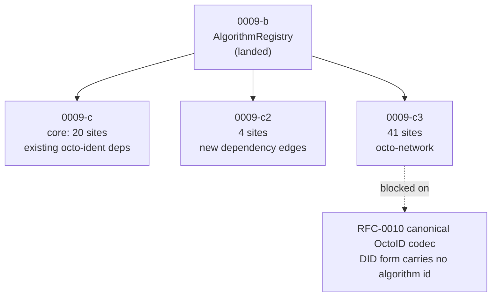

# Mission `0009-c-verification-dispatch` — CLAIMED 2026-10-09

## Status

Claimed (2026-10-09). `0009-b-algorithm-registry` has landed, so the registry
this dispatches through exists.

This is v2.0 of a mission that previously claimed **65 sites across 32
files**. That number was wrong in two independent ways, and both are recorded
in §What changed and why. The real core slice is **20 sites across 7 crates**
that already depend on `octo-ident`.

### In progress — the "already depends on octo-ident" claim was too strong

The first scoping pass classified crates by whether they depended on
`octo-ident`, and concluded this slice needed **no new dependency edges**.
That was measured by grepping the whole manifest, which cannot tell
`[dependencies]` from `[dev-dependencies]`. Re-checking per section:

- `quota-router-sm-engine` had `octo-ident` as a **dev**-dependency only.
- `octo-cap-macaroon` had `octo-ident` as a **dev**-dependency only.

Neither can dispatch from library code on a dev-dependency, so both
gained a real edge — with a manifest comment, per the repository's
dependency-rationale convention. `octo-runtime` was correctly edge-free:
it routes through the `octo-wallet` re-export, which is the gateway
pattern that crate already used for `ed25519_dalek`.

**Lesson for the re-survey:** check the section, not the file.

### Two prerequisites this scope did not name

`0009-b` built the registry and registered **nothing** — the only
`SignatureAlgorithm` implementations in the tree were two test dummies,
so there was no algorithm to dispatch to. The process-wide singleton
`0009-b` recorded as a gap also did not exist. Both are prerequisites of
dispatch and are delivered here: a new Layer E crate `octo-algo-ed25519`
carrying `Ed25519Algorithm`, and `bootstrap`/`global` on the registry.

### Progress: 18 of 20 sites dispatched

**Done and gated.** The AC#11 vector asserts no dispatched crate rebuilds
a `VerifyingKey` inline, and it is mutation-checked:

| Crate                    | Sites | Notes                                                            |
| ------------------------ | ----- | ---------------------------------------------------------------- |
| `octo-wallet`            | 8     | `IdentityKey::verify` takes the algorithm from its signer        |
| `octo-cap-macaroon`      | 6     | canonical governance verifier + 4 `CapabilitySigner` smoke tests |
| `octo-reputation`        | 1     | the single governance choke point                                |
| `quota-router-sm-engine` | 1     | strict check preserved                                           |
| `octo-runtime`           | 1     | zero new edges, via the `octo-wallet` gateway                    |
| `octo-wallet-node`       | 1     | test-local smoke check                                           |

**Two sites cannot be dispatched by this slice, and saying so is the
point.** Both read the algorithm off a value that does not carry one:

- **`octo-cap-macaroon` §`CapabilityToken::verify_holder_sig`** — the
  algorithm would have to travel on the token. `AlgorithmId` has no serde
  impl, so adding the field is a Layer B wire-form change.
- **`octo-protocol` §`verify_ed25519_signature`** — `Authorization::Signature`
  carries no algorithm, and the `did:octo:z` payload is a bare 32 bytes.
  The dispatcher has nothing to dispatch on. **Same root cause as
  `0009-c3`**: the DID wire form cannot name an algorithm.

Both are in the AC#11 vector's allowlist, each with its reason written
inline, and the vector still walks both files so a _new_ hardcoded site
there is caught rather than hidden behind the exception.

### Three follow-ons, recorded not hidden

1. **`AlgorithmId` needs serde** (Layer B). This is the single
   prerequisite for both blocked sites and for `SuspensionAuth` carrying
   its own algorithm instead of the verifier assuming one. Widening the
   substrate is deliberately its own change.
2. **`CapabilitySigner::algorithm_id()`.** The trait has 11 implementors
   across 6 crates and does not declare an algorithm, so the four smoke
   tests name theirs in a local helper. Nothing is blocked on it — the
   verifiers take the id as a parameter — but a signer that cannot state
   its algorithm is a signer the registry cannot route.
3. **`HsmAdapter::algorithm_id()`** landed here and is the pattern worth
   copying for the trait above.

## Status

Claimed (2026-10-09). `0009-b-algorithm-registry` has landed, so the registry
this dispatches through exists.

This is v2.0 of a mission that previously claimed **65 sites across 32
files**. That number was wrong in two independent ways, and both are recorded
in §What changed and why. The real core slice is **20 sites across 7 crates**
that already depend on `octo-ident`.

## Dependencies

`depends_on: 0009-b-algorithm-registry`. `0009-e` (signable prefix) gates full
correctness but is not a compile-time dependency.

**Siblings, deliberately separate missions** — see §Decomposition:

| Mission   | Sites | Why it is not here                                                |
| --------- | ----- | ----------------------------------------------------------------- |
| `0009-c2` | 4     | need a **new `octo-ident` dependency edge** to reach the registry |
| `0009-c3` | 41    | `octo-network`, and it is **blocked** on the DID codec            |

Do not pull sibling work into this mission. A green run here must mean the core
is dispatched, not that someone opportunistically fixed a neighbouring crate.

> **Conflict to declare, not discover.** This mission touches
> `crates/octo-cap-macaroon`, which is owned by `0957-ext-macaroon-crate`, and
> `crates/octo-wallet`, which carries the identity substrate. Claim alongside
> them or coordinate the handoff — do not land a conflicting signature change
> on top of in-flight work.

## What changed and why

The v1.0 mission asserted a single 65-site scope. Investigating AC#11's actual
wording, and the code it points at, contradicts that scope in three ways.

### 1. AC#11 names two constructors, and Shape 2 calls neither

AC#11 requires that `VerifyingKey::from_bytes` and `Signature::from_bytes`
MUST NOT appear at any holder- or capability-signature verification site. Both
are **constructors** — they pick bytes and make a decision.

The 27 Shape-2 sites (`pub fn verify(&self, coordinator_pubkey: &VerifyingKey)`)
call **neither**. They accept an already-typed key and never choose an
algorithm. AC#11's literal requirement does not reach them. They are a real
coupling — an Ed25519 type in a public signature — but it is a _different_
defect with a different fix, and inventing a grep for it under AC#11's name
converts a precise criterion into an unfalsifiable one.

### 2. The DOT sites are node-transport signatures, not holder or capability signatures

AC#11 scopes to **holder- or capability-signature** verification sites. Every
one of the 27 Shape-2 sites is under `crates/octo-network/src/dot/`, and each
verifies a **transport role** key: founder, witness, issuer, DC (data curator),
coordinator, incumbent, local node.

Three facts confirm they are a different trust domain, not an oversight:

- `dot/` contains **zero** references to `octo-ident`, `VerificationMethod`,
  `DidDocument`, or any DID registry. It never resolves an identity.
- `octo-network` does **not** depend on `octo-ident`, by design. Its manifest
  comment records that it extracts the operator pubkey from `operator_did`
  "without round-tripping through the full octo-ident codec".
- These are node-to-node protocol messages with a fixed wire format. They are
  not claims a holder makes about itself, and they are not capability tokens.

### 3. The DOT coupling's real root is the DID form, and it is deeper than 27 signatures

`octo-cap-macaroon::pubkey_from_did` parses `did:octo:0x<hex>` into
`Option<[u8; 32]>`. A bare 32-byte array carries **no algorithm identifier**, so
the DID string itself is Ed25519-by-construction. Its own doc comment calls
this a "Phase 1 form" that "production swaps in the RFC-0010 §Canonical OctoID
Codec once `octo-ident` lands the typed form".

So changing 27 signatures from `&VerifyingKey` to `&AlgorithmId` while the
caller still derives keys through `pubkey_from_did` **moves nothing** — every
caller would resolve to Ed25519 anyway. The signatures are cosmetic until the
codec lands. That is what `0009-c3` is blocked on, and it is why this is a
decomposition rather than a rename.

### 4. Shape 1 was not homogeneous either

Even within the `from_bytes` sites, one is not a CipherOcto key at all:
`octo-adapter-nostr` verifies a **nostr event** signature, and NIP-01 mandates
Ed25519. The registry describes algorithms an **identity document** may declare;
a third-party protocol's fixed key format is a different question, and routing
it through `AlgorithmRegistry` would be a semantic error, not dispatch. It is
deferred to `0009-c2` to be decided on its own merits.

## Scope

Every holder- or capability-signature verification site in a crate that
**already depends on `octo-ident`**, dispatched through `AlgorithmRegistry`.

| Crate                    | Sites | Kind of key                                                                                                              |
| ------------------------ | ----- | ------------------------------------------------------------------------------------------------------------------------ |
| `octo-wallet`            | 8     | `IdentityKey::verify`, `verify_successor_proof`, `verify_revocation_proof`, HSM, identity store, capability hop envelope |
| `octo-cap-macaroon`      | 7     | capability + governance signatures                                                                                       |
| `octo-runtime`           | 1     | routes `VerifyingKey` through the `octo_wallet` re-export                                                                |
| `octo-protocol`          | 1     | authorization                                                                                                            |
| `octo-reputation`        | 1     | governance signature                                                                                                     |
| `quota-router-sm-engine` | 1     | signed envelope                                                                                                          |
| `octo-wallet-node`       | 1     | test-local verify                                                                                                        |

**`octo-wallet` is the point of this mission.** `IdentityKey::verify` is the
only verification entry point on RFC-0009's own primary type. It was missing
from the original mission entirely.

**Re-survey before starting.** The counts are a point-in-time grep. The
exhaustive check needs **both** shapes, because the Shape-2 grep is how you
find what belongs to `0009-c3` rather than to you. Report any drift; do not
silently absorb it.

Note the distinction that matters: sites that _sign_, sites that _verify a
holder signature_, and sites that _carry a typed signature field_ are not the
same job. Only the second needs dispatch. Signing through the registry is
`0009-e`'s problem, not this one.

### Per-key revocation is not this mission's

AC#14 requires the verifier to consult key-level revocation
(`VerificationMethod.revoked_at`) **before** the identity-scoped check. The
identity gate is RFC-0958's.

**A verifier-side key gate cannot fire on the ZK path.** RFC-0958 §Algorithms
resolves the DID inside the circuit, so the verifier never reaches the decision,
and `BatchSigPublicInputs` carries only `signer_roots` and `message_root` — no
holder DID, no `algorithm_id`, no `key_id`. A verifier therefore holds no
cryptographically bound statement of _which_ key signed, and cannot check that
key's revocation even in principle.

Ownership is settled in RFC-0009 A14 and belongs to neither this mission nor
`0958-a`: both are verifier work. Closing it is a **circuit change** — publish
`holder_did`, `algorithm_id` and `key_id` as public inputs, constrain the
circuit so the signing key is the document method bearing that `key_id`, and
let the verifier gate on `(holder_did, key_id)` before the identity gate. That
moves the committed CASM digest, so it is its own amendment and its own mission
(`0958-b-circuit-key-identity-public-inputs`). This mission's scope is dispatch,
which is unaffected.

A14's oracle — one STARK-curve key compromised, identity otherwise sound,
Ed25519 key untouched — remains a **failing** vector until that circuit change
lands.

## Decomposition

BLUEPRINT §Multi-Mission Decomposition: split when features have different
prerequisite chains. These three do — one needs no new edges, one needs new
edges, one is blocked on a codec that does not exist yet.



## Acceptance Criteria

Verified by the §Test Vectors list. Each vector is a named, independently
runnable check; a vector passing is the acceptance condition met.

## Test Vectors (per RFC-0009 §Acceptance Criteria)

- `no_verification_site_hardcodes_an_algorithm` — the AC#11 vector. It is a
  **workspace-wide grep**, run from the workspace root, not a test inside
  `octo-ident`. Scope it to this mission's crates and both shapes; report
  anything found elsewhere rather than fixing it here.

  The pattern must catch the Shape-2 sites too — not because AC#11 reaches
  them, but because that grep is how this mission confirms its siblings still
  exist. **A vector that greps only the first shape reports green with
  `0009-c3` entirely untouched.**

- `cross_algorithm_signature_replay_rejected` — **owned by `0009-e`, not this
  mission's to deliver.** Listed because the dispatch sites here are what the
  prefix protects; the vector runs in `0009-e`, and needs `0009-d` to have
  registered a second algorithm before it can run over a real pair.
- `revoked_identity_replay_rejected` — RFC-0958's, i.e. `0958-a`'s. **Not this
  mission's to deliver.**
- `compromised_key_revoked_without_identity_revocation` — **owned by neither this
  mission nor `0958-a`.** Needs the circuit change; see §Per-key revocation.
  Currently a failing vector.

### Vector ownership, stated once

Three vectors have more than one plausible owner. Per BLUEPRINT
§Multi-Mission Decomposition, ownership is decided **before** implementation,
not discovered when two branches collide:

| Vector                                                | Owner            | Note                                                                                                         |
| ----------------------------------------------------- | ---------------- | ------------------------------------------------------------------------------------------------------------ |
| `no_verification_site_hardcodes_an_algorithm`         | `0009-c`         | dispatch for this slice; siblings carry their own scope                                                      |
| `cross_algorithm_signature_replay_rejected`           | `0009-e`         | a property of the prefix. Dispatch-level mismatch rejection is `0009-c`'s, but that is a different assertion |
| `revoked_identity_replay_rejected`                    | `0958-a`         | the identity gate is RFC-0958's                                                                              |
| `compromised_key_revoked_without_identity_revocation` | **not this set** | needs a circuit change, settled in RFC-0009 A14 — see §Per-key revocation                                    |

## Layer direction (per `cipherocto-design-principles`)

- `octo-ident` (Layer B) — owns the registry; consumers dispatch through it and
  MUST NOT reach into `ed25519_dalek` for a verification decision
- `octo-cap-macaroon` (Layer E) — consumes the registry, defines no parallel
  abstraction
- `octo-wallet` (Layer B) — same, within the substrate

Every crate in scope **already** depends on `octo-ident`. This mission adds no
new dependency edge, which is the main reason it is the right first slice: it
cannot silently create an upward dependency.

The point of the registry is that a consumer's signature stops being a
cross-crate coupling. If `octo-cap-macaroon` still names
`ed25519_dalek::Signature` in its public API after this mission, the
abstraction did not do its job.

## Validation

```bash
cargo fmt --all -- --check
cargo clippy -p octo-ident -p octo-wallet -p octo-cap-macaroon -p octo-protocol -p octo-reputation -p octo-runtime -p quota-router-sm-engine -p octo-wallet-node --all-targets --all-features -- -D warnings
cargo test -p octo-ident --lib
cargo test -p octo-wallet --lib
cargo test -p octo-cap-macaroon --lib
cargo test -p octo-protocol --lib
cargo test -p octo-reputation --lib
cargo test -p octo-runtime --lib
cargo test -p quota-router-sm-engine --lib
```

`octo-network` is deliberately **absent**. It holds no site in this slice, and
it is long to build. Pulling it in would make this gate slow without making it
stronger.

Do not run the full workspace suite; the touched crates are the ones under
change.

## Backward compat

None required. Nothing is deployed. The failure mode to avoid is leaving a site
on the old path "temporarily" — that is a parallel abstraction, and per
§No parallel abstractions it never converges.

## Cross-references

- `rfcs/accepted/process/0009-identity-evolution-v12.md` — AC#11, AC#14, A12, A14
- `rfcs/accepted/process/0010-canonical-did-codec.md` — the codec `0009-c3` blocks on
- `missions/claimed/0009-b-algorithm-registry` — the registry this dispatches through
- `missions/open/0009-c2-verification-dispatch-new-dependency-sites`
- `missions/open/0009-c3-network-verification-dispatch`
- `missions/open/0958-b-circuit-key-identity-public-inputs`
- `missions/open/0009-e-signable-domain-separation`
- `missions/claimed/0957-ext-macaroon-crate` — crate ownership conflict

## Claimant

@unassigned

## Pull Request

#
