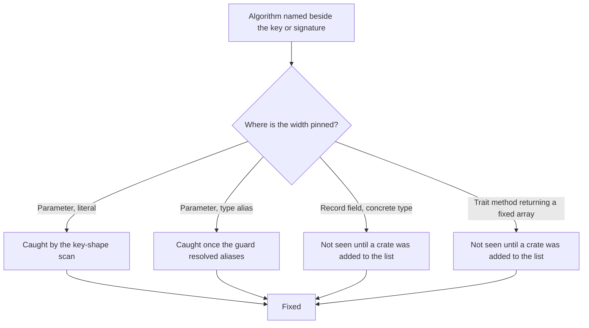
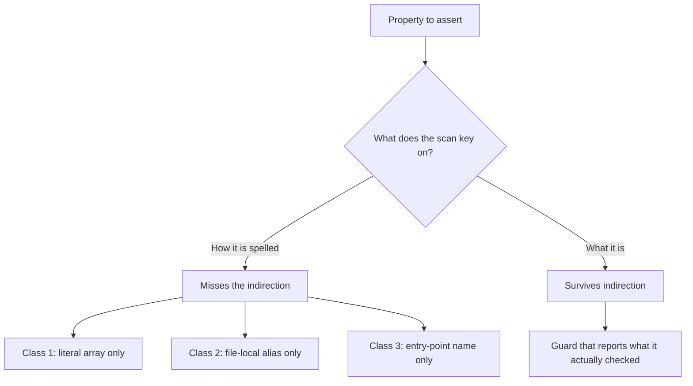

# Mission `0009-ce-a-type-alias-hides-the-same-pin`

## Status

Complete. Filed by asking what the key-shape guard could not see, not by
finding another site.

**Five real sites were fixed across four crates, three guards were hardened or
added, and the largest remaining AC#11 population — 24 adapter call sites — is
measured, declared, and owned rather than assumed clean.** Each vector is mutation-verified against the
implementation, and each turns red under exactly the mutation it exists to
catch.

The arc did not stop at the two sites the alias check found. It went on to ask
what else the same mistake had produced, and found two more shapes — one where
the algorithm sat beside a pinned key, one where a pinned **signature** sat
beside a dispatched algorithm. Both are recorded below.

## The finding

`0009-cd` left behind a guard: `no_verification_site_pins_its_key_to_a_fixed_size_array`,
which walks the dispatched crates and fails any verification site whose key
parameter is a fixed-size array.

It matched the literal spelling `&[u8;`. That is a match on how the pin is
**written**, not on what the pin **is**.

`AskSigned::verify` and `verify_settlement_receipt` both dispatch on
`algorithm_id`, so both satisfied the dispatch vector that had been checking
this the whole time. Both took their key through `Ed25519PublicKey`, and

```rust
pub type Ed25519PublicKey = [u8; 32];
```

A stark-schnorr key is 33 bytes. Neither function could receive one, and the
guard reported both clean, because the width was spelled one indirection away
from the pattern.

This is the third time in this arc that a name-based measure produced a wrong
number. The first was the M-15 adapter guard, which was edited in the same
change that stranded fourteen adapters. The second was the site-count floor,
which was asserted at 60 and arrived against an actual 53. The lesson is not
that text scans are useless — it is that a scan must be keyed on the property
being asserted.

## What was fixed

| Site                        | Was                 | Now     |
| --------------------------- | ------------------- | ------- |
| `AskSigned::verify`         | `&Ed25519PublicKey` | `&[u8]` |
| `verify_settlement_receipt` | `&Ed25519PublicKey` | `&[u8]` |

Both now let the registered algorithm report `BadKeyLength`, which is also the
only form that names the algorithm and the size it expects. Callers passing a
`&[u8; 32]` are unaffected: the coercion happens at the call site.

## Evidence

### `an_ask_signed_by_a_non_ed25519_algorithm_verifies`

Signs the canonical payload with stark-schnorr and verifies through
`AskSigned::verify`. The key is 33 bytes, so acceptance cannot come from a
length coincidence.

The signed form is built directly rather than through `AskSigned::sign`, and
the test says why: `SignatureAlgorithm` has no `sign` method, only `verify`, so
signing cannot dispatch at the trait level. That is a property of the trait, not
an oversight, but it does mean the vector covers the verify path only.

### `a_settlement_receipt_signed_by_a_non_ed25519_algorithm_verifies`

The second of the two sites the guard found, and the vector it was hiding. It
reconstructs the signature input independently of the verifier, so it also pins
that both sides compute the same message — if they ever diverge, the vector
fails rather than silently testing a different message than production
verifies.

### Why these two vectors and not the ones already present

Every other vector in `ask.rs` is blind to this difference, and that is worth
stating precisely rather than implying. They reach `verify` through
`ed25519_id()`. Every fixture key is 32 bytes. `AskSigned::sign` is
Ed25519-only. A verifier that ignored its `algorithm_id` argument entirely and
inlined a `VerifyingKey` would pass **every one of them**.

Mutation confirms it rather than arguing it. Forcing the Ed25519 identifier at
`AskSigned::verify` turns the new vector red and leaves the other eight in the
module green. The same mutation at `verify_settlement_receipt` turns that vector
red and leaves the other thirteen green.

## Two more instances of the same mistake

The alias check found two sites. It did not find the next two, because those
are spelled differently — but they are the same defect, and finding them is
what turned this from a two-site cleanup into a class.

### The algorithm named beside a pinned key

`RouterKeyResolver` in `octo-settlement-core` takes the signing key as
`Option<[u8; 32]>` and, right beside it, `router_algorithm_id` — documented as
the way to name a router's algorithm, citing the reasoning that a verifier must
not supply its own.

Those two could not both be true. A resolver could override
`router_algorithm_id` to an algorithm whose key is not 32 bytes —
stark-schnorr's is 33 — and would then have had no way to return the key that
algorithm needs. The override was **unimplementable for its stated purpose**.
The dispatch argument was load-bearing in name only, which is the phrase this
whole arc keeps arriving at by different routes.

The key is now a borrowed slice — borrowed rather than owned because this runs
once per receipt in a chain walk, and a lookup should not allocate.

The vector here is the first in that crate to show a second algorithm
verifying rather than merely refused. Both existing vectors are credited
accurately in the test: hardcoding Ed25519 does turn the refusal test red, so
the pair catches "assumes Ed25519" and "refuses too much". Neither catches an
implementation that supports only Ed25519, and only the new one does.

The vector also pins an ordering fact that is easy to get backwards.
`settlement_hash` is `receipt_id_for`, which hashes `router_sig`, so it must be
computed _after_ the signature is in place. Getting that backwards produces a
`ChainIntegrity` error that reads like a signature problem.

### The pinned signature beside a dispatched algorithm

`ExecutionEnvelope.signature` in `quota-router-sm-engine` was the concrete
`ed25519_dalek::Signature` type, while `verify_envelope_signature` took an
`algorithm_id` beside it and dispatched on it. An envelope could hold no
signature from any other algorithm, so the dispatch argument could never reach a
second value in practice.

This one was invisible to the key-shape guard for two reasons at once: the pin
was in a **record field** rather than a parameter, and the conversion to bytes
happened behind a **method call** rather than a type annotation. A guard reading
signatures cannot see either.

The field is now bytes and the serde shim that produced it is gone. The wire
form is unchanged — the shim emitted `serialize_bytes` over the same 64 bytes —
but that is a claim about two implementations agreeing, so it is pinned by a
test rather than asserted in a doc comment.

Dropping the shim also retired the file's inline-constructor allowlist entry,
which the gate itself reported as superseded. The entry was removed and
documented in the guard rather than re-justified.

## What is left, measured

After these fixes, a scan of the dispatched crates for algorithm-specific
**verification** types finds exactly one live occurrence, and it is correctly
out of scope:

`octo-protocol` wraps `ed25519_dalek::Signature` in `Ed25519SignatureBytes`
and pins the key to 32 bytes. Its key pin is owned by the DID wire form — the
payload must decode to exactly 32 bytes — and the module states that this crate
owns the wire shape only, with concrete structure living in downstream
extension crates. Widening either would be a protocol decision, not a dispatch
fix.

That measurement is why **no guard was added** for this class. A guard that
fires on exactly one legitimate occurrence on the day it is written needs an
exemption from birth, and a guard that never reports anything true gets muted
within a month. The measurement is recorded instead, which is what someone
deciding to build the guard would need.

`ed25519_dalek::SigningKey` is deliberately not in that set: signing genuinely
is Ed25519-only, because `SignatureAlgorithm` has no `sign` method.

## The list of crates that get looked at

Every guard in this arc walks a **fixed list**. A list only speaks about the
crates somebody put in it, so a crate holding verification code that appears in
no list is not clean — it is _unexamined_, and from outside the two are
indistinguishable. That is the same failure the rest of this arc keeps meeting,
one level up.

It was live. `octo-cap-macaroon` holds `verify_holder_sig`, which dispatches
correctly on the algorithm recorded beside the signature, and which no gate had
ever read. The crate turned out to be clean — its `HolderSignature` is arguably
the best instance of this pattern in the workspace, storing `Vec<u8>` and
validating the length against the _registered algorithm's_ `signature_len()`
rather than a hardcoded 64 — but it was clean by review and by luck, and
nothing would have said so.

The guard walks every crate source and asserts that any crate containing the
dispatch call appears in one of the dispatched, pending, out-of-scope,
allowlisted, or algorithm lists. The two algorithm crates get their own list,
because they _define_ the entry point rather than choosing an algorithm through
it, and a dispatch question only exists where a caller chooses. A measured floor
guards against the walk itself shrinking, which would make the completeness
check pass vacuously.

### Adding the crate immediately produced a second finding

A coverage guard that only ever confirms what you already believed is a
census, not a check. Adding `octo-cap-macaroon` turned up a site that had been
invisible for a different reason.

`verify_governance_signature` took its key as `&GovernancePubkey` and its
signature as `&GovernanceSignatureBytes` — aliases for `[u8; 32]` and
`[u8; 64]` — so a 33-byte key was a compile error at the call rather than a
runtime verdict. That is the same defect as the three key-side widenings above,
appearing for the fourth time, and it sits in the **substrate's shared
governance verifier**, which every governance-signed event type in the workspace
calls.

It also reached the registry by hand: `shared_registry()`, then `get()`, then
`verify` on the algorithm. That was not carelessness — the code needed to report
a wrong-width key as `InvalidPubkeyLength` rather than folding it into "signature
bad", and the dispatch entry point collapses every failure into one error.

Both parameters are now slices, and the body routes through `verify_dispatch`.
The distinction turns out to be free: the dispatch error carries the registered
algorithm's length error intact, so the specific case is recovered by matching
rather than by taking a second route to the registry. One way in, and the
specific diagnosis survives.

## The pattern across all five sites



Five sites, four spellings, one defect. Only the first two were caught by a
scan keyed on the property. The other three needed either alias resolution or
the crate to be on the list at all.

## The largest AC#11 population: 24 adapters, one shape

The coverage guard keyed on the dispatch call. That raised the next question —
what about crates that verify _without_ dispatching — and the honest answer
needed a sharper marker than "contains `verify_dispatch`".

A call to `.verify(` whose **first argument is an algorithm identifier** is
precise where the bare call was not: it matches `env.verify(&ed25519_id(), …)`
and does not match `RootSecretKnowledge.verify(&ctx)`, which is a capability
policy check and has nothing to do with signatures.

That measurement found **20 platform adapters, 24 call sites, all naming
`ed25519_algorithm_id()`, and not one passing anything else.**

That is a real AC#11 limitation and it is already owned. The adapters have no
peer registry, so they cannot know which algorithm a peer's key speaks; binding
a per-peer algorithm is CD-6's work, and the `M-15` guard already checks the
call shape at every one of them.

### The assumption was declared at five sites, not twenty-four

One adapter says Ed25519 is named explicitly "so the call site reads as an
assumption rather than an accident". Measured, that sentence was true at **5 of
24** sites. The other nineteen hardcoded Ed25519 in silence — which is the
accident the one note warns against, arriving nineteen times.

All nineteen now say it. The fix is prose, deliberately: the assumption is real
and known, so the honest move is to make it findable rather than to pretend it
away.

`every_adapter_naming_a_concrete_algorithm_declares_the_assumption` pins the
**declaration, not the algorithm**, and that distinction is the whole design.
When CD-6 replaces these with real per-peer lookups, the measured floor fails
loudly — so the debt being paid is visible rather than silently absorbed by a
guard that was quietly edited to accommodate it. That is the exact failure this
arc spent its earlier passes on, and the guard is built not to repeat it.

Mutation-verified: removing one declaration turns it red and names the file and
line.

### The debt those 24 sites point at does not discharge them

The declaration added at the nineteen silent sites originally said per-peer
algorithm binding is CD-6's work. **Checked, and that was false.** CD-6's design
names a peer _registry_ and its five acceptance criteria are all about
authentication — no credential injection, no forged envelope, no replay, no
dead `auth_mode`, no dishonest Bluetooth send. The word "algorithm" does not
appear in the plan.

CD-6 D1 binds a **key** to a known peer. Naming the **algorithm** that key
speaks is a further step the plan does not specify, and no plan currently does.

This is worth separating carefully, because the two halves differ in kind. A
recorded constraint about _code_ is a hypothesis to be measured — this arc has
disproved six of them. A recorded constraint about _governance_ is a fact,
bounded only by a counterexample, and here the counterexample is the plan
itself.

So the nineteen notes were corrected rather than left standing. They now say
what is true: CD-6's registry binds the key to a known peer, and naming the
algorithm per peer is a step beyond what that plan specifies. The five
pre-existing notes were already worded this way — they said "binding the key to
a known peer" — which is why they were accurate and the new ones were not.

The guard now requires a note to point at the **registry** work specifically. A
note claiming CD-6 will deliver the algorithm would be a pointer to work that
does not exist, and it would outlive its usefulness by looking like an owned
debt — which is worse than an admitted gap.

**This is the one item in this arc that is not code work.** Closing it needs a
decision nobody has recorded: whether the DOT/1 envelope gains an algorithm
field, or whether CD-6 D1's peer registry is extended to carry an algorithm
binding. Both are wire-format or plan changes with a blast radius across all
twenty adapters, which is a decision rather than a refactor.

## The two hardening passes

Both were driven by asking what the guard still could not see, and both are
verified by planting.

### Cross-crate aliases

The first version of the alias table was built **per file**. That resolves an
alias declared in the file under scan and nothing else, so a file that pulls
one in with `use` from another crate has the same pin and is reported clean by
not looking.

The table is now workspace-wide, with the scanned file's own declaration winning
on a name clash. A name declared at two different widths is dropped rather than
resolved to whichever was seen last — guessing which declaration a `use`
statement reached is precisely the unfounded claim this guard exists to avoid.

Verified by planting an alias declared in `octo-reputation` and imported into a
verify signature in `octo-network`: the guard goes red and names the binding and
the resolved width. Disabling the workspace merge turns it green again on the
identical plant, which is what shows the merge is load-bearing rather than
decorative.

### Hand-rolled registry verification

A harder gap. Both algorithm crates expose exactly one verification entry point,
`verify_dispatch`, and every scan in this arc is keyed on that name. They also
publish `shared_registry`, so a site can do

```text
registry.get(id)?.verify(key, msg, sig)
```

which verifies correctly, dispatches correctly, and is invisible to a scan
keyed on the function name. No name-based measure closes it, so the class is
closed structurally instead: a function body may not both take the registry
handle and perform a verification that is not the sanctioned entry point.

Narrow on purpose. Reading the registry to ask what a deployment supports is
legitimate, so this fires only when the same function also verifies.

Verified by planting exactly that pairing in `octo-reputation`. The new vector
catches it and names the function, while the key-shape scan and the
inline-rebuild scan both stay green on the same plant — so this is a class the
existing vectors did not already cover, not a duplicate of one.

## Why the helpers have their own test

`fixed_size_aliases` and `declared_type_of` are the load-bearing part of a
guard that reports on every crate in the workspace, and a helper that finds
nothing is indistinguishable from a helper looking for something that is not
there.

`the_alias_helpers_find_the_indirection_they_exist_for` therefore pins both
halves of the guard's one decision — parameter type to width — against
synthetic signatures, so the test fails if either half stops working
independently of whatever the live source happens to look like today.

The first version of `declared_type_of` took leading alphanumerics only, so
`&[u8]` yielded nothing and the test asserted `None`. That was technically
consistent with the guard, which treats an unresolvable type as no alias, but
it conflated "declared as a slice" with "not a parameter here". It now returns
the type as written, and a slice resolves to `[u8]` — present, and not a width.
That is the distinction the guard actually depends on.

## Acceptance Criteria

- [x] `AskSigned::verify` and `verify_settlement_receipt` take the key as a slice.
- [x] `no_verification_site_pins_its_key_to_a_fixed_size_array` resolves type aliases, not just literal array spellings.
- [x] That resolution is workspace-wide, so an imported alias is not invisible.
- [x] A cross-algorithm vector exists for each of the two fixed sites, mutation-verified against the implementation.
- [x] Both helpers have a unit test that pins the indirection they exist to resolve.
- [x] No verification site reaches the algorithm registry except through `verify_dispatch`.
- [x] `RouterKeyResolver::router_key` returns a slice, so `router_algorithm_id` is implementable.
- [x] `ExecutionEnvelope::signature` is bytes, so `verify_envelope_signature` can dispatch over more than one value.
- [x] The envelope signature wire form is pinned by a test rather than asserted in prose.
- [x] The forwarder class is triaged by reading, with the one fixed-width verification parameter attributed to the DID wire format.
- [x] The remaining algorithm-specific verification types in dispatched crates are measured and attributed, not assumed.
- [x] `verify_governance_signature` takes key and signature as slices and routes through `verify_dispatch`.
- [x] No crate containing the dispatch call is absent from every AC-11 list.
- [x] Every adapter site naming a concrete algorithm declares that it is an assumption, and names CD-6 as the owner.
- [x] Workspace `cargo check --all-targets` clean; clippy clean under `--features full`.

## The three-class lesson



Each class here was found the same way: not by a new site, but by asking what
the existing guard was incapable of reporting. The fix in every case was to key
the scan on the property rather than the spelling.

## The forwarder gap, measured

The forwarder gap is **not** closed. A function that takes a key and hands it to
another verify function never mentions `verify_dispatch`, so the key-shape scan
skips it. Catching it means following the call graph, and a text-scan
approximation was tried and measured unsound: 3265 of 5457 candidate names
matched, 15 hits, 0 true positives. Five real forwarders exist and were fixed by
hand.

That left the gap asserted but unmeasured — stated as a theoretical hole in the
one guard governing this property. It was worth measuring, because "we believe
this class is empty" and "this class is empty" are different claims.

The scan looks for fixed-size array parameters — literal or alias — across the
dispatched crates, then keeps the ones whose parameter name reads like a key. The
filter that selects candidates is name-based and therefore a **pointer, not a
proof**, which is the same distrust this file has applied to every other
name-based measure. What settles it is reading each verification-side candidate.

| Site                                                          | Verdict                                                           |
| ------------------------------------------------------------- | ----------------------------------------------------------------- |
| `verify_platform_admin_proof` (`octo-network`)                | fixed-width param, root cause is the DID wire format — see below  |
| `verify_receipt_chain_authenticated` (`octo-settlement-core`) | clean — key arrives through a resolver trait, already dispatching |
| `verify_revocation_proof` and siblings (`octo-wallet`)        | clean — `&[u8]` at every hop                                      |
| `verify_authorization_signature` (`octo-protocol`)            | fixed-width by wire format — see below                            |

**The result is zero live defects.** The one site with a genuinely fixed-width
verification parameter traces to a wire format rather than to a dispatch
decision, which is a different kind of problem with a different owner.

### Why `verify_platform_admin_proof` is not a dispatch defect

It takes `expected_dc_pubkey: &[u8; 32]`, which looks exactly like the two sites
this mission fixed. Two things distinguish it.

It performs **no cryptographic verification at all**. The body is a freshness
check, an equality comparison against the proof's pubkey, and a non-empty
signature check. The module contains no dispatch call and no key constructor;
the doc comment records that adapter-signature verification is delegated to the
substrate boundary. Nothing chooses an algorithm here, so no algorithm is
being assumed.

And the 32 bytes come from the **DID wire format**. Its only caller passes the
result of `pubkey_from_did`, which accepts a canonical `did:octo:0x<64-hex>`
string and rejects anything else — the hex length is fixed at 64 by the form
itself. A 33-byte key has no canonical encoding in that format, so the width is
a property of the identifier, not a decision by the verifier. That helper's own
docs record that the Phase 1 form is replaced by the typed RFC-0010 codec, so
the constraint has a named owner and an intended replacement.

The honest conclusion is that a `[u8; 32]` in a `verify_*` signature is not by
itself evidence of an AC#11 defect. This one is a real fixed width, and it is
still the wrong thing to point a guard at.

### What this changes about the gap

Nothing structural — the guard is no less blind. But the gap now carries a
measurement instead of an assertion, which matters for anyone deciding whether
to close it. A call-graph analysis would have to be sound to be worth building,
and the one approximation available in-tree was not.

A handle taken in one function and passed to another — the same shape, one level
up — is uncovered by the registry guard for the same reason, and is untriaged.
