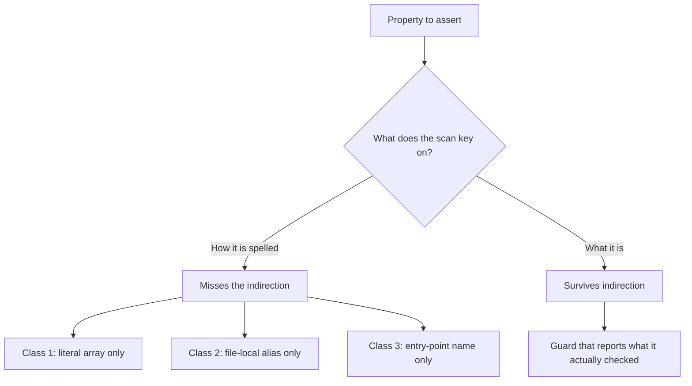

# Mission `0009-ce-a-type-alias-hides-the-same-pin`

## Status

Complete. Filed by asking what the key-shape guard could not see, not by
finding another site.

Two real sites were fixed, the guard that missed them was hardened twice, and
nine cross-algorithm vectors now stand across five crates. Each is
mutation-verified against the implementation, and each turns red under exactly
the mutation it exists to catch.

## The finding

`0009-cd` left behind a guard: `no_verification_site_pins_its_key_to_a_fixed_size_array`,
which walks the dispatched crates and fails any verification site whose key
parameter is a fixed-size array.

It matched the literal spelling `&[u8;`. That is a match on how the pin is
**written**, not on what the pin **is**.

`AskSigned::verify` and `verify_settlement_receipt` both dispatch on
`algorithm_id`, so both satisfied the dispatch vector that had been checking
this the whole time. Both took their key through `Ed25519PublicKey`, and

```rust
pub type Ed25519PublicKey = [u8; 32];
```

A stark-schnorr key is 33 bytes. Neither function could receive one, and the
guard reported both clean, because the width was spelled one indirection away
from the pattern.

This is the third time in this arc that a name-based measure produced a wrong
number. The first was the M-15 adapter guard, which was edited in the same
change that stranded fourteen adapters. The second was the site-count floor,
which was asserted at 60 and arrived against an actual 53. The lesson is not
that text scans are useless — it is that a scan must be keyed on the property
being asserted.

## What was fixed

| Site                        | Was                 | Now     |
| --------------------------- | ------------------- | ------- |
| `AskSigned::verify`         | `&Ed25519PublicKey` | `&[u8]` |
| `verify_settlement_receipt` | `&Ed25519PublicKey` | `&[u8]` |

Both now let the registered algorithm report `BadKeyLength`, which is also the
only form that names the algorithm and the size it expects. Callers passing a
`&[u8; 32]` are unaffected: the coercion happens at the call site.

## Evidence

### `an_ask_signed_by_a_non_ed25519_algorithm_verifies`

Signs the canonical payload with stark-schnorr and verifies through
`AskSigned::verify`. The key is 33 bytes, so acceptance cannot come from a
length coincidence.

The signed form is built directly rather than through `AskSigned::sign`, and
the test says why: `SignatureAlgorithm` has no `sign` method, only `verify`, so
signing cannot dispatch at the trait level. That is a property of the trait, not
an oversight, but it does mean the vector covers the verify path only.

### `a_settlement_receipt_signed_by_a_non_ed25519_algorithm_verifies`

The second of the two sites the guard found, and the vector it was hiding. It
reconstructs the signature input independently of the verifier, so it also pins
that both sides compute the same message — if they ever diverge, the vector
fails rather than silently testing a different message than production
verifies.

### Why these two vectors and not the ones already present

Every other vector in `ask.rs` is blind to this difference, and that is worth
stating precisely rather than implying. They reach `verify` through
`ed25519_id()`. Every fixture key is 32 bytes. `AskSigned::sign` is
Ed25519-only. A verifier that ignored its `algorithm_id` argument entirely and
inlined a `VerifyingKey` would pass **every one of them**.

Mutation confirms it rather than arguing it. Forcing the Ed25519 identifier at
`AskSigned::verify` turns the new vector red and leaves the other eight in the
module green. The same mutation at `verify_settlement_receipt` turns that vector
red and leaves the other thirteen green.

## The two hardening passes

Both were driven by asking what the guard still could not see, and both are
verified by planting.

### Cross-crate aliases

The first version of the alias table was built **per file**. That resolves an
alias declared in the file under scan and nothing else, so a file that pulls
one in with `use` from another crate has the same pin and is reported clean by
not looking.

The table is now workspace-wide, with the scanned file's own declaration winning
on a name clash. A name declared at two different widths is dropped rather than
resolved to whichever was seen last — guessing which declaration a `use`
statement reached is precisely the unfounded claim this guard exists to avoid.

Verified by planting an alias declared in `octo-reputation` and imported into a
verify signature in `octo-network`: the guard goes red and names the binding and
the resolved width. Disabling the workspace merge turns it green again on the
identical plant, which is what shows the merge is load-bearing rather than
decorative.

### Hand-rolled registry verification

A harder gap. Both algorithm crates expose exactly one verification entry point,
`verify_dispatch`, and every scan in this arc is keyed on that name. They also
publish `shared_registry`, so a site can do

```text
registry.get(id)?.verify(key, msg, sig)
```

which verifies correctly, dispatches correctly, and is invisible to a scan
keyed on the function name. No name-based measure closes it, so the class is
closed structurally instead: a function body may not both take the registry
handle and perform a verification that is not the sanctioned entry point.

Narrow on purpose. Reading the registry to ask what a deployment supports is
legitimate, so this fires only when the same function also verifies.

Verified by planting exactly that pairing in `octo-reputation`. The new vector
catches it and names the function, while the key-shape scan and the
inline-rebuild scan both stay green on the same plant — so this is a class the
existing vectors did not already cover, not a duplicate of one.

## Why the helpers have their own test

`fixed_size_aliases` and `declared_type_of` are the load-bearing part of a
guard that reports on every crate in the workspace, and a helper that finds
nothing is indistinguishable from a helper looking for something that is not
there.

`the_alias_helpers_find_the_indirection_they_exist_for` therefore pins both
halves of the guard's one decision — parameter type to width — against
synthetic signatures, so the test fails if either half stops working
independently of whatever the live source happens to look like today.

The first version of `declared_type_of` took leading alphanumerics only, so
`&[u8]` yielded nothing and the test asserted `None`. That was technically
consistent with the guard, which treats an unresolvable type as no alias, but
it conflated "declared as a slice" with "not a parameter here". It now returns
the type as written, and a slice resolves to `[u8]` — present, and not a width.
That is the distinction the guard actually depends on.

## Acceptance Criteria

- [x] `AskSigned::verify` and `verify_settlement_receipt` take the key as a slice.
- [x] `no_verification_site_pins_its_key_to_a_fixed_size_array` resolves type aliases, not just literal array spellings.
- [x] That resolution is workspace-wide, so an imported alias is not invisible.
- [x] A cross-algorithm vector exists for each of the two fixed sites, mutation-verified against the implementation.
- [x] Both helpers have a unit test that pins the indirection they exist to resolve.
- [x] No verification site reaches the algorithm registry except through `verify_dispatch`.
- [x] Workspace `cargo check --all-targets` clean; clippy clean under `--features full`.

## The three-class lesson



Each class here was found the same way: not by a new site, but by asking what
the existing guard was incapable of reporting. The fix in every case was to key
the scan on the property rather than the spelling.

## The forwarder gap, measured

The forwarder gap is **not** closed. A function that takes a key and hands it to
another verify function never mentions `verify_dispatch`, so the key-shape scan
skips it. Catching it means following the call graph, and a text-scan
approximation was tried and measured unsound: 3265 of 5457 candidate names
matched, 15 hits, 0 true positives. Five real forwarders exist and were fixed by
hand.

That left the gap asserted but unmeasured — stated as a theoretical hole in the
one guard governing this property. It was worth measuring, because "we believe
this class is empty" and "this class is empty" are different claims.

The scan looks for fixed-size array parameters — literal or alias — across the
dispatched crates, then keeps the ones whose parameter name reads like a key. The
filter that selects candidates is name-based and therefore a **pointer, not a
proof**, which is the same distrust this file has applied to every other
name-based measure. What settles it is reading each verification-side candidate.

| Site                                                          | Verdict                                                           |
| ------------------------------------------------------------- | ----------------------------------------------------------------- |
| `verify_platform_admin_proof` (`octo-network`)                | fixed-width param, root cause is the DID wire format — see below  |
| `verify_receipt_chain_authenticated` (`octo-settlement-core`) | clean — key arrives through a resolver trait, already dispatching |
| `verify_revocation_proof` and siblings (`octo-wallet`)        | clean — `&[u8]` at every hop                                      |
| `verify_authorization_signature` (`octo-protocol`)            | fixed-width by wire format — see below                            |

**The result is zero live defects.** The one site with a genuinely fixed-width
verification parameter traces to a wire format rather than to a dispatch
decision, which is a different kind of problem with a different owner.

### Why `verify_platform_admin_proof` is not a dispatch defect

It takes `expected_dc_pubkey: &[u8; 32]`, which looks exactly like the two sites
this mission fixed. Two things distinguish it.

It performs **no cryptographic verification at all**. The body is a freshness
check, an equality comparison against the proof's pubkey, and a non-empty
signature check. The module contains no dispatch call and no key constructor;
the doc comment records that adapter-signature verification is delegated to the
substrate boundary. Nothing chooses an algorithm here, so no algorithm is
being assumed.

And the 32 bytes come from the **DID wire format**. Its only caller passes the
result of `pubkey_from_did`, which accepts a canonical `did:octo:0x<64-hex>`
string and rejects anything else — the hex length is fixed at 64 by the form
itself. A 33-byte key has no canonical encoding in that format, so the width is
a property of the identifier, not a decision by the verifier. That helper's own
docs record that the Phase 1 form is replaced by the typed RFC-0010 codec, so
the constraint has a named owner and an intended replacement.

The honest conclusion is that a `[u8; 32]` in a `verify_*` signature is not by
itself evidence of an AC#11 defect. This one is a real fixed width, and it is
still the wrong thing to point a guard at.

### What this changes about the gap

Nothing structural — the guard is no less blind. But the gap now carries a
measurement instead of an assertion, which matters for anyone deciding whether
to close it. A call-graph analysis would have to be sound to be worth building,
and the one approximation available in-tree was not.

A handle taken in one function and passed to another — the same shape, one level
up — is uncovered by the registry guard for the same reason, and is untriaged.
