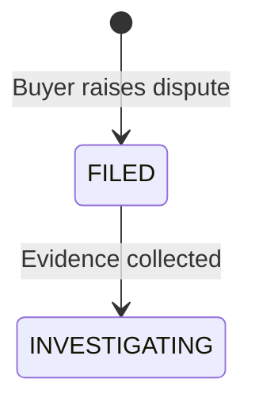

# Mission `sixty-nine-accepted-rfcs-use-mermaid-thirty-two-still-use-ascii-and-nothing-checks`

## Status

Deferred. Converting 696 diagram lines across 32 accepted RFCs is a documentation
change with real review surface, and adding a check is a tooling decision.
Neither is actioned. Nothing was changed.

## Finding

`CLAUDE.md` is unusually specific about diagrams:

> **Diagrams:** Always prefer Mermaid diagrams over ASCII art. Mermaid is
> rendered in GitHub, VS Code, and most Markdown viewers.
>
> **When creating or updating docs:** Use `mermaid` code blocks for flowcharts,
> state diagrams, sequence diagrams. Avoid ASCII art (`┌─`, `└─`, `─►`, etc.).
> If existing ASCII diagrams exist, convert them to Mermaid.

The rule is adopted. It is not enforced. And because nothing measures it, a
single document can satisfy it in one place and break it in another.

| Measure                               | Count   |
| ------------------------------------- | ------- |
| Accepted RFC files                    | 157     |
| containing `mermaid` code blocks      | **69**  |
| containing ASCII box-drawing diagrams | **32**  |
| containing **both**                   | **18**  |
| ASCII diagram lines, corpus-wide      | **696** |

The 69 is the important number and it is easy to miss. This is not a codebase
that ignored the rule — nearly half the accepted corpus already migrated. It is a
codebase that adopted a convention, wrote no check, and drifted on the rest.

## Nothing measures it

This was verified by reading the battery itself rather than by searching for the
absence of a check, which is the only way a negative claim about tooling can be
trusted.

`scripts/run-local-checks.sh` runs nine suites:

| #   | Suite                 |
| --- | --------------------- |
| 1   | dangerous tokens      |
| 2   | safe-commit arguments |
| 3   | installer             |
| 4   | document guards       |
| 5   | rfc anchors           |
| 6   | rfc type refs         |
| 7   | section cites         |
| 8   | accepted rfc vh       |
| 9   | frontmatter           |

None of them reads a fenced block looking for a diagram. The four suites closest
to the territory — document guards, rfc anchors, section cites, accepted rfc vh —
cover frontmatter, section resolution, section citations and version history.
Diagrams are outside all of them.

A grep across `scripts/` and `.github/workflows/` returns four files, and all
four are incidental: one line of the anchors baseline that happens to contain
the word "mermaid" inside a dangling-anchor name, one shell script and one
Python file that match only on a box-drawing character in unrelated context.
There is no check.

## The decay is visible inside single documents

Corpus-level counts hide the more useful fact, which is that 18 documents use
both conventions. A reader opening one of those sees the project applying its
own rule ten lines apart.

RFC-0900 — the marketplace RFC — is one of them. Its §Dispute Lifecycle is a
mermaid `stateDiagram-v2`, clean and correct:



Twenty lines above it, §Escrow Flow is a hand-drawn box flowchart:

```
1. Buyer initiates purchase
   │
   ▼
2. OCTO-W held in escrow (protocol contract)
   │
   ▼
```

Same file. Three mermaid blocks, ten ASCII lines. The state machine that defines
the dispute lifecycle was converted; the escrow flow beside it was not.

That pairing is worth keeping in mind as a migration example in either
direction. §Dispute Lifecycle shows what the conversion produces. §Escrow Flow
shows what is left to convert.

## The heaviest concentrations

Not a to-do list — the top five, as a sense of where the work would land.

| File                                                        | ASCII lines |
| ----------------------------------------------------------- | ----------- |
| `networking/0862-stoolap-data-sync`                         | 66          |
| `economics/0920-unified-python-sdk-dual-mode-compatibility` | 60          |
| `networking/0850p-a-whatsapp-auth-onboarding`               | 45          |
| `networking/0850ab-a-telegram-auth-onboarding`              | 43          |
| `numeric/0110-deterministic-bigint`                         | 39          |

The two onboarding RFCs at 45 and 43 lines are close siblings, so they should
convert as a pair or not at all.

Worth separating out from the rest: `numeric/0110-deterministic-bigint` is not
drawing an architecture diagram, it is laying out a **byte layout** in a box —
`Byte 0: Version`, `Byte 1: Sign`, and so on. Mermaid does not express a byte
table well. That diagram is doing a job the target format cannot, and converting
it would be a downgrade. The same is probably true of the wire-format boxes in
`numeric/` and the two `economics/096x` capability RFCs.

**So the right fix is not a blanket "696 lines → Mermaid".** It is a rule that
distinguishes a flowchart or state machine, which converts, from a byte or wire
layout, which does not. A check that flagged all 696 would be wrong on the
subset where ASCII is the better tool.

## What the owner should do

- **Decide the scope before writing any check.** Flowcharts and state machines
  convert. Byte layouts and wire formats probably stay. Deciding this first
  prevents a lint that is wrong on its own rule.
- **If a check is wanted, make it advisory, not a hard fail.** A first pass in
  `--corpus` reporting mode — the pattern `lint-rfc-anchors.py` already uses —
  would give the corpus number without a red build on 32 files.
- **Convert the two onboarding RFCs together.** They are siblings at 45 and 43
  lines and will read inconsistently if one is done.
- **Leave `0862` until the byte-layout question is settled.** At 66 lines it is
  the largest single job, and it likely mixes both kinds of diagram.
- **The rule itself is fine.** It is written clearly and it has already moved 69
  documents. The gap is measurement, not guidance.

## Reproduction

````bash
# CONTROL — mermaid really is adopted. If this returns 0 the grep is broken.
grep -rl '```mermaid' rfcs/accepted/ --include='*.md' | wc -l
# 69

find rfcs/accepted -name '*.md' | wc -l
# 157

# ASCII diagram files and total lines
grep -rlE '[│▼├└─►┌┐┘]' rfcs/accepted/ --include='*.md' | wc -l
# 32
grep -rhE '[│▼├└─►┌┐┘]' rfcs/accepted/ --include='*.md' | wc -l
# 696

# the 18 that use both, which is where decay is visible
comm -12 \
  <(grep -rl '```mermaid' rfcs/accepted/ --include='*.md' | sort) \
  <(grep -rlE '[│▼├└─►┌┐┘]' rfcs/accepted/ --include='*.md' | sort) | wc -l
# 18

# RFC-0900 uses both conventions in one file
printf 'mermaid %s / ascii %s\n' \
  "$(grep -c '```mermaid' rfcs/accepted/economics/0900-ai-quota-marketplace.md)" \
  "$(grep -cE '[│▼├└─►┌┐┘]' rfcs/accepted/economics/0900-ai-quota-marketplace.md)"
# mermaid 3 / ascii 10

# heaviest concentrations
grep -rcE '[│▼├└─►┌┐┘]' rfcs/accepted/ --include='*.md' \
  | grep -vE ':0$' | sort -t: -k2 -rn | head -5

# the byte-layout case, which Mermaid cannot express
grep -nE '[│▼├└─►┌┐┘]' rfcs/accepted/numeric/0110-deterministic-bigint.md | head -4

# nothing checks for diagrams: read the battery, do not grep for absence
grep -nE 'run "' scripts/run-local-checks.sh
# nine suites (the --with-cites document-guards variant is indented, so
# `^run "` alone shows 8 of the 9), none of them reads a fenced block
# for a diagram
````

## Cross-references

- Mission `the-only-ci-wired-anchor-linter-checks-rfcs-but-indexes-headings-from-the-whole-tree`
  — the anchor linter's `--corpus` reporting mode, the pattern an advisory
  diagram check would follow
- Mission `the-marketplace-facade-has-no-production-caller` — RFC-0900, the
  document carrying both conventions in this finding
- Mission `documentation-that-describes-a-mechanism-nobody-built` — the adjacent
  class; this one is the inverse, a rule that describes a mechanism nobody
  checks
- Mission `rfc-0900-specifies-a-listing-lifecycle-that-does-not-exist-anywhere`
  — the same document's §State Machines, which is where its mermaid diagram
  sits
