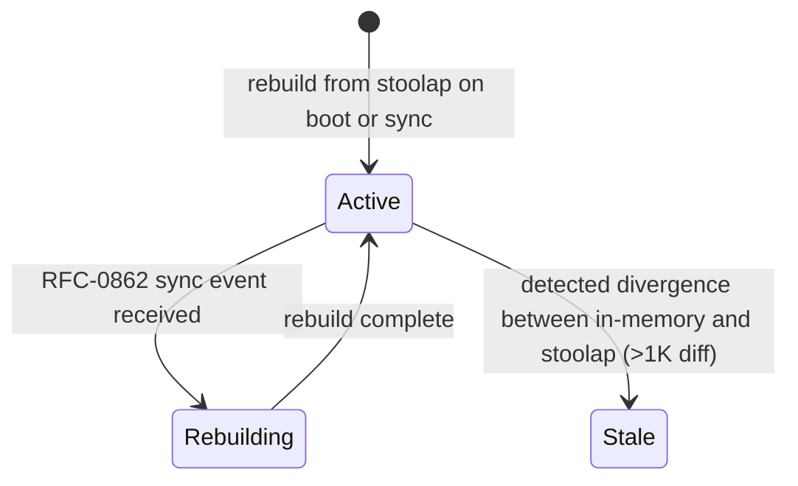

# Mission `the-marketplace-index-has-no-rebuild-path-and-no-staleness-check`

## Status

Deferred — implementing a sync ingest handler is a Layer B change that needs
the RFC-0862 fork adapter to land first, and the staleness bound (`>1K diff`)
needs a divergence metric that no component currently computes. Both are
architecture decisions with cross-RFC dependencies. Nothing was actioned; no
probe was needed, since the absence is structural.

## Finding

RFC-0959 gives the Marketplace Index a lifecycle and two operational
guarantees. The implementation provides neither, and the gap is two removes
from the marketplace — the sync engine it depends on has no production
adapter at all.

### What the RFC specifies

§Roles gives the index its authority and its lifecycle:

```text
| `Marketplace Index` | in-memory BTreeMap … rebuilt on RFC-0862 sync event
  | Read-only selection: `select_ask(did, model, jurisdiction, budget_ceiling)`
  | Active → Rebuilding → Stale (state machine in §Lifecycle Requirements below)
  | RFC-0862 (rebuild driver) |
```

§Lifecycle Requirements draws the machine:



and states two guarantees in prose immediately below it:

```text
**Liveness check:** index repopulates on RFC-0862 sync event; missing-Ask
returns `AskNotFound`.
**Recovery semantics:** on router restart, in-memory index rebuilds from
stoolap `asks` table; missing rows = silent gap, not crash.
```

So the RFC promises: a sync-driven rebuild, a rebuild-driven recovery, a
divergence check with a stated bound, and an error on a missing Ask.

### What exists

**The subscription list is never read.** `sync.rs` is a declarative enum of
table names plus a `ReplicatedTables` vec. Its own module doc says the fork
"reads cipherocto's tables out of the WAL automatically; this list is only
used for subscription / event filtering" and instructs the caller to "pass
`ReplicatedTables::default().names()` to your `StoolapAdapter` constructor".

Nobody does. `ReplicatedTables` and `CipheroctoTable` have **zero consumers**
outside their own module and the `lib.rs` re-export.

**The sync engine has no production adapter.** `octo-sync` defines
`DatabaseSyncAdapter` as the integration boundary, and its doc says the
`StoolapAdapter` impl is "provided by the Stoolap fork (mission 0862-base
§Stoolap fork changes)".

That impl does not exist. The only `impl DatabaseSyncAdapter for …` in the
tree is `MockAdapter`, in `octo-sync/src/test_util.rs`.

So even if an ingest handler existed, no sync event could arrive to trigger
it. The chain is broken at its first link.

**No lifecycle states, no divergence check.** `Rebuilding` and `Stale` appear
in no `.rs` file. Neither does any divergence metric between the in-memory
map and the `asks` table, so the `>1K diff` bound has nothing to measure.

**The liveness check is false on both halves.** The index cannot repopulate
from a sync event, and `select_ask` returns `Option<Ask>` — it has no error
path, so it cannot return the `AskNotFound` the check names. The variant
exists in `SettlementError`, unconstructed.

### The one rebuild that does exist is a different type

`Marketplace::open_path_with_store` really does hydrate the order book from
the repository on open — mission `marketplace-book-load-on-open` closed that
correctly, and it is the `[*] --> Active: rebuild from stoolap on boot` edge.

It is the **facade's** boot path, on `OrderBook<AskSpec>`, not
`MarketplaceIndex`, and it runs on open rather than on a sync event. The
facade has no production caller, so even this is unreachable today.

## The parallel that makes this readable

The slashing subsystem already found this exact failure mode and fixed it.
`slashing.rs` carries the note:

```text
This previously discarded the store's error and returned `Ok` anyway,
justified in a comment by "a follow-on observability hook can detect via
`load_all` divergence". No such hook exists — the phrase appears nowhere
else in the crate.
```

That is the same shape: a **documented hook that nothing implements**, used
to justify a weaker guarantee. There it was a store write silently dropped;
here it is an entire lifecycle state machine and its liveness check.

Worth noting as a house pattern rather than an isolated slip — this audit has
now found the "comment promises a mechanism that does not exist" shape in the
Ask lifecycle (`soft_delay`), the settlement hash (`cost`, and the parties),
the Ask signature (verification "before marketplace insert"), the jurisdiction
gate, and now the index's rebuild and staleness. The codebase documents its
own controls accurately far more often than not; where it fails, it fails by
describing a mechanism rather than omitting it.

## Three `AskNotFound` variants

Incidental, but it belongs with the liveness claim. `AskNotFound` is declared
in at least three unrelated error types — `octo_settlement_core::SettlementError`,
`octo_wallet::capability::market_delivery`, and `SettlementError` in
`quota-router-storage` — and none of them is reachable from `select_ask`,
which returns `Option`.

So the RFC's "missing-Ask returns `AskNotFound`" names a contract that has
three partial implementations and no producer. Recorded as corroboration for
the two-stack pattern in
`the-settlement-receipt-has-no-receipt-id-and-two-disjoint-stacks-exist`;
not pursued further here.

## Why no test catches it

The `sync.rs` tests exercise the list itself — that `default_phase_c()`
returns `["asks"]`, that `"asks"` parses to the variant, that `to_string()`
round-trips. All pass, and all are correct tests of a name list.

What they cannot test is the property that matters: that something reads the
list. There is no caller to invoke, so no test in the module could express
"a sync event repopulates the index". The absence is not a missing assertion;
it is a missing subsystem, and the tests are honestly scoped to the part that
exists.

## What the RFC owner needs to decide

- Should the `StoolapAdapter` land (mission 0862-base) before the marketplace
  depends on a sync-driven rebuild, or should the RFC-0959 index lifecycle be
  restated against what is actually available? Right now the RFC names a
  driver that has no implementation anywhere in the tree.
- Who calls `ReplicatedTables::names()`? The module doc instructs a caller
  that does not exist. If the list is genuinely informational, it should say
  so instead of describing a hand-off.
- What is the ingest path for an Ask received over sync? There is no handler
  to write the code into — `MarketplaceIndex::insert` exists, but nothing
  would call it.
- Should the `>1K diff` staleness bound be kept? It requires a divergence
  metric that would have to be computed and acted on. The RFC's "Recovery
  semantics" already permits a "silent gap, not crash", which is arguably the
  opposite posture; the two should be reconciled.
- Should `select_ask` return `Result<Ask, SettlementError>` so the liveness
  check has a shape? That is a breaking signature change across every call
  site, and it would also close the "missing rows are a silent gap" hole.
- Should the facade's boot hydration and the index's sync rebuild be one
  mechanism rather than two types with one of them missing?

## Reproduction

```bash
# the RFC's lifecycle, liveness check and recovery semantics
grep -n -A8 'Marketplace Index' rfcs/accepted/economics/0959-ask-settlement-chain.md
grep -n 'Liveness check\|Recovery semantics' \
  rfcs/accepted/economics/0959-ask-settlement-chain.md

# the subscription list has no consumers
grep -rn 'ReplicatedTables\|CipheroctoTable' --include=*.rs crates/ octo-sync/ \
  | grep -v 'src/sync.rs'

# the sync engine has only a mock adapter
grep -rn 'impl DatabaseSyncAdapter' --include=*.rs . | grep -v worktrees
grep -n -A3 'StoolapAdapter.*impl' octo-sync/src/adapter.rs

# no lifecycle states and no divergence metric
grep -rn 'Rebuilding\|divergence between' --include=*.rs \
  crates/quota-router-storage/src/ crates/quota-router-core/src/marketplace/

# select_ask returns Option, so AskNotFound is unreachable from it
grep -n -A10 'pub fn select_ask' crates/quota-router-storage/src/marketplace.rs
grep -rn 'AskNotFound' --include=*.rs crates/ octo-sync/ | head

# the parallel already fixed in slashing
grep -n -B2 -A4 'No such hook exists' \
  crates/quota-router-core/src/marketplace/slashing.rs
```

## Cross-references

- RFC-0959 §Roles — the Marketplace Index row naming RFC-0862 as its rebuild
  driver
- RFC-0959 §Lifecycle Requirements — the four-state machine, the liveness
  check and the recovery semantics this mission measures
- RFC-0862 §DatabaseSyncAdapter — the integration boundary whose only
  implementation is a mock
- Mission `marketplace-index-is-a-parallel-unwired-abstraction` — the same
  index measured from the consumer side: it has no consumer either
- Mission `marketplace-book-load-on-open` — the boot rebuild that does exist,
  on the facade rather than the index
- Mission `the-marketplace-facade-has-no-production-caller` — why even the
  working rebuild is unreachable
- Mission `the-settlement-receipt-has-no-receipt-id-and-two-disjoint-stacks-exist`
  — the three parallel `AskNotFound` variants, and the duplicated-subsystem
  pattern this belongs to
