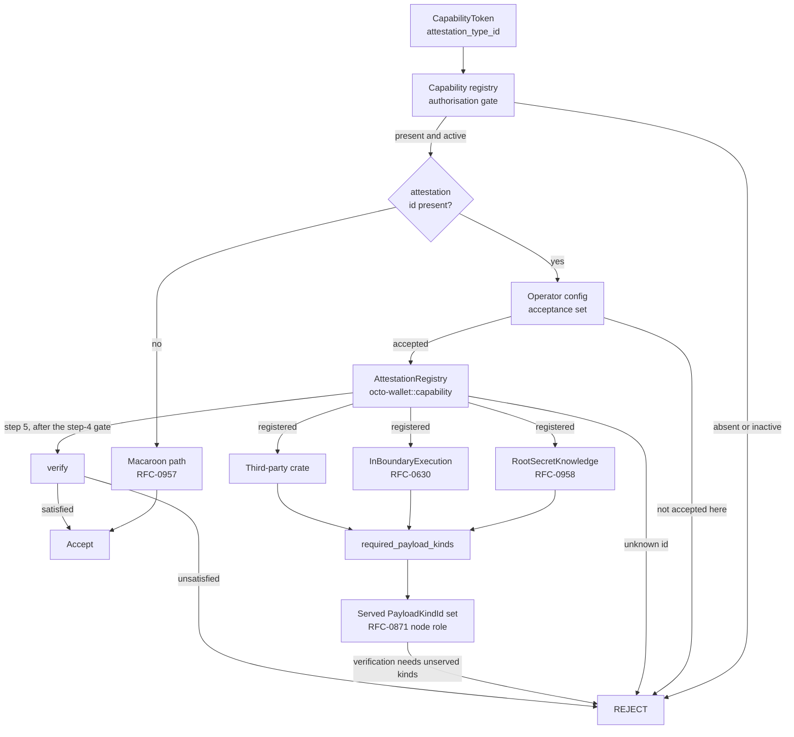

# RFC-0973 (Economics): Pluggable Proof Attestation for Capabilities

## Status

Draft

## Authors

- Author: @mmacedoeu

## Maintainers

- Maintainer: @mmacedoeu

## Summary

This RFC makes proof attestation a **pluggable, third-party extensible axis of
the capability substrate**. A capability declares _what it attests_ by a
128-bit attestation type id; the attestation is verified by a registered
`AttestationStrategy` implementation living in its own crate; and the node
operator chooses which strategies their node accepts and runs verifiers for.
The same mechanism carries both ZK-based capability types now being defined,
and any third-party attestation added later, without a central edit. It also
reconnects attestation to RFC-0871 §Node Role — Payload-Kind Declared: a
strategy declares which `PayloadKindId` UUIDs a node must serve in order to
**produce** a valid attestation, and separately whether **verification** needs
that same coverage. The two are distinct gates — the first checked once at boot,
the second per call — so "what is proven" and "who may prove it" stay separate
concerns, and a node is not forced into production duty merely because it
verifies.

One property governs how all of it must be read, and it is stated here because
it is the easiest thing to get backwards: **an accepted attestation is not an
authorisation.** A proof establishes that someone knows a secret, nothing about
who they are or what they may do. What makes an accepted attestation meaningful
is that the capability was already issued — the capability registry is an
authorisation gate the dispatch cannot pass without, and it is not something
this RFC introduces. See §Security Considerations.

## Dependencies

**Requires:**

- RFC-0957: Capability Token Format — this RFC **amends** its wire format to
  carry the attestation envelope, and declares that amendment here
- RFC-0871: Specialized Node Protocol Envelope — supplies `PayloadKindId` and the
  served-payload-kind notion a strategy declares its requirement against
- RFC-0958: ZK Capability Subclass — defines the capability class and the
  circuit this RFC's binding relation applies to, and is **amended** by
  §Root-Secret Binding. It does not itself define `root_secret_knowledge` as a
  strategy; that identifier is introduced here
- The holder registry, as a hard authorisation dependency. It exists today and
  is keyed by capability id, with an `active` predicate over revocation and
  expiry. An accepted attestation carries no authority of its own; see
  §Security Considerations
- RFC-0008: Deterministic AI Execution Boundary — this RFC carries the execution
  class mapping it mandates for every RFC

**Optional:**

- RFC-0965: Capability Extension Format — this RFC applies its §Per-Extension
  Crate Layout to attestation strategies

**Relationship to RFC-0630.** Proof-of-Inference supplies the _fact_ that
in-boundary execution attests — it is a consensus mechanism for inference, and
it does not itself define a capability, an attestation, or a macaroon. The
`in_boundary_execution` strategy adapts that fact to this interface; it is not a
re-implementation of it, and this RFC does not amend RFC-0630.

## Design Goals

| Goal | Target                                                                  | Metric                                                                                             |
| ---- | ----------------------------------------------------------------------- | -------------------------------------------------------------------------------------------------- |
| G1   | Adding an attestation strategy requires 0 edits to `octo-wallet` core   | strategy crate PR touches no core file                                                             |
| G2   | Unknown attestation id rejected, never downgraded                       | 100% of negative tests reject                                                                      |
| G3   | Operator acceptance set is fail-closed against what the node can verify | config naming an unregistered strategy refuses boot                                                |
| G4   | Wallet can verify every capability minted before this RFC               | 100% of the pre-RFC capability fixtures, re-serialising to identical bytes                         |
| G5   | Both reference strategies are instances, not special cases              | 2 strategy crates implementing one trait, one registry                                             |
| G6   | Operator can select non-attested operation without a core change        | an acceptance set naming no strategies verifies the whole pre-RFC fixture set on the macaroon path |
| G7   | A circuit-backed strategy states its admission cost and soundness       | profile present, and its soundness figure traceable to prover parameters                           |

## Motivation

**A proof is a general way to establish a fact without revealing the witness,
not one authorization mechanism.** RFC-0871's envelope carries
`Authorization::Proof(ProofBundle)` alongside `Signature`, `Capability`, and
`ThresholdSignature`. Reading the ZK subclass through that variant makes it look
like a fourth way to say "you may do this". It is not. What is coming is a
general proving substrate whose instances happen to include knowledge of a
macaroon root secret and attestation that an inference ran inside the protocol
boundary, and whose third instance will be written by someone outside this
repository. A mechanism that treats the first two as special cases will have to
be renegotiated for the third.

**The current shape caps extensibility at a closed vocabulary.**
`CapabilityClass { V1, ZKBearing }` is a two-variant enum, so a third kind of
proof is a central edit plus a cross-crate review — the exact cost CLAUDE.md's
"Extension over enumeration (no central enums)" exists to avoid. That enum was
also mirrored across crates in more than one place before being converged, which
is what that cost looks like in practice. It answers _what an issuer produced_,
which stays useful as a mint-time and storage taxonomy, and should stop being the
answer to _what the proof establishes_.

**Node specialization already solved its half of this.** RFC-0871 §Node Role —
Payload-Kind Declared makes a node's role the set of `PayloadKindId` UUIDs it
serves, precisely so no role enum constrains future nodes. An attestation
strategy can declare the payload kinds required to produce a valid attestation,
which links the two axes without reintroducing a role taxonomy. RFC-0009 removed
its role enum from its specification on the same reasoning, though the wallet
still retains the enumeration as a mint-time gate; that residue is recorded in
§Implementation Phases rather than presented as settled.

**Operators must be able to choose, and the choice must be checkable.** A node
that accepts an attestation it cannot verify is worse than one that rejects it:
the operator's configuration becomes an unauditable claim rather than a
decision.

## Roles and Authorities

| Actor                 | Identifier            | Authority scope                                                  | Lifecycle                 |
| --------------------- | --------------------- | ---------------------------------------------------------------- | ------------------------- |
| Core maintainer       | repo commit identity  | Allocates RFC-range attestation ids; owns the trait and registry | per PR                    |
| Strategy crate author | crate + registry key  | Implements and registers one strategy; may not modify core       | per crate release         |
| Node operator         | node config signature | Chooses the acceptance set for the node they operate             | per node, re-read at boot |
| Issuer                | issuer DID            | Chooses the attestation when minting a capability                | per mint                  |
| Verifier              | node DID              | Executes a registered strategy against an attestation            | per verification          |

**Authority boundaries that MUST NOT be crossed:**

- An operator may restrict the acceptance set. An operator may **not** name a
  strategy the node cannot verify.
- A strategy crate author may claim an id in the RFC range only via a core
  allocation. User-range ids are self-allocated, fail closed on any node that
  has not registered them, and are exclusively claimed — a second crate claiming
  one already held is refused rather than replacing the incumbent.
- No actor may weaken a verification outcome. Registry misses, unknown ids, and
  absent attestations are rejections, never downgrades.
- No actor may extend what the attestation means. A strategy establishes the
  fact its type id names and nothing further; in particular it cannot confer
  authority the capability's own registry record does not carry.

## Specification

### System Architecture



The diagram carries both dispatch gates that reject on operator posture rather
than on the attestation: the acceptance set at step 2, and the step-4
verification-side coverage check. The step-4 edge into `verify` is drawn as a
separate edge because a node that fails step 4 never reaches step 5, while both
draw from the resolved strategy — collapsing them into one path would assert
that a rejected-at-step-4 node still verifies.

The unauthenticated branch is step 1 of the dispatch and is a first-class
outcome, not a degenerate one: most capabilities carry no attestation, and a
token that does is never verified by that path.

The first gate is the one that makes acceptance mean anything: everything past
it can be satisfied by an attacker who minted their own capability. See
§Security Considerations.

### Data Structures

**Attestation type id.** A 128-bit value carried on any capability that
declares an attestation.

```text
attestation_type_id: 16 bytes
    RFC range   : 0x0000_0000_0000_0000 - 0x7FFF_FFFF_FFFF_FFFF  (core-allocated)
    user range  : 0x8000_0000_0000_0000 - 0xFFFF_FFFF_FFFF_FFFF  (self-allocated)
```

Unknown in either range means reject. The user range is a naming convenience,
not a bypass; its values are equally subject to registry lookup.

**Names that collide in the current substrate.** A single identifier,
`cap_root_hash`, is used for two unrelated 32-byte values across this
codebase, and the binding relation below is only correct for one of them. This
RFC uses unambiguous names and requires implementations to.

| Name used here                    | Derivation                                                                               | Where it lives                               |
| --------------------------------- | ---------------------------------------------------------------------------------------- | -------------------------------------------- |
| `macaroon_root_secret_hash`       | `BLAKE3(root_secret)`                                                                    | macaroon field, covered by the capability id |
| `capability_id`                   | `BLAKE3(0x05 ‖ canonical_ser_unsigned(macaroon))`                                        | macaroon field, registry primary key         |
| `cap_root_hash` (ZK public input) | no fixed derivation; supplied per proof and compared against a verifier-held expectation | ZK circuit public inputs                     |
| `cap_root_hash` (wire decode)     | `compute_capability_id(macaroon)` — the **same** value as `capability_id`                | decoding a v1 wire token to its registry key |

The first is the binding target. The second is the registry key. The third is
unrelated to either and merely shares the name. The fourth is **not a fourth
value**: the wire decoder derives the same capability id the mint path computes,
byte-identically, and that equivalence is pinned by a test. It is listed only
because one identifier carries two meanings across the substrate for two
distinct values, which is the ambiguity worth eliminating.

A comment in the wire decoder once documented a different derivation for this
identifier and was corrected; the code was always computing the capability id.
The name, not the behaviour, is what needs fixing — and renaming is a
wire-affecting change recorded in §Implementation Phases rather than attempted
here.

**RFC-0958 specifies a different relation for these inputs, and the code has
drifted from it.** RFC-0958 declares `cap_root_hash` as `BLAKE3(root_secret)` and
specifies in-circuit re-derivation of the whole caveat chain ending at that
value. The implemented circuit does neither: it declares the inputs, never
derives them, and asserts only that a Poseidon commitment over the witness is
non-zero. This is a pre-existing specification-to-implementation drift, not a
property this RFC introduces, and it is recorded in §Implementation Phases
rather than resolved here.

What this RFC does with the drift is narrow and deliberate. It binds
**`macaroon_root_secret_hash`**, carried as its own public inputs, and leaves the
existing `cap_root_hash_lo`/`_hi` fields alone. It also does not adopt RFC-0958's
full chain re-derivation: that relation is the whole chain, and binding the root
hop alone is the narrower claim this RFC makes. Both choices are narrower than
what RFC-0958 specifies, so adopting them requires amending RFC-0958's relation
rather than merely adding a strategy beside it — which is why RFC-0958 appears
here as amended and not as merely consulted.

An implementation that binds the root-secret hash against the existing
`cap_root_hash` fields would be asserting a relation about whichever derivation
the circuit's consumer chose, which is precisely the ambiguity the table above
exists to remove.

**Attestation payload.** The attestation id names a strategy; the attestation
itself is an opaque, strategy-defined byte string whose encoding belongs to the
strategy crate. A token carries either an absent marker or exactly one
`(attestation_type_id, payload)` pair; there is no third state in which a token
claims an attestation class but names no strategy.

**The envelope MUST sit inside the capability canonical form.** This is
normative, not a default. The token already carries an optional proof-bundle
segment, and that segment is excluded from the capability-id hash. An envelope
placed there would be invisible to the registry primary key, so swapping an
attestation between capabilities would leave both capability ids valid and both
registrations active — the exact substitution A2 describes, silently successful.
The envelope therefore goes in the hashed canonical form, in the segment that
existing parsers already read.

**The envelope is size-bounded.** An attestation payload is opaque and
strategy-defined, so without a bound the decode path has no limit on what it will
accept and hold. The envelope carries a total-length prefix, and a payload
exceeding the transport's segment limit is a decode failure on that same path as
a malformed one — before any strategy is resolved and before any proof is handed
to a verifier. The limit itself is set by the transport rather than by this RFC,
which fixes only the requirement that one exists and is enforced on read. Without
that, an attacker who can get a token in front of a verifier controls how much
memory the verifier allocates before deciding anything.

A malformed envelope is a decode failure, not a verification rejection. The
wire form either carries a well-formed pair or an absent marker; a truncated or
unparseable payload fails before dispatch and is reported as such. §Error
Handling covers verification-time rejections, and records this case as the
decode-time failure it is rather than as a rejection.

**Capability class is not a wire field.** The capability class is a
storage-projection and mint-time taxonomy, not a field on the token; the token's
wire form carries presence of an attestation, not a class enumeration. This RFC
does not add a class field and does not read one during dispatch. Where the
class matters — which mint paths may produce an attested token — that is a
mint-time rule, not a verification-time one.

**Strategy trait.**

```rust
pub trait AttestationStrategy: Send + Sync {
    /// Stable 128-bit discriminator, RFC-allocated or user range.
    fn type_id(&self) -> AttestationTypeId;

    /// Verify an attestation against a capability. Pure function of
    /// (capability, attestation, context): same inputs, same outcome on
    /// every node, or verification is non-deterministic across the fleet.
    fn verify(&self, ctx: &AttestationVerifyCtx<'_>) -> Result<AttestationOutcome, AttestationError>;
}
```

Optional companion trait: what a node must serve to verify, and what admitting
this strategy costs. A strategy that does not implement this declares no
deployment requirement and no cost.

```rust
pub trait AttestationAdmission {
    /// Payload kinds a node must serve to produce a valid attestation.
    /// Empty means the strategy imposes no deployment requirement.
    fn required_payload_kinds(&self) -> &[PayloadKindId] {
        &[]
    }

    /// Whether **verification** — as distinct from production — needs a node
    /// that serves the required kinds. A node that does not serve them can
    /// normally still verify an attestation someone else produced.
    ///
    /// There is no default, and the absence of this trait is not a default
    /// either: it means the strategy declared no requirement, which the
    /// registry represents as an explicit "no requirement" value rather than by
    /// leaving the gate unstated. A strategy that does implement it MUST answer,
    /// because this is consulted by a rejection gate.
    fn verifier_needs_producing_kinds(&self) -> bool;

    /// Circuit budget facts, for admission control where the attestation is a
    /// proof. There is deliberately **no default**: returning `None` is how a
    /// strategy states that it carries no circuit cost, and it is a claim the
    /// strategy must be true about, so it is written rather than inherited.
    /// A strategy that returns `None` while carrying a proof skips the budget
    /// gates entirely. LR1 makes implementing this trait mandatory for a
    /// cost-bearing strategy, but implementing it is not the same as answering
    /// it truthfully: nothing in the registry can tell a `None` that means "no
    /// circuit cost" from one that means "I did not measure mine", so a
    /// cost-bearing strategy returning `None` is a false claim about itself
    /// that review must catch rather than a rule the runtime enforces.
    fn admission_profile(&self) -> Option<AdmissionProfile>;
}

/// What the dispatch and boot validation consult. A strategy that does not
/// implement `AttestationAdmission` gets the permissive value — no required
/// kinds, no verification requirement, no profile — so the gates always have a
/// value to read rather than a branch that might not run.
pub struct Admission {
    pub required_payload_kinds: Vec<PayloadKindId>,
    pub verifier_needs_producing_kinds: bool,
    /// Circuit budget facts, or `None` where the strategy declares it carries
    /// no circuit cost. A cost-bearing strategy must answer this truthfully;
    /// the obligation is on the strategy, not on the gate, which cannot tell a
    /// cost-free claim from an unmeasured one.
    pub admission_profile: Option<AdmissionProfile>,
}

/// Circuit budget facts a strategy states so a node can refuse to admit it
/// rather than discovering at verification time that it has no headroom.
pub struct AdmissionProfile {
    /// In-circuit cost in CASM words, where the attestation is a circuit proof.
    pub casm_cost_hint_words: CostFigure,
    /// Security the attestation actually carries, derived from prover
    /// parameters. A strategy supplies the parameters and this figure is
    /// computed from them, so the value cannot be asserted independently.
    pub security_bits: SecurityFigure,
}

/// An in-circuit cost that may not have been measured yet. The unmeasured state
/// is represented explicitly rather than as a sentinel number, because a
/// sentinel is indistinguishable from a real measurement of that value.
pub enum CostFigure {
    Measured(u32),
    Unmeasured,
}

/// What a valid attestation for a capability must establish, derived from the
/// capability alone. Core-owned so the context can be built without naming a
/// strategy type; deliberately has no accessor for the attestation.
pub trait Expectation {
    /// The bound value this capability's attestation must match. For a
    /// capability carrying an RFC-0957 macaroon this is
    /// `macaroon.root_secret_hash`, so a strategy reads its binding target
    /// through this accessor rather than reaching into a macaroon type it
    /// would otherwise not depend on. A capability with no such field yields
    /// the digest the strategy's own relation is defined against.
    fn bound_value(&self) -> &[u8; 32];
}

/// Security bits, computed rather than asserted. No constructor takes a bare
/// integer: a value can only be produced from a strategy's prover parameters,
/// so the figure cannot be asserted independently of what it derives from.
pub struct SecurityFigure(u32);

/// The prover parameters security is derived from: proof-of-work bits in the
/// Fiat-Shamir channel, log blowup factor, and query count. Read from the
/// prover's existing pinned values.
pub struct SecurityParams {
    pub pow_bits: u32,
    pub log_blowup_factor: u32,
    pub n_queries: u32,
}

impl SecurityFigure {
    /// Derive the security the bound prover configuration actually delivers.
    /// This is the only way to obtain a value, and it is a function of the
    /// configuration rather than a claim about it, so two strategies on
    /// different configurations cannot report the same number by assertion.
    ///
    /// The formula is the one the proof system documents: proof-of-work bits
    /// plus log-blowup times query count. The parameters are reached through the
    /// workspace's existing pinned constants rather than through an accessor
    /// on the prover type, which exposes public fields and no inherent
    /// methods; reading a configuration object here would couple this trait to
    /// one prover build rather than to the parameters themselves.
    #[must_use]
    pub fn from_prover_parameters(params: &SecurityParams) -> Self {
        Self(params.pow_bits + params.log_blowup_factor * params.n_queries)
    }

    #[must_use]
    pub fn bits(&self) -> u32 {
        self.0
    }
```

`bits()` exists because the budget gate compares numbers rather than tokens:
`node.has_headroom` in `validate_policy` below is handed this figure and unwraps
it through the accessor, so the value a node budgets against is the one the
prover parameters produced. Without it a caller would have to reach into the
tuple struct, which would be a second, unfenced path to the same number.

**Verification context.** `AttestationVerifyCtx` is a borrow-only view carrying
the capability under verification, the attestation bytes, and any read-only
policy handle a strategy needs. It MUST NOT carry a concrete storage type.
Strategies that need registry or catalog access receive an injected
`&dyn` trait, never a concrete substrate handle, so a strategy crate does not
acquire a storage dependency it has no use for.

```rust
pub struct AttestationVerifyCtx<'a> {
    /// The capability being verified. Never the attestation's own claim about it.
    pub capability: &'a Capability,
    /// The attestation bytes, as produced by this strategy's own encoding.
    pub attestation: &'a [u8],
    /// What the verifier expects the attestation to establish, derived from
    /// `capability` and never from `attestation`. Required, not optional, and a
    /// core-owned trait object rather than a strategy's concrete type: core
    /// builds this context and must not name a third-party type to do it.
    pub expectation: &'a dyn Expectation,
    /// Read-only policy handles a strategy asked for, as trait objects.
    pub policy: &'a dyn PolicySource,
}
```

`PolicySource` is a read-only trait a strategy uses to consult node policy it
was configured with — for example a threshold or an allow-list. It exposes no
mutation and no concrete storage, so a strategy cannot reach the substrate
through it. A strategy that needs nothing from policy receives a handle whose
methods return `None`.

**The refuse-only rule on `PolicySource` is a convention enforced by review, not
by a type.** The type cannot express it: the same `Unsatisfied` outcome covers a
policy refusal and a failed relation, and nothing distinguishes a strategy that
consulted policy from one that ignored it. Core can enforce the _narrow_ claim —
no strategy can reach storage or mutate policy through this handle — but the
broader claim, that policy may produce a refusal and never an acceptance, is
something a reviewer confirms by reading `verify`, exactly as the
ignore-the-expectation convention is (§Algorithms). This is recorded rather than
left implicit, because a convention with no stated owner is a convention nothing
checks, and because TV16 depends on it: it is the reason two nodes with
different policies may legitimately return different verdicts.

`Expectation` is a **core-owned trait**, not a strategy type, because core
constructs the context and a Layer-B crate cannot name a third-party type to do
that. Its single method states the anti-self-comparison rule structurally: the
expectation is derived from the capability and is given no accessor for the
attestation, so a strategy holding one cannot read the attestation's own claim
back out of it. A strategy that needs its own richer expectation shape reads the
capability through `ctx.capability` and interprets it under its own rules.

`AttestationError` is a **core** type carrying an opaque, strategy-supplied
reason, because it appears in the trait's return position and third-party
strategies dispatch through one registry — a strategy-owned error type could not
appear there. The strategy chooses the reason; core decides what every variant
means, which is rejection.

`SecurityParams` is the prover's security-relevant parameters — proof-of-work
bits, log blowup factor, and query count — read from the workspace's existing
pinned constants rather than redeclared here, so the figure this RFC computes is
the same one the prover already reports.

**A verifier MUST NOT compare a proof against itself.** An existing
capability-verification helper accepts an absent expectation and then uses the
proof's own public inputs as the comparison target, which makes the check
vacuous. `verify` MUST always receive expectations derived from the capability
under verification, never from the attestation being checked. A strategy that
accepts an absent expectation and falls back to the proof's own inputs is not
expressible against the trait: the expectation is a required field of the context
rather than an option, so the absent case has no representation. A strategy that
ignores the expectation it is handed remains possible, which is why this is stated
as a type property plus a review convention rather than as a guarantee alone.

**Outcome.** `AttestationOutcome` is `Satisfied` or `Unsatisfied`, plus an
optional machine-readable reason for the rejection that is safe to log. It is
never `Satisfied` on an unresolved or skipped check — see §Root-Secret Binding
for why the currently-circuited attestation establishes nothing.

**Reference strategies shipped by this RFC.**

| Strategy                | Establishes                                                      | Source                                                               | Circuit cost                                   | Notes                                       |
| ----------------------- | ---------------------------------------------------------------- | -------------------------------------------------------------------- | ---------------------------------------------- | ------------------------------------------- |
| `root_secret_knowledge` | the bearer knows the macaroon root secret, without disclosing it | narrower than RFC-0958's, which this RFC amends; strategy named here | unmeasured — see §Root-Secret Binding          | one BLAKE3 hop over the secret              |
| `in_boundary_execution` | the attested inference ran inside the protocol boundary          | RFC-0630                                                             | unmeasured — Phase 2, see §Performance Targets | proof-of-inference trace bound to the token |

Both are instances of one mechanism. A third-party strategy is a third row, not
a code change.

**No cost figure is claimed for either strategy.** An earlier draft of this RFC
carried a measured word count that turned out to describe a commitment to the
root secret the token already contains, not the binding below. Until a word count
is measured on the actual program, the honest entry is "unmeasured". The first
strategy's measurement belongs to Phase 3, which is where the binding work lands,
and the second to Phase 2, which is where the crate implementing it lands.

#### Root-Secret Binding

`root_secret_knowledge` proves exactly one relation:

```text
    the witness contains s  such that  BLAKE3(s) == macaroon.root_secret_hash
    # `root_secret_hash` is the token field's own name and the same value
```

`root_secret_hash` is an existing public field of the RFC-0957 macaroon, already
covered by the capability id, so the binding needs **no new commitment and no
second hash primitive**. It does require the BLAKE3 permutation to be computed
**inside** the circuit; see the invariant below.

**This relation is not established today, and the production path does not reach
it.** The circuit computes a Poseidon commitment over the witness and asserts
only that it is non-zero, which any witness satisfies. A conformance test pins
exactly that absence: it feeds an unrelated value as the root secret and asserts
the harness still accepts it, written so that it fails once the binding lands.
Separately, the mint path does not execute this circuit at all: it discards the
witness and proves a different program, so the properties a real proof would
carry are not being obtained in production either. Until the rejection vector
below passes and the mint path is wired to the capability circuit, no
`root_secret_knowledge` attestation may be registered, and an operator node MUST
refuse boot if the strategy appears in its acceptance set. The strategy ships
with no registry entry at all; registration is Phase 3 work.

**The BLAKE3 hop MUST be executed by constrained program logic.** An
attestation whose digest is supplied to the circuit — as a private witness, a
prover-side precomputation, or a hint — is forgeable by construction: the
proposer supplies both an arbitrary secret and the public digest, and every
check passes. This is not hypothetical; the current circuit has no in-circuit
hash of the root secret at all, and the substrate carries a documented history of
a stub satisfying a cryptographic-sounding check by a non-zero comparison. Any
design where the digest is an input rather than a computed result is rejected.

**The primitive is not yet available in-circuit.** The in-circuit BLAKE3 module
is test-gated with no production call site, and exposes only keyed-hash and HMAC
entry points above the compression function — there is no unkeyed hash entry
point, which is what this relation requires. BLAKE3 over felt-constrained words is
not a field-native operation, so its cost is not comparable to the Poseidon figure
that motivated the earlier draft. §Performance Targets owns the cost question and
the ceiling; if the measured cost of an unkeyed BLAKE3 hop is judged unacceptable,
the primitive is a legitimate thing to revisit, and that decision is recorded
wherever it is taken.

**The binding target does not scope with attenuation.** `root_secret_hash` is
assigned once, at mint, and chain extension takes the macaroon by value without
touching it. Every descendant in an attenuation tree therefore carries a **byte-identical**
`root_secret_hash`, and since that value is the binding target, an attestation
produced for a parent is automatically valid for every attenuated child. The
strategy gives zero attenuation scoping: narrowing a capability with caveats does
not narrow the attestation, because the attestation attests to the root secret
and the root secret is what the tree shares.

This is not a defect to be fixed here — it is a property of binding to the root
secret rather than to a per-token value — but it must be understood before the
strategy is offered. A capability holder who attenuates cannot weaken a
`root_secret_knowledge` attestation by doing so. Any design that needs
attestation strength to narrow with caveats must bind to a value that changes
along the chain, which is exactly what §Root-Secret Binding rules out for the
nonce-derived fields.

**What is deliberately NOT bound.** A capability macaroon has three values
whose derivation takes the root secret as input directly: `root_secret_hash`,
`root_id`, and `chain[0]`. The capability id and `chain[1..]` are secret-dependent
only transitively, through those three. Of the direct three, only `root_secret_hash` is a
candidate binding target at all: the other two cannot be, because they need the
nonce. It is not yet in-circuit, and this section is where that is recorded.
`root_id` and `chain[0]` are distinct derivations over the
mint nonce, and the nonce is deliberately unrecoverable. Binding either would
require publishing it. The consequences are set out in §Alternatives Considered;
the point here is that the exclusion is a decision, not an omission.

**`chain[0]` is an assumed root, not a derived one.** RFC-0957's signature
verification seeds its running capability-id hasher with `chain[0]` taken from
the struct and never re-derives it; the chain's integrity runs forward from an
unverified anchor. This RFC does not change that. It is recorded so the
attestation is not read as anchoring the chain: the proof shows possession of the
root secret, while the chain remains anchored to an assumed `chain[0]`.

**Scope of the claim.** This is authentication of _possession_, not
_authorization_. Satisfying it requires knowing the root secret — which any
compromise of that secret, or any legitimate bearer, provides. No node should
treat an accepted `root_secret_knowledge` attestation as evidence that the bearer
is the issuer, or as authority beyond what the capability's own caveats permit.

`root_secret_hash` is the **only** field in this token family that is a plain
unkeyed BLAKE3 hash with no domain prefix. The capability id and the chain root
both apply a domain separator; the root id deliberately does not, an asymmetry
recorded as intentional rather than pending. That asymmetry does not affect this
RFC — the root id is not the binding target — but it is stated here so the
domain-separation picture is not read as more uniform than it is. This is wire-format-frozen: changing
how `root_secret_hash` is computed invalidates every issued capability, because
the value is covered by the capability id and by the registry primary key. Any
work under this RFC that touches that derivation MUST preserve byte-compatibility
or be an explicit, separately-recorded breaking change.

**Truncation.** `root_id` is a 16-byte truncation of a keyed hash — 128 bits.
It is a replay-dedup key and MUST NOT be used as a binding commitment; doing so
would drop the attestation's soundness floor to 128 bits. The binding target is
the full 32-byte `root_secret_hash`.

### Algorithms

**Fail-closed dispatch.**

```text
verify_capability_attestation(token, node, issuers, strategies, clock):
    # `issuers`   = the holder registry, keyed by capability id, existing today
    # `strategies` = the attestation registry, keyed by attestation type id, new
    0. if issuers.lookup_active(token.capability_id, clock) is None:
          -> REJECT   # authorisation precedes attestation; see §Security Considerations
    1. attestation_id = token.attestation_type_id
       if absent:
          -> run the RFC-0957 macaroon path, then ACCEPT on its own terms
       # an id present on a token means the token is attested, and an attested
       # token is never verified by the unattested path
    2. if attestation_id not in node.accept_set:
          -> REJECT   # operator does not accept this strategy here
    3. strategy = strategies.resolve(attestation_id)
       if unresolved -> REJECT   # includes user-range ids never registered
    4. admission = strategies.admission_of(strategy)
       # A strategy not implementing AttestationAdmission yields an Admission with
       # empty kinds and verifier_needs_producing_kinds = false. The value is
       # always present, so this gate always runs.
       #
       # Boot already required the node to serve these kinds in order to produce.
       # This step is the *verification-side* requirement, which boot cannot
       # check because it depends on the strategy, not the node: a strategy that
       # declares verification needs producing capability causes a reject here
       # for a node whose production coverage changed after boot. The gate is
       # therefore reachable, and is distinct from the boot check above.
       if admission.verifier_needs_producing_kinds:
          if not node.serves_all(admission.required_payload_kinds):
             -> REJECT   # this node cannot verify what it cannot produce
    5. outcome = strategy.verify(ctx{
            capability:  token,
            attestation: token.attestation_payload,
            expectation: &core_expectation_for(token),  # never from the attestation
            policy:      node.policy_source(),
       })
       on Err(e) -> REJECT, carrying e's reason    # a strategy that cannot decide
                                                # has not verified anything
       if outcome is Unsatisfied -> REJECT, with the reason outcome carries
    -> ACCEPT
```

Step 0 is load-bearing and is not an optimization. Steps 1–5 can be satisfied by
an attacker who minted their own capability; only step 0 makes acceptance mean
anything.

Step 3 is load-bearing for a different reason: without it, a node could accept a
token whose strategy it has no implementation for and reach step 5 with
nothing to call. The boot-time counterpart is the resolvability check in
`validate_policy`, which rejects the configuration rather than the token — the
two are not the same gate, and an acceptance set cannot change between them.

Step 1 has no attested-class exception. A token carrying an attestation id is
attested, full stop; it never falls back to the macaroon path, and a token
without one is never accepted on the strength of an attestation it does not
carry.

**Boot-time policy validation.**

```text
validate_policy(policy, node, strategies):
    for strategy_id in policy.accept_set:
        if not strategies.contains(strategy_id):
            -> FAIL TO START, naming the offending id
        admission = strategies.admission_of(strategies.resolve(strategy_id))
        # producing-side coverage: the node must be able to produce what it
        # accepts. This is a boot check, not a per-call one, because it is a
        # statement about the node rather than about any single attestation.
        if admission.required_payload_kinds is non-empty:
            # producing-side only: the node must be able to produce what it
            # accepts. The verification-side requirement is a different gate and
            # is deliberately NOT checked here, so that step 4 remains reachable
            # for a node that boots but cannot verify.
            if not node.serves_all(admission.required_payload_kinds):
                -> FAIL TO START, naming the kinds the node does not serve
        profile = admission.admission_profile
        if profile is Some:
            if profile.casm_cost_hint_words is Unmeasured:
                -> FAIL TO START, naming the strategy with no measured cost
            if not node.has_headroom(profile.casm_cost_hint_words,
                                     profile.security_bits.bits()):
                -> FAIL TO START, naming the exceeded budget
```

The soundness side is unwrapped through `bits()` rather than read as a struct
field, which is what keeps `SecurityFigure`'s single constructor the only route
to a value: there is no second path by which a caller could supply one. The
unmeasured check above is the guard that makes the bare cost figure safe to
pass. `Measured` is the arm every reference strategy reaches when its phase
completes the measurement — `Unmeasured` is the only value constructible today,
and §Implementation Phases names the phase that replaces it.

**Strategy registration.**

```text
register_strategy(strategies, strategy, allocation_record):
    id = strategy.type_id()
    if id is in the RFC range:
        if not allocation_record.contains(id):
            -> REJECT   # no core allocation backs this id
    if strategies.claims(id):
        -> REJECT   # every id is exclusively claimed, in either range; the
                    # incumbent is left untouched rather than replaced
    if not strategies.insert(id, strategy):
        -> REJECT   # insert never overwrites a claimed id
```

Registration is where the id gates are, which is why neither can be bypassed by
a strategy: the two behaviours pinned to registration — id allocation and
exclusive user-range claim — both execute here rather than at verification time,
where a strategy could skip them.

The remaining two registration-time guarantees are **type properties rather than
runtime checks**, which is the stronger form. `SecurityFigure` takes no bare
integer from anywhere, so a soundness figure cannot be asserted independently of
the prover parameters it derives from. And `AttestationVerifyCtx` carries the
expectation as a required field rather than an option, so the _absent-expectation_
fallback — the shape where a verifier compares a proof against itself because it
has nothing to compare it to — cannot be written against this trait. That is the
narrow claim; the broader one, that no strategy can ignore the expectation it is
handed, is a convention enforced by review rather than by a type. Neither needs
an algorithm because neither has a code path to check.

Boot validation therefore covers three things: resolvability, producing-side
coverage, and admission budget. An unmeasured cost fails the boot rather than
passing on a guess, which is why `CostFigure` carries an explicit unmeasured
state — it is a rejection, not a wildcard.

### Lifecycle Requirements

1. A strategy crate MUST implement `AttestationStrategy` and register in an
   `init` path. Core MUST NOT be edited to add one. It MUST ALSO implement
   `AttestationAdmission` if it declares any payload-kind requirement **or**
   carries any circuit cost — the trait is where both live, so a cost-only
   strategy has the same obligation as a kind-requiring one. Leaving the trait
   unimplemented states that a strategy imposes no requirement and costs
   nothing, which is a claim the strategy must be true about.
2. A node MUST validate its operator policy at boot and refuse to start on an
   unresolvable acceptance entry.
3. A verifier MUST reject, never downgrade, on an unknown id, an unresolved
   strategy, a capability absent from the registry, or a policy mismatch.
4. **Attenuation MUST carry the attestation envelope forward and register the
   child, or refuse.** The envelope propagates from parent to child at the point
   the child is produced, so a child of an attested parent cannot exist without
   one. Because attenuation recomputes the capability id, the child is a
   different registry key and MUST be registered under it in the same operation. This is a mint-time
   rule in core rather than a verification-time one, because at verification the
   verifier has no way to learn that a parent carried an attestation: it sees
   only the child, and an attenuation need not name its parent. The rule is
   about the envelope's **presence**, not its scope — a child inherits its
   parent's attestation as valid rather than losing it, and §Root-Secret Binding
   states why that inheritance is unavoidable when binding to the root secret.
5. Back-compat MUST preserve readability of every capability minted before this
   RFC. A capability carrying no attestation takes the macaroon path, and its
   canonical form MUST NOT change as a result of this RFC.
6. Strategy implementations MUST be deterministic functions of their inputs.
7. A node MUST advertise its acceptance set in its node metadata, so that a peer
   relying on "this node verifies proofs" can detect a node that accepts none.
   Advertising a strategy the node cannot actually verify is a false claim and
   is prohibited; the advertised set is the acceptance set intersected with what
   the node can verify.
8. The registration host MUST be a binary or node crate. A Layer-B core crate
   MUST NOT depend on a Layer-E strategy crate to discover it.
9. Deferral of any mission gated on a Draft dependency is user-initiated only.

### Determinism Requirements

Registry resolution is a pure lookup on a stable 128-bit key. Verification
outcomes are a pure function of (capability, attestation, context).

### RFC-0008 Execution Class Mapping

| Operation                                         | Class | Rationale                                                                                                                                                        |
| ------------------------------------------------- | ----- | ---------------------------------------------------------------------------------------------------------------------------------------------------------------- |
| Capability registry lookup (authorisation)        | A     | Pure lookup on a stable key; decides whether a capability exists at all                                                                                          |
| Attestation registry resolution                   | A     | Pure lookup on a stable 128-bit key                                                                                                                              |
| `verify`                                          | A     | Decides acceptance of a monetary claim, so must be protocol-deterministic                                                                                        |
| Admission gating on declared payload kinds        | A     | Rejection decision reached from node state, not from probabilistic output                                                                                        |
| Operator acceptance-set selection                 | C     | Operator-local configuration, non-deterministic by nature, excluded from consensus by RFC-0008                                                                   |
| Dispatch step 2, reading that set                 | A     | Turns node configuration into an accept-or-reject decision on a capability, so it is consensus-relevant and must not be classified with the choice that feeds it |
| Operator policy fed to `verify` by `PolicySource` | C     | Operator-local, non-deterministic by nature, excluded from consensus by RFC-0008                                                                                 |
| `verify` reading `PolicySource`                   | A     | A verdict that depends on operator-local configuration is not protocol-deterministic, so a strategy may use policy only to refuse, never to accept               |
| Strategy cost and soundness figures               | B     | Deterministic once the strategy is fixed, and proof-verifiable, but supplied by a third-party crate rather than derived in-protocol                              |

The policy rows are split on the same principle as the acceptance-set rows, and
for the same reason. A strategy that consults operator-local policy through
`PolicySource` is not protocol-deterministic, so it may use that policy to
**refuse** and never to **accept**. That restriction is what keeps `verify` a
Class A operation despite carrying operator configuration into it, and it is the
one case where a Class A row sits beside a Class C row without contradiction.

The acceptance-set rows are deliberately two, because RFC-0008 excludes Class C
from any consensus-relevant path and one row claiming both would break that rule.
The **act of choosing** the set is Class C: non-deterministic by nature,
operator-local, and no node can be harmed by another node's choice. The **gate
that reads it** is Class A: it turns that configuration into an accept-or-reject
decision on a capability. Two nodes given the same capability and different
acceptance sets reaching different outcomes by design is the intended consequence
of operator discretion — but it follows from the Class A gate, not from anything
the Class C choice is allowed to carry.

## Performance Targets

Registry resolution <1µs. Verification cost is the strategy's own.
`AdmissionProfile` lets a node refuse to admit a strategy it has no budget or
headroom for, rather than discovering the exhaustion during verification.

**The circuit ceiling is a budget this project sets, not an external limit.** A
budget fixed while the circuit proved nothing is not a target worth preserving; it
encodes the cost of the absence of the binding. When a strategy's binding
requires more words than an earlier no-op ceiling allowed, the correct response is
to re-derive the ceiling from the algorithm, not to select a weaker primitive that
happens to fit. Every change to a ceiling is an explicit, recorded decision with
its rationale.

**The cost of the `root_secret_knowledge` relation is currently unknown.** The
in-circuit BLAKE3 module has no production call site and exposes no unkeyed hash
entry point, so the figure has never been measured on the real program. Owning
the measurement is Phase 3; until it exists, the strategy table states
"unmeasured" rather than an estimate.

`in_boundary_execution` has the same open question, and it belongs to Phase 2,
which is the phase that lands the crate implementing it. Recording it as deferred
to some later party would be the documented-deferral failure mode; naming the
phase that owns it is what makes the obligation real.

## Error Handling

Every rejection is fail-closed and distinguishable to the operator. No rejection
reason is silently coerced into acceptance, and none is logged with the
underlying attestation bytes.

| Condition                                  | Result                          | Operator-visible reason                                  |
| ------------------------------------------ | ------------------------------- | -------------------------------------------------------- |
| Capability absent from the registry        | REJECT at dispatch step 0       | unknown or inactive capability                           |
| Capability expired at the verifier's clock | REJECT at dispatch step 0       | capability no longer active, expired rather than unknown |
| Attestation envelope malformed             | decode failure, before dispatch | unparseable attestation envelope                         |
| Attestation payload over the size bound    | decode failure, before dispatch | payload exceeds the segment limit                        |
| Attestation id absent                      | macaroon path                   | none — this is the normal unattested case                |
| Attestation id not in acceptance set       | REJECT at step 2                | strategy not accepted here                               |
| Strategy id unresolved                     | REJECT at step 3                | unknown strategy id                                      |
| Verification needs kinds not served        | REJECT at step 4                | node cannot verify what it cannot produce                |
| Verification unsatisfied                   | REJECT at step 5                | strategy-supplied reason, safe to log                    |
| Panic in `verify` (unwinding build)        | REJECT                          | strategy panicked                                        |

The first two rows are the same rejection with different causes, and the reason
column distinguishes them because an expired capability is an operational
condition an operator can act on, while an unknown one usually means the token
was never issued here. The two rows before them are decode failures rather than
verification outcomes, and are listed so the operator sees the whole set; they
happen before any strategy is resolved.

Boot-time rejections, all reported before the node serves: an unresolvable
strategy id, an acceptance entry whose required payload kinds the node does not
serve, an unmeasured circuit cost, and a cost exceeding the node's budget. Each
names the offending strategy, so the operator can act rather than merely observe.

Registration refusals are separate and occur earlier, at composition time rather
than at boot: a duplicate id claim, and an RFC-range id with no core
allocation.

**A strategy whose relation is not yet established has no registry entry at
all.** It is not a registered-but-disabled state. Naming one in an acceptance set
therefore fails at boot through the same `validate_policy` path as any other
unknown id, reporting it as unresolvable. This is deliberate: a registered
strategy that silently verified nothing would be the weakest possible posture,
because the operator's configuration would name a check that never runs.

Panic containment holds only for Rust panics under an unwinding build. A fault
raised inside the native prover or verifier is a process-level event that no
caller-side handler can convert into a rejection; that boundary is owned by the
verifier's FFI layer, not by this dispatch.

## Implicit Assumptions Audit

| Assumption                                               | Where relied upon       | Blast radius if false                                                                                                                                                                                                                                                                                                                                                            | Mitigation / status                                                                                                                                                                                                                                  |
| -------------------------------------------------------- | ----------------------- | -------------------------------------------------------------------------------------------------------------------------------------------------------------------------------------------------------------------------------------------------------------------------------------------------------------------------------------------------------------------------------- | ---------------------------------------------------------------------------------------------------------------------------------------------------------------------------------------------------------------------------------------------------- |
| A strategy can name its own circuit cost                 | `AdmissionProfile`      | Admission control is advisory only                                                                                                                                                                                                                                                                                                                                               | Optional profile; strategies with no circuit cost state nothing and are valid                                                                                                                                                                        |
| Verifier-side checking never needs more than prover-side | `AttestationAdmission`  | A node could verify something it could not have produced                                                                                                                                                                                                                                                                                                                         | No default; a strategy that declares a requirement must state the verifier answer explicitly                                                                                                                                                         |
| Determinism holds across independent implementations     | `verify`                | Two nodes disagree on the same attestation                                                                                                                                                                                                                                                                                                                                       | Pure-function requirement is an acceptance criterion, not a comment                                                                                                                                                                                  |
| An operator configures in good faith                     | operator policy         | Self-DoS, plus a peer-visible divergence from another node's posture                                                                                                                                                                                                                                                                                                             | Accepted: an operator cannot harm a _third party_ node, but peers may observe the divergence, which is why the acceptance set is advertised (Lifecycle Requirement 7)                                                                                |
| The capability is already registry-authorised            | every acceptance        | Attestation would be self-authorising and worthless (see §Security Considerations)                                                                                                                                                                                                                                                                                               | Named as a **Requires** dependency; dispatch cannot reach ACCEPT without it                                                                                                                                                                          |
| A circuit attestation computes its own digest            | `root_secret_knowledge` | Attestation forgeable by construction                                                                                                                                                                                                                                                                                                                                            | Normative invariant in §Root-Secret Binding; any digest-as-input design rejected                                                                                                                                                                     |
| The clock reaching step 0 is honest and unskewed         | `lookup_active`         | An expired capability reads as active and is accepted, or a live one reads as expired and is refused. The predicate covers both revocation and expiry, so a node with a badly-set clock mis-serves in the same way a node with a bad registry would. The same wall clock the token's own expiry was minted against decides, so skew between issuer and verifier is the live case | Accepted with the existing lifetime model: this RFC introduces no new time source and inherits the capability format's. Recorded because step 0 is the load-bearing gate, so a clock failure here is an authorisation failure and not a cosmetic one |

## Security Considerations

**An accepted attestation is not an authorisation.** This is the single most
important property of the design and it is easy to read backwards. The proof
establishes that _someone_ knows a preimage of a value the token contains. It
establishes nothing about who that someone is.

The concrete consequence: an attacker can mint their own capability, compute its
root secret hash from a secret of their own choosing, and produce a perfectly
valid `root_secret_knowledge` attestation for it. Every step of the dispatch
algorithm passes. What stops that is not the proof — it is the **capability
registry**. A capability id that was never issued by an issuer is not present in
the registry, so the capability fails to resolve and is rejected before any
attestation is consulted.

Consequently the registry is a hard **Requires** dependency of this RFC, not an
adjacent subsystem. The dispatch MUST NOT be reachable in a configuration where
the capability has not already been resolved against the registry. An operator
who removes registry lookup has not weakened the node; they have removed the only
thing that made the attestation mean anything.

**What this argument does not cover.** It is a read-path argument: it says a
capability absent from the registry is rejected. It says nothing about who may
_write_ to the registry. Registry integrity — that a record exists only for a
capability an issuer actually issued, under an identity the issuer controls — is
inherited from the capability format's own issuer model and is **out of scope
here**. An actor with registry write authority can insert a record for a
self-minted capability and step 0 will pass; the attestation then attests to a
capability the registry has blessed. Any deployment that grants write authority
broadly has moved the trust boundary rather than removed it, and this RFC does
not claim to have closed it.

Two further limits follow, and neither is fixed by a better proof:

- The circuit does not bind the witness to a holder identity. The holder-signature
  sub-circuit is currently a structural placeholder rather than a verification, so
  nothing in the attested statement ties the witness to the token's holder. The
  attestation binds the witness to the **token** and to nothing else.
- Replay is not prevented by the attestation. There is no verifier challenge and
  no per-verification binding, so a valid attestation for a capability verifies
  against any node. Single-use semantics, if wanted, must come from the
  capability's own caveats and registry lifetime — never from the attestation.

**Registry lookup settles authorisation, not identity.** The registry answers
"was this capability issued", which is what makes acceptance meaningful. It does
not answer "who is presenting it". Holder identity is a separate binding that
attenuation does not disturb: a bearer may attenuate, re-sign, and transfer, and
every dispatch step still passes — once the child is registered under its own
capability id, which attenuation changes — because the capability is still issued
and the root secret is unchanged. That is bearer-token semantics rather than a defect
here, but it means "the registry authorised this" must not be read as "the
registry identified the presenter".

Fail-closed is the second-order argument, not the first: a node that rejects
anything it cannot verify cannot be induced by **configuration** to accept a
forged attestation, because configuration cannot widen what the node can check.
Widening requires shipping the strategy, which is a code change and therefore
auditable. This holds for the strategy layer only; it says nothing about the
authorisation step, which is the registry's.

An operator may run a node that accepts no attestations at all. That is a real
permitted choice and a genuine weakening: such a node relies entirely on the
RFC-0957 macaroon path and inherits its custody properties. It must be visible
rather than silent — see A1.

## Adversarial Review

### Adversary Analysis

**Adversary test — decision table.** RFC-0008 governs the execution-class
boundary; this RFC touches the cryptographic binding surface, so the design must
answer what an adversary controls and where each control is stopped.

| #   | Question                                                 | Answer                                                                                                                                                           |
| --- | -------------------------------------------------------- | ---------------------------------------------------------------------------------------------------------------------------------------------------------------- |
| 1   | What can an adversary supply without permission?         | A capability of their own minting, an attestation over it, and an arbitrary circuit witness.                                                                     |
| 2   | What does each of those reach?                           | The witness reaches the strategy, and the strategy accepts. Nothing else: the capability id does not resolve, so step 0 rejects first.                           |
| 3   | What stops it?                                           | The capability registry, which is authorisation rather than attestation. The proof is not the control and is never described as one.                             |
| 4   | What is the residual exposure?                           | Registry write authority, holder identity after transfer, and attestation replay across a shared root secret. All three are stated as limits rather than solved. |
| 5   | Does accepting a strategy widen what the node can check? | No. Widening requires shipping the strategy, which is a code change and an audited registration. Configuration can narrow only.                                  |

The question this table exists to answer is Q3, because the intuitive answer —
"the proof stops it" — is wrong. The proof stops nothing on its own.

**A1 — Operator silently downgrades their node's assurance.** The operator sets
an acceptance set excluding every attested capability, and clients that assume
"this node verifies proofs" are not warned. _Impact:_ medium. _Mitigation:_ the
acceptance set is advertised in node metadata (Lifecycle Requirement 7), so a
mismatch is peer-detectable. A node advertises the intersection of its acceptance
set with the strategies it can actually verify, so advertising a set it cannot
honour is not possible.

**A2 — Attestation id swapped between capabilities.** A holder pairs one
capability's id with another's attestation. _Impact:_ high if unspecified.
_Mitigation:_ the attestation envelope participates in the capability canonical
form, so presenting an attestation under a different capability yields a different
registry primary key and fails step 0 (TV15). This mitigation depends on the
envelope sitting inside the hashed canonical form and **not** on the optional
proof-bundle segment, which that hash excludes — the placement is normative for
that reason. Cross-capability replay of a whole attestation under a shared root
secret is a different attack and is covered by A12.

**A3 — Two third parties claim the same user-range id.** Self-allocation is open,
so two independent strategy crates can pick the same value. A holder's
attestation would then be verified by whichever crate the node happens to have
registered under that id. _Impact:_ high where it applies, because it is a
silent substitution rather than a rejection. _Mitigation:_ registration claims a
user-range id exclusively — a second registration of the same id fails rather
than replacing the first, and a node advertising a strategy must have won the
claim. The two id ranges are disjoint by their top bit, so a user-range claim
cannot collide with a core allocation; that case is instead gated by the
allocation record.

**A3b — A strategy claims an RFC-range id core has not allocated.** _Impact:_
low; requires a crate already trusted to run. _Mitigation:_ the attestation
registry carries an allocation record naming which RFC-range ids core has
allocated, written only by the core maintainer's allocation commit and landed in
Phase 1. Registration rejects an RFC-range id absent from it. Until that record
exists, the RFC range admits nothing — the fail-closed state, not an open one.

**A4 — `verify` panics on adversarial attestation input.** _Impact:_ availability.
_Mitigation:_ `catch_unwind` at the dispatch boundary converts a Rust panic into
a rejection. This holds only under an unwinding build profile, and requires an
`AssertUnwindSafe` boundary because the trait holds shared references; an abort
build does not unwind and the mitigation silently does not apply. A fault inside
the native verifier is a process-level event outside any caller's reach.

**A5 — Strategy verification is non-deterministic.** Two nodes disagree on the
same attestation. _Impact:_ high; fork in acceptance. _Mitigation:_
determinism is a trait requirement, and TV16 pins it across two independently
built implementations rather than across two calls into one build. The other
vectors establish rejection on a single implementation, which is a weaker and
different claim.

**A6 — Attestation stripped by attenuation.** An attested parent is attenuated to
an unattested child, which then takes the macaroon path as if it carried no
attestation. _Impact:_ high; a silent downgrade one step earlier than the
dispatch would catch. _Mitigation:_ Lifecycle Requirement 4 forbids it, and the
check is in core so it holds regardless of which strategy is registered (TV14).

**A7 — Binding target truncated to the 16-byte `root_id`.** A prover needs
knowledge of the root secret; a 128-bit commitment to it is materially weaker
than the 32-byte `root_secret_hash` and is not what the strategy specifies.
_Impact:_ medium; weakens rather than breaks. _Mitigation:_ the binding target is
fixed at the full-width `root_secret_hash` by §Root-Secret Binding, and
`root_id`'s truncated form is named there as unfit for this use so a later
"simplification" cannot quietly substitute it.

**A8 — Public-input ordering error in the calldata mirror.** The witness calldata
is built by a hand-maintained mirror of the circuit's input struct. A field
reordering or omission that still type-checks would produce a proof over
attacker-chosen public inputs, with every hash check internally consistent.
_Impact:_ high; silent. _Mitigation:_ the calldata-layout conformance test must be
extended to cover every field the change introduces, not merely re-run on the
previous shape — a test that passes without exercising the new field is the
failure, not the safeguard. The existing test pins the calldata order against
the Cairo serialisation layout; it does not yet assert that the field set and
the circuit's declared inputs agree, so this change needs both. The related trap recorded in
`docs/architecture/zk-stwo-cairo-executable-recipe.md`, where declared and actual
builtins diverge, is the same failure mode and is covered by the same discipline.

**A9 — Attestation read as authorization.** An accepted
`root_secret_knowledge` attestation is treated as evidence the holder is the
issuer, or as authority beyond the capability's caveats. _Impact:_ medium;
policy error rather than a broken primitive. _Mitigation:_ §Root-Secret Binding
states the possession-not-authorization scope in the specification, so the limit
travels with the requirement rather than living only in review notes.

**A10 — Chain anchoring assumed from the attestation.** A node treats an accepted
`root_secret_knowledge` attestation as anchoring the caveat chain, because
`chain[0]` looks like a secret-derived value. It is not verified, before or
after this RFC. _Impact:_ medium; an over-claim about what was proved.
_Mitigation:_ stated explicitly in §Root-Secret Binding as an out-of-scope
known property, so no later document can inherit the stronger belief.

**A11 — Digest supplied to the circuit rather than computed by it.** The prover
passes the root-secret hash as a private witness alongside an arbitrary secret,
and every check passes because nothing relates the two. _Impact:_ critical; the
attestation is forgeable by construction. _Mitigation:_ the in-circuit-execution
requirement in §Root-Secret Binding makes this a normative prohibition, and it is
listed as an explicit assumption row in §Implicit Assumptions Audit. This is not
hypothetical — the current circuit performs no in-circuit hash of the root secret
at all.

**A12 — Attestation valid across capabilities sharing a root secret.** Because the
binding target is fixed at mint and never changes under attenuation, an
attestation for one capability is valid for every capability in the same tree —
and for any other capability minted from the same root secret. _Impact:_ medium;
the attestation does not narrow when the capability does. _Mitigation:_ none is
available at the verification layer, because the shared target is not a
verification defect. This is a **scope limit of the strategy**, stated in
§Root-Secret Binding: `root_secret_knowledge` attests to the root secret and
nothing narrower. A deployment needing per-token attestation must use a strategy
that binds a per-token value.

**A13 — Holder identity inferred from an accepted attestation.** The attestation
is read as proving the bearer is the token's holder. The circuit binds the
witness to the token and to nothing else; the holder-signature sub-circuit is a
structural placeholder. _Impact:_ medium; policy error. _Mitigation:_ stated in
§Security Considerations, distinct from A9's authorization over-claim.

**A14 — Strategy under-reports its admission profile.** A strategy declares a
circuit cost or security figure below its true value, so a node admits it on a
budget it could not actually afford, or credits soundness it does not carry.
_Impact:_ medium; admission control is the thing the profile exists to
enforce. _Mitigation:_ the soundness figure is not a bare integer — it is computed by a
formula over a declared parameter set, so two strategies cannot report the same
number by typing one in. A strategy can still declare parameters that flatter
it, so the figure is only as trustworthy as the strategy supplying it. Cost
figures are self-reported for the same reason: they gate admission, they do not
establish soundness, and an under-reported cost degrades to a node discovering
its budget exhausted during verification rather than at boot. A cost the strategy
has not measured is rejected at boot outright, which is the only case the gate
treats as decisive.

**A15 — Verifier clock skewed or hostile.** The active predicate at step 0
covers revocation and expiry, so a node whose wall clock disagrees with the
issuer's reads an expired capability as live and accepts it, or a live one as
expired and refuses it. _Impact:_ high on the authorisation gate specifically —
this is a failure of the control the whole RFC leans on, not of the attestation.
_Mitigation:_ none added here. The time source is the capability format's, this
RFC introduces none, and both the issuer and the verifier already depend on it.
Recorded as an assumption and exercised by TV13b so that the exposure is visible
rather than latent, and because "expires" is a property of the record rather than
of the attestation, nothing in the strategy layer can compensate for it.

## Economic Analysis

No token emission changes. Attestation choice is a security posture decision
with no direct fee effect. Operators with heterogeneous requirements should not
be forced to uniform posture, which is the economic argument for operator
selection over a centrally-chosen default. `AdmissionProfile` is an
operator-visible input to that decision.

Admitting an attestation strategy has a real cost — verification work on every
redemption, and for a circuit strategy, prover and verifier time. An operator
choosing a posture is choosing that cost explicitly, which is the point of
surfacing it as an admission profile rather than leaving it implicit.

## Compatibility

Capabilities carrying no `attestation_type_id` take the macaroon path unchanged.
`CapabilityClass` keeps its two variants and its meaning as a mint-time and
storage-projection taxonomy. Consumers of the previously-divergent
`CapabilityClass` declarations import the converged type.

**The canonical form of an existing capability MUST NOT change.** The envelope
is omitted entirely when absent, never encoded as a null sentinel, so a
capability minted before this RFC re-serialises to the same bytes and the same
capability id. Back-compat is achieved by omission, not by ordering: the
serialization substrate keys fields canonically, so "appended last" is not an
expressible guarantee and is not claimed. Any change to the un-attested bytes is a
wire break and is out of scope for this RFC.

**Forward compatibility is fail-closed, by consequence rather than by design.**
A node built before this RFC decodes a v1 wire token with a struct that has no
field for the envelope. It does not error on the unknown field — nothing in the
token substrate rejects unknown fields — it silently drops it and recomputes the
capability id over the truncated macaroon. That id matches no registry record,
so the capability is absent rather than attested, and a pre-RFC node refuses an
attested capability it cannot recognise.

That outcome is correct but incidental: it falls out of the id being a hash over
the canonical form, not out of anything this RFC states. It is recorded here
because a future change to the decoder — accepting unknown fields, or tolerating
a missing envelope — would remove the refusal silently. A decoder that tolerates
the field absent on read would compute an id consistent with pre-RFC behaviour
and then apply the macaroon path to an attested capability, which is the V1
bypass this dispatch exists to prevent. The envelope is therefore required on
read for any capability whose canonical form includes it, and that requirement is
carried by the id rather than by the decoder.

## Test Vectors

**TV1** — capability with no attestation id, present and active in the registry:
accepted on the macaroon path.

**TV2** — attested capability, registered strategy, in the acceptance set,
satisfying attestation, registry present: ACCEPT.

**TV3** — TV2 with a strategy id not in the registry: REJECT.

**TV4** — TV2 with a registered strategy outside the acceptance set: REJECT.

**TV5** — a token whose attestation envelope is truncated or unparseable: rejected
before dispatch, as a decode failure rather than a verification rejection.

**TV5b** — a token whose attestation payload exceeds the size bound: rejected
before dispatch as a decode failure, with no strategy resolved.

**TV6** — TV2 with an unsatisfying attestation: REJECT.

**TV7** — policy names an unregistered strategy: node refuses to start.

**TV7b** — policy accepts a strategy whose required payload kinds the node does
not serve: node refuses to start, naming the kinds.

**TV7c** — policy accepts a strategy whose circuit cost is unmeasured: node
refuses to start. An unknown cost is a refusal, not a wildcard.

**TV7d** — policy accepts a strategy exceeding the node's circuit budget: node
refuses to start, naming the budget.

**TV7e** — a second crate registers a user-range id already claimed: registration
fails, and the incumbent is unaffected.

**TV7f** — a crate registers an RFC-range id that no allocation record names:
registration fails (A3b).

**TV7g** — a crate registers an id the allocation record names: registration
succeeds, and the id resolves at dispatch.

**TV8** — `verify` panics on adversarial input under an unwinding build: REJECT,
node survives. See A4 for the abort-build caveat.

**TV9** — historical capability corpus replayed: all accepted, and every
re-serialised capability id byte-identical to its pre-RFC value. The corpus is
the set of capability fixtures checked into the capability crate's test tree,
captured before this RFC changes the canonical form and pinned by hash so a
change to it cannot pass silently. Phase 1 captures and freezes it. A corpus
that does not exist yet is not a passing result: the vector is unsatisfiable
until the capture lands, and saying so is the point.

**TV10** — strategy declaring `verifier_needs_producing_kinds`, verified on a
node whose serving set changed after boot so that it no longer serves the declared
kinds: REJECT at step 4, at verification time. Distinct from TV7b, which is the
same mismatch observed at boot and is a refusal to start.

**TV11** — `root_secret_knowledge` with a witness whose secret hashes to the
capability's `root_secret_hash`, on a node where the strategy is established:
ACCEPT.

**TV12** — `root_secret_knowledge` with a witness whose secret does **not** hash
to `root_secret_hash`: REJECT. This vector is the exit criterion for the binding
work and is currently **failing**: the circuit asserts only that a commitment
over the witness is non-zero, so an unrelated secret is accepted as satisfying
it. Until TV12 holds, the strategy is not registrable and an acceptance set
naming it is a boot failure, per §Root-Secret Binding.

**TV13** — a self-minted capability with a self-chosen root secret and a valid
`root_secret_knowledge` attestation, absent from the registry: REJECT at dispatch
step 0. This vector pins that the proof carries no authorisation of its own.

**TV13b** — capability whose lifetime has expired at the verifier's clock:
REJECT at step 0, reported as no longer active rather than as absent. A node
whose clock runs behind the issuer's reads the same capability as live; that
divergence is the clock-skew exposure, and this vector is how it is observed.

**TV14** — attenuating an attested parent: the child carries the envelope
forward and is registered under its post-attenuation capability id, then verifies,
because the binding target does not change under attenuation (§Root-Secret
Binding). Both halves are load-bearing: an attenuation that drops the envelope
fails at production, and one that does not register the child fails at step 0.

**TV15** — capability C's attestation envelope copied onto capability C′: REJECT
at step 0, because the envelope is inside the hashed canonical form, so C′'s
capability id changes and no longer resolves. The strategy never runs.

Two capabilities minted from the **same** root secret are not separated by this
check, because the binding target is byte-identical across an attenuation tree.
That is A12, and it is a scope limit of the strategy rather than a rejection the
dispatch can perform.

**TV16** — determinism: the same capability, attestation, **and context**
verified by two independently built strategy implementations yields the same
verdict. A single-implementation run cannot satisfy this; the vector requires
two builds. The context term is load-bearing rather than pedantic:
§Determinism Requirements makes the outcome a pure function of all three, and a
strategy permitted to consult `PolicySource` may legitimately refuse on one
node's policy and accept on another's. Comparing capability and attestation
alone would demand agreement the design explicitly withdraws, so this vector
fixes the context too — which is precisely the narrower claim that keeps the
wider determinism requirement true.
Phase 2 lands the strategy crates, so this vector is closed after Phase 2 and A5
is not closed before it passes.

## Alternatives Considered

**Central enum `{V1, ZKBearing, RootSecretKnowledge, InBoundaryExecution, …}`.**
Rejected. Each additional attestation becomes a central edit plus a cross-crate
review, which is what CLAUDE.md's "Extension over enumeration (no central
enums)" exists to prevent, and what RFC-0871 G1 already rejected for node roles.

**One centrally-mandated attestation.** Rejected. It caps the proof vocabulary
at whatever the first design decided, which is precisely the constraint the two
ZK capability types are being built to escape.

**Shipping exactly one reference strategy.** Rejected. One strategy cannot
distinguish an abstraction that generalises from one that happens to work: a
mechanism exercised only by a possession-of-secret fact may be a wrapper around
that single case, and would not be discovered until a third party tried to use it
for something else. The second strategy exists to make the failure visible
now, while changing the design is still cheap. It also forces the two to share
the trait, the registry, and the dispatch, which is where the real test of an
extension point lives.

**Treat ZK as one more `Authorization` variant.** Rejected as too narrow. It
models a proof as a way to say "you may do this", which cannot express "this
inference ran in-boundary" or any third-party attestation a stranger writes
next year.

**Operator-selectable by registry only, no strategy trait.** Rejected. Without a
trait there is no way for a node to state what it can verify, so the operator's
acceptance set cannot be checked against reality.

**Binding `root_id` or `chain[0]` by publishing the mint nonce.** Rejected. Both
are keyed hashes over the mint nonce, and the nonce's unrecoverability is the
mechanism protecting the replay dedup keyed on `root_id`. Publishing it to make
the circuit checkable would trade a live protection for a redundant second
binding, since `root_secret_hash` already commits to the same secret at full
width.

**Proving `root_secret` and `nonce` as private witness values.** Rejected. With
both secret, a prover may choose any nonce and derive the matching `root_id`, so
the constraint is satisfied by any knowledge of any root secret and carries no
per-token binding. It would look like a strengthening and be a weakening.

**A new Poseidon commitment field on the token.** Rejected for
`root_secret_knowledge`. Poseidon was attractive because it fit the previous
circuit ceiling at a low word count, but the macaroon already commits to the root
secret in the same primitive the rest of the format uses. A third commitment in a
second primitive buys a field to carry, a domain-separation obligation between
the two, and no additional security. This is a rejection of that _alternative_, not
a commitment to BLAKE3 as the only available primitive; see §Root-Secret Binding on
what remains open.

**Registering `root_secret_knowledge` before its relation holds.** Rejected. It
would let an operator configure a node to accept an attestation that establishes
nothing, and every acceptance would be a false positive. The strategy ships
unregistered and is registrable only when TV12 passes.

## Implementation Phases

### Phase 1: Core

Land `AttestationTypeId`, the `AttestationStrategy` and `AttestationAdmission`
traits, and the fail-closed `AttestationRegistry` in `octo-wallet::capability`.

`AttestationTypeId` is declared in `octo-cap-macaroon`, alongside
`CapabilityClass` and beneath the wallet that consumes it. Declaring it in the
wallet would invert the dependency: the macaroon's canonical form must carry the
id, and the macaroon cannot name a wallet type without a cycle. The same
declaration-once-then-re-export shape already used for `CapabilityClass` applies.

Create the id allocation record: the list of RFC-range attestation ids core
has allocated. Until it exists the RFC range admits nothing.

Capture and freeze the pre-RFC capability fixtures as the back-compat corpus
(TV9). TV16 is **not** claimed here: it needs two independently built strategy
implementations, and Phase 1 lands no strategy crate, so two fixtures of a single
build would prove nothing across implementations. The vector belongs to Phase 2,
which lands the first two.

Extend the capability canonical form with the attestation envelope, omitted
entirely when absent, so an un-attested capability serialises byte-identically.
Enforce the size bound on read, on the same path as the malformed-envelope
failure, so an oversized payload is rejected before any strategy is resolved
rather than after.
This phase declares the RFC-0957 wire amendment. Mint MUST register a capability
under its post-attestation capability id, in the same operation that attaches the
envelope. Registering first and attesting second would leave every attested
capability absent from the registry, because the attestation changes the id the
registry is keyed on.

The same rule applies to attenuation, which is easy to overlook because it is
not a mint: extending the caveat chain **recomputes the capability id**, so an
attenuated child is a different registry key from its parent. Attenuation MUST
therefore register the child under its post-attenuation id, in the same operation
that carries the envelope forward. Without this, every attenuated child is absent
from the registry and step 0 rejects it — a capability the bearer legitimately
narrowed becomes unusable.

### Phase 2: Enhanced

Land the reference strategy crates — `octo-cap-zk` for
`root_secret_knowledge` and `octo-cap-poi` (new) for `in_boundary_execution` —
with no registry entry at all. Record the
`in_boundary_execution` admission profile here, measured rather than estimated,
since this is the phase that lands the crate it describes. Land operator policy with
boot-time validation. Land the dispatch, including the registry lookup at step 0,
in the wallet verification path behind macaroon-path back-compat.

**This phase also owns registering `in_boundary_execution`.** LR1 requires every
strategy crate to register, so leaving both crates unregistered with only Phase 3
naming one would make the second a permanent exemption no phase owns. Unlike
`root_secret_knowledge`, this strategy's relation — a proof-of-inference trace
bound to the token, per RFC-0630 — is not waiting on the missing in-circuit
BLAKE3 entry point, so it has no Phase 3 blocker. Its two preconditions are
therefore both satisfiable here: the profile measured in this phase, and the
relation verified against the trace the boundary actually produces. Once both
hold, register the strategy in the same phase; until then it has no registry
entry and naming it in an acceptance set fails at boot as unresolvable
(§Error Handling). Registering it here rather than deferring is what keeps LR1
unconditional.

### Phase 3: Root-Secret Binding

For `root_secret_knowledge`:

1. **Add an unkeyed entry point to the in-circuit BLAKE3 module.** This is the
   blocking prerequisite and it comes first: the module exposes only keyed-hash
   and HMAC entry points above the compression function, and keyed mode with a
   zero key is not BLAKE3 unkeyed mode, so the relation cannot be expressed with
   what exists today.
2. Add `root_secret_hash` to the circuit's public inputs and assert the BLAKE3
   hop. This is a public-input change, not a token-format change.
3. Slim that module to the unkeyed single-chunk path the relation actually calls.
   It is currently test-gated, and un-gating it in its present shape admits far
   more code than one call requires.
4. Update the witness-calldata layout mirror and extend the layout conformance
   test to cover the new fields (A8). The existing test pins field order; this
   step also makes it assert the field set, since order alone would not catch an
   input the circuit never declared. The same conformance discipline covers the
   related trap recorded in `docs/architecture/zk-stwo-cairo-executable-recipe.md`,
   where a mismatch between declared and actual builtins produces a proof over
   unintended inputs.
5. Re-derive the circuit ceiling from the resulting program and record the new
   figure with its rationale (§Performance Targets).
6. **Wire the mint path to the capability circuit.** It currently discards the
   witness and proves a different program, so no property a real proof would
   carry is obtained in production. Until this lands, an attestation could be
   correctly verified and still never produced by the mint path, which is the
   other half of the registration precondition alongside TV12.
7. Invert the characterization test that pins the absent binding into a
   rejection test (TV12), and only then register the strategy.

### Phase 4: Cross-cutting substrate corrections

Out of scope for this RFC's own mechanism, and recorded here because they were
surfaced by its review and are prerequisites for a clean implementation:

- `NodeType` is retained in the wallet as the mint-time ZK gate, and the class
  registry that enforces it is a production type with no production call site —
  only its tests instantiate it. The role model this RFC links to treats it
  as a computed projection. Closing that gap is a separate change.
- `cap_root_hash` names several different values in the current substrate. See
  the table in §Data Structures. Renaming is a wire-affecting change and is not
  attempted here.

### Phase 5: Dependency direction and deployment properties

Removes the direct dependency from the Layer-B wallet crate on the strategy
crate, re-pointing the re-exporting module. This is Phase 5 work rather than
Phase 1's because the lint below fails the build until the removal is done, so
doing it first would break the tree.

Lands the two properties this RFC states but that no earlier phase implements:

- **Node-metadata advertisement** (Lifecycle Requirement 7, A1's only
  mitigation): the node's acceptance set is advertised in its announced node
  metadata, advertising the acceptance set intersected with what the node can
  verify. A test asserts a node accepting no attestations advertises an empty set
  rather than an absent one, and that a configured-but-unverifiable strategy
  never appears in the advertisement.
- **Registration host and dependency lint** (Lifecycle Requirement 8): the
  strategy crates are linked from the node or binary crate that composes a node,
  and a CI lint fails the build if a Layer-B core crate gains a dependency on a
  strategy crate. The existing lint that keeps mint calls out of a node-type
  path is the pattern to follow.

Neither is optional. An acceptance set that is not advertised makes A1
undetectable, and a registration path that lives in core inverts the dependency
the layer model forbids — both are claims the RFC otherwise makes on the
strength of nothing.

## Key Files to Modify

- `crates/octo-wallet/src/capability/` — trait, registry, dispatch, attenuation rule
- `crates/octo-cap-macaroon/src/macaroon.rs` — attestation envelope in the capability
  canonical form, omitted entirely when absent
- `crates/octo-cap-macaroon/src/holder_record.rs` — only if the storage projection
  must carry the id; it is not where the canonical form is computed
- `crates/octo-cap-zk/` — reference strategy 1 crate
- `crates/octo-cap-poi/` — reference strategy 2 crate (new)
- `crates/octo-wallet/Cargo.toml` — gains an `octo-protocol` dependency for
  `PayloadKindId` in the admission trait, and loses its direct `octo-cap-zk`
  dependency in favour of registration

Strategy crates are reached through registration only. A Layer-B core crate must
not name a Layer-E strategy crate, so the existing direct dependency is removed
rather than extended. Removing it requires re-pointing the wallet's ZK mint
module, which re-exports the strategy crate wholesale and would otherwise stop
compiling. `CapabilityClass` can be sourced from the macaroon crate, which both
already depend on. The node-type projection **cannot**: it is declared in the
strategy crate rather than the macaroon one, and the orphan rule is what forces
that mirror. Dropping the dependency is therefore a removal plus a re-point,
both landing in Phase 5 alongside the lint that tests for them.

## Future Work

- Third-party attestation strategies registering without core edits (G1).
- RFC-0958 F7 recursive composition to close the proof-size gap, tracked there.
- An in-circuit hash module supporting more than the single unkeyed 32-byte case
  Phase 3 adds; a longer secret or a different construction would need more of
  the permutation exposed.
- Nothing here reopens the cost measurements already owned by named phases; it
  exists for work no phase covers.

## Version History

| Version | Date       | Change                                                                                                                                                                                                                                                                                                                                                                                                                                                                                                                                                                                                                                                                                                                                                                                                                                                                                                                                                                                                                                                                                                                                                                                                                                                                                                                                                               |
| ------- | ---------- | -------------------------------------------------------------------------------------------------------------------------------------------------------------------------------------------------------------------------------------------------------------------------------------------------------------------------------------------------------------------------------------------------------------------------------------------------------------------------------------------------------------------------------------------------------------------------------------------------------------------------------------------------------------------------------------------------------------------------------------------------------------------------------------------------------------------------------------------------------------------------------------------------------------------------------------------------------------------------------------------------------------------------------------------------------------------------------------------------------------------------------------------------------------------------------------------------------------------------------------------------------------------------------------------------------------------------------------------------------------------- |
| v0.1    | 2026-10-07 | Initial Draft. `AttestationStrategy` trait, fail-closed registry, operator acceptance set, two reference strategies. Rewritten from a narrower framing that treated proof attestation as an authorization mechanism.                                                                                                                                                                                                                                                                                                                                                                                                                                                                                                                                                                                                                                                                                                                                                                                                                                                                                                                                                                                                                                                                                                                                                 |
| v0.2    | 2026-10-07 | §Root-Secret Binding fixes the `root_secret_knowledge` relation to one BLAKE3 hop against the existing `root_secret_hash`, after the earlier +78-word field-native figure was found to describe a commitment to the same secret already present in the token. Records that `root_id` and `chain[0]` are unbindable without exposing the mint nonce, that `chain[0]` is an assumed rather than derived root, and that the claim is possession not authorization (A7–A10). §Performance Targets records that the circuit ceiling is a project-set budget to be re-derived from the algorithm rather than a limit that dictates the primitive.                                                                                                                                                                                                                                                                                                                                                                                                                                                                                                                                                                                                                                                                                                                          |
| v0.3    | 2026-10-07 | First review round, five lenses in parallel, all findings resolved. Corrects three claims that the code contradicts: the attestation relation is **not** established today (the circuit asserts only that a witness commitment is non-zero, and a conformance test proves an unrelated secret succeeds), the circuit already has `cap_root_hash` public inputs which are **not** the binding target, and the mint path currently discards the witness rather than proving it. Adds the registry as a hard authorisation dependency after establishing that a self-minted capability satisfies the relation unaided, and that only the registry lookup rejects it. Splits the fat strategy trait, removing a fail-open default on a rejection gate. Adds an attenuation rule so a child cannot silently lose an attestation. Declares the RFC-0957 wire amendment and the back-compat encoding it depends on. Adds the attestation payload envelope, which the previous draft never specified. Adds §Error Handling. Retargets the key-files list at the capability canonical form rather than the storage projection. Removes a duplicated rationale section.                                                                                                                                                                                                        |
| v0.3a   | 2026-10-07 | Second review round. Corrects a justification this file had introduced: the attenuation rule claimed attenuation derives an independent root secret from its parent, which it does not, so a parent's attestation is automatically valid for every attenuated child and the strategy gives no attenuation scoping at all. Rewrites a dispatch gate that could never reject because its second branch was unreachable given its first. Splits the two registries the algorithm had conflated into a single identifier, and bounds the read-path argument by naming registry write authority as inherited and out of scope.                                                                                                                                                                                                                                                                                                                                                                                                                                                                                                                                                                                                                                                                                                                                            |
| v0.4    | 2026-10-07 | Third review round. Restores the execution class mapping RFC-0008 requires that round 2 removed as redundant: RFC-0008 requires every RFC to carry that table, so deleting it broke a MUST rather than a convention. Splits the acceptance-set class assignment, because its selection is operator-local while its effect is consensus-relevant once advertised in node metadata. Gives the admission cost an explicit unmeasured state, since the struct could not represent the honest answer for a strategy whose cost has not been measured, and makes boot validation actually consume the profile and the declared payload kinds rather than only checking resolvability. Replaces the attenuation rule's verification-time framing with a mint-time one, since a verifier cannot learn that a parent carried an attestation. Adds an adversary for a strategy under-reporting its own admission figures, and a rejection reason for one reference strategy being counted where no owner exists.                                                                                                                                                                                                                                                                                                                                                               |
| v0.5    | 2026-10-07 | Fourth review round. Restores the v0.3 history row, which the previous round's edit had overwritten rather than appended to, leaving the two largest changes in this RFC's history unrecorded. Corrects a false claim that the root id is domain-separated: the asymmetry is deliberate and recorded as such, and only the capability id and chain root apply a separator. Gives the security figure a constructor, without which no strategy could build an admission profile and the budget gate could never run. Adds the registration algorithm, which four requirements pinned to registration had left with no implementing interface. Splits the id-collision adversary into the two cases the range split actually permits, since a user-range id cannot collide with a core allocation. Adds test vectors and operator-visible reasons for the boot-time rejections introduced last round, and assigns the dependency removal to the phase that must precede the lint testing for it.                                                                                                                                                                                                                                                                                                                                                                       |
| v0.5a   | 2026-10-07 | Fifth review round, which also binds the clock the dispatch reads into the algorithm signature. A report claimed the authorisation registry did not exist; it does, keyed by capability id with an active predicate over revocation and expiry, and the report had inspected the node-keyed class registry instead, which is test-only. Names it so the claim is checkable. Corrects a guarantee stated three times as the absence of a public constructor while the type block beside it defined one, which read literally made the admission profile unbuildable and the budget gate permanently dead. Extends id exclusivity to both ranges so an already-held id cannot be replaced, and stops a registration algorithm from ending in an unconditional insert after a branch that checked nothing.                                                                                                                                                                                                                                                                                                                                                                                                                                                                                                                                                              |
| v0.6    | 2026-10-07 | Sixth review round, two reviewers in parallel. Both converged independently on a Rust code fence left open across an interposed paragraph, which rendered the admission trait's introduction as Rust source while passing every existing check, and on a security-figure constructor calling a method the pinned prover type does not have. Corrects that registration was required at mint only, leaving every attenuated child absent from the registry because attenuation recomputes the capability id, which contradicted both a stated property and a test vector. Moves the unkeyed in-circuit hash entry point from future work into the phase that depends on it, makes the admission trait mandatory for a cost-only strategy so the budget gate is reachable, defines the policy trait the context names, binds the clock the dispatch reads, and replaces a strategy-owned error type with a core type carrying a strategy-supplied reason. Derives the security figure from the prover's own pinned security parameters rather than from a prover configuration object.                                                                                                                                                                                                                                                                                 |
| v0.7    | 2026-10-07 | Seventh review round. Corrects the naming table's treatment of the wire decoder, which derives the same capability id the mint path computes rather than a fourth distinct value, so the table no longer asserts an ambiguity the substrate does not have. Assigns the second strategy's measurement to the phase that lands its crate, and stops future work reinstating an ownership the performance section declines to name. States what the calldata-layout conformance test currently pins and what this change must extend it to, so an adversary mitigation no longer gates on a test narrower than the one described. Names the conformance test that pins the absent binding, and resolves the one remaining phase disagreement between the key-files list and the phase that owns the dependency removal.                                                                                                                                                                                                                                                                                                                                                                                                                                                                                                                                                 |
| v0.8    | 2026-10-07 | Eighth review round. Records that RFC-0958 specifies a different relation for the same public inputs than this RFC binds, and that the implemented circuit has drifted from RFC-0958 in both respects. The prohibition this RFC previously stated contradicted the RFC it declares as amended; it now states the drift, adopts a narrower relation deliberately, and says adopting it requires amending RFC-0958 rather than adding a strategy beside it. Makes the expectation a core-owned trait, since a Layer-B crate cannot name a third-party type to build the context that carries it. Separates the boot gate from the verification gate so the latter is reachable, and gives the test vector that depends on it a distinct observation point. Adds the mint-path wiring to the phase that gates registration, and the corpus, determinism, and profile items each phase was already named as owning. Corrects three labels that called the proof-of-work bits a field width, adds the missing error arm to dispatch, and gives the allocation gate its own vectors.                                                                                                                                                                                                                                                                                       |
| v0.9    | 2026-10-07 | Ninth review round. Restores a test vector whose body a previous edit had merged into the following one, which had left the adversary that cites it pointing at an empty paragraph. Splits the operator acceptance set into the choice and the dispatch gate that reads it, because RFC-0008 excludes Class C from any consensus-relevant path and one row claiming both broke that rule while the surrounding prose described a split the table did not contain. Names the phase step that supplies the primitive before the step that asserts the hop it supplies, binds and tests the same name in the dispatch algorithm, gives the execution class mapping the standalone heading the template prescribes, disambiguates the strategy table's source column against the dependency list, and corrects a history row that described its own change backwards.                                                                                                                                                                                                                                                                                                                                                                                                                                                                                                    |
| v0.10   | 2026-10-07 | Tenth review round, two reviewers. Restores a note displaced from beside the test vector it qualifies, which the previous round's repair had left under an unrelated one and with no antecedent for its referent. Removes the default that let a strategy return no admission profile and skip both boot gates, so the trait no longer supplies a value that contradicts what it requires. Adds the verifier clock to the assumptions audit and an adversary for it, because the active predicate covers expiry as well as revocation and a bad clock is an authorisation failure on the gate the whole RFC leans on. Gives operator policy the same class treatment the acceptance set received, with the restriction that policy may cause a refusal and never an acceptance. Adds the forward-compatibility consequence, which is fail-closed by accident of the hash rather than by design, and bounds the attestation payload. Corrects the issuer identity in the roles table, which mapped the issuer to the holder, and merges three definitions that had been concatenated into one paragraph.                                                                                                                                                                                                                                                              |
| v0.11   | 2026-10-07 | Eleventh review round. Repairs damage the previous round's own insertions caused: an opening emphasis marker with no closer, an orphaned emphasis marker, a table row separated from its table by a blank line, and two entries inserted into ordered lists above the entry that should precede them. All four are the same defect as an entry being added without checking where it lands, which is the class the round-9 repair already demonstrated. Adds the phase item and test vector that the size bound introduced in the previous round lacked, since a normative requirement with nothing scheduled behind it is the same gap that produced the unowned corpus and determinism vectors.                                                                                                                                                                                                                                                                                                                                                                                                                                                                                                                                                                                                                                                                    |
| v0.12   | 2026-10-07 | Twelfth review round. Reorders TV5b below TV5, which is the same misplaced-entry defect the previous round's own message claimed to have repaired — the vector was added above the entry it qualifies and above the one whose number it extends. Assigns registration of `in_boundary_execution` to the phase that lands its crate, since Lifecycle Requirement 1 is unconditional and no phase named a second registration, leaving one strategy permanently exempt. Corrects a doc comment that attributed to LR1 a rule LR1 does not contain: LR1 requires implementing the admission trait, not returning a profile, so a cost-bearing strategy answering `None` is a self-description no runtime check can falsify and the obligation is review-enforced. Draws the two dispatch rejection edges the diagram omitted, the acceptance set and the step-4 coverage gate, without which a node failing either gate read as verifying anyway.                                                                                                                                                                                                                                                                                                                                                                                                                       |
| v0.13   | 2026-10-07 | Thirteenth review round, internal-consistency lens. Nine findings, all verified against the source before repair. The Summary said a strategy declares payload kinds a node must serve in order to verify, collapsing the producing-side list checked once at boot into the separate verification-side flag checked per call. TV16 fixed only capability and attestation where the determinism section makes the outcome a function of all three, so a strategy permitted to consult policy could never satisfy it as written. The refuse-only rule on policy was normative in the execution class table with nothing implementing, testing, or scheduling it, unlike the two conventions the RFC already labels review-enforced; it is now labelled the same way, with the reason the type cannot carry it. Three symbols were declared and never consumed — the soundness accessor, the expectation's sole method, and the measured-cost arm — and each now names where it is read. The naming table's prose claimed several values and three meanings over a table showing two of each. The strategy table cited RFC-0958 as the source for a relation this RFC deliberately narrows, against a dependency list declaring it amended. Three passages described a strategy as shipping disabled, which the error section explicitly denies is a state that exists. |

## Related RFCs

- RFC-0008: execution-class taxonomy
- RFC-0630: Proof of Inference — source of the in-boundary execution fact
- RFC-0871: Specialized Node Protocol Envelope
- RFC-0957: Capability Token Format — **amended** by this RFC
- RFC-0958: ZK Capability Subclass — **amended** by this RFC
- RFC-0965: Capability Extension Format — crate layout for strategy crates

## Related Use Cases

- [Pluggable Proof Attestation for Capabilities](../../../docs/use-cases/pluggable-proof-attestation-for-capabilities.md)
