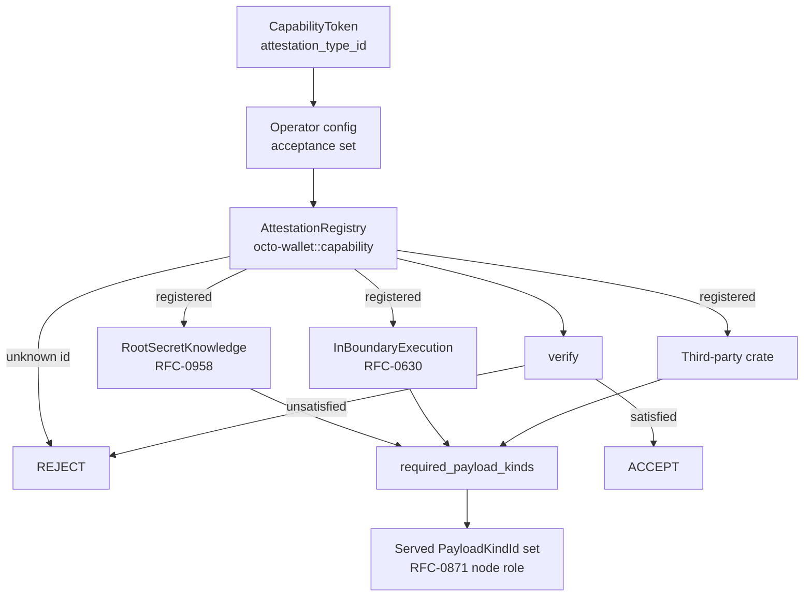

# RFC-0973 (Economics): Pluggable Proof Attestation for Capabilities

## Status

Draft

## Authors

- Author: @mmacedoeu

## Maintainers

- Maintainer: @mmacedoeu

## Summary

This RFC makes proof attestation a **pluggable, third-party extensible axis of
the capability substrate**. A capability declares _what it attests_ by a
128-bit attestation type id; the attestation is verified by a registered
`AttestationStrategy` implementation living in its own crate; and the node
operator chooses which strategies their node accepts and runs verifiers for.
The same mechanism carries both ZK-based capability types now being defined,
and any third-party attestation added later, without a central edit. It also
reconnects attestation to RFC-0871 §Node Role — Payload-Kind Declared: a
strategy declares which `PayloadKindId` UUIDs a node must serve in order to
produce a valid attestation, so "what is proven" and "who may prove it" stay
separate concerns.

## Dependencies

**Requires:**

- RFC-0957: Capability Token Format — this RFC **amends** its wire format to
  carry the attestation envelope, and declares that amendment here
- RFC-0871: Specialized Node Protocol Envelope — supplies `PayloadKindId` and the
  served-payload-kind notion a strategy declares its requirement against
- RFC-0958: ZK Capability Subclass — supplies the `root_secret_knowledge`
  reference strategy, and is **amended** by §Root-Secret Binding
- The capability registry, as a hard authorisation dependency. An accepted
  attestation carries no authority of its own; see §Security Considerations

**Optional:**

- RFC-0965: Capability Extension Format — this RFC applies its §Per-Extension
  Crate Layout to attestation strategies
- RFC-0008: execution-class taxonomy used by §Determinism Requirements

**Relationship to RFC-0630.** Proof-of-Inference supplies the _fact_ that
in-boundary execution attests — it is a consensus mechanism for inference, and
it does not itself define a capability, an attestation, or a macaroon. The
`in_boundary_execution` strategy adapts that fact to this interface; it is not a
re-implementation of it, and this RFC does not amend RFC-0630.

## Design Goals

| Goal | Target                                                                  | Metric                                                                    |
| ---- | ----------------------------------------------------------------------- | ------------------------------------------------------------------------- |
| G1   | Adding an attestation strategy requires 0 edits to `octo-wallet` core   | strategy crate PR touches no core file                                    |
| G2   | Unknown attestation id rejected, never downgraded                       | 100% of negative tests reject                                             |
| G3   | Operator acceptance set is fail-closed against what the node can verify | config naming an unregistered strategy refuses boot                       |
| G4   | Wallet can verify every capability minted before this RFC               | 100% of the historical token corpus, with byte-identical re-serialisation |
| G5   | Both reference strategies are instances, not special cases              | 2 strategy crates implementing one trait, one registry                    |
| G6   | Operator can select non-attested operation without a core change        | config-driven, unit-tested                                                |
| G7   | A strategy can state its admission cost and soundness                   | profile present and derived for circuit-backed strategies                 |

## Motivation

**A proof is a general way to establish a fact without revealing the witness,
not one authorization mechanism.** RFC-0871's envelope carries
`Authorization::Proof(ProofBundle)` alongside `Signature`, `Capability`, and
`ThresholdSignature`. Reading the ZK subclass through that variant makes it look
like a fourth way to say "you may do this". It is not. What is coming is a
general proving substrate whose instances happen to include knowledge of a
macaroon root secret and attestation that an inference ran inside the protocol
boundary, and whose third instance will be written by someone outside this
repository. A mechanism that treats the first two as special cases will have to
be renegotiated for the third.

**The current shape caps extensibility at a closed vocabulary.**
`CapabilityClass { V1, ZKBearing }` is a two-variant enum, so a third kind of
proof is a central edit plus a cross-crate review — the exact cost CLAUDE.md's
"Extension over enumeration (no central enums)" exists to avoid. That enum was
also mirrored across crates in more than one place before being converged, which
is what that cost looks like in practice. It answers _what an issuer produced_,
which stays useful as a mint-time and storage taxonomy, and should stop being the
answer to _what the proof establishes_.

**Node specialization already solved its half of this.** RFC-0871 §Node Role —
Payload-Kind Declared makes a node's role the set of `PayloadKindId` UUIDs it
serves, precisely so no role enum constrains future nodes. An attestation
strategy can declare the payload kinds required to produce a valid attestation,
which links the two axes without reintroducing a role taxonomy. RFC-0009 removed
its role enum from its specification on the same reasoning, though the wallet
still retains the enumeration as a mint-time gate; that residue is recorded in
§Implementation Phases rather than presented as settled.

**Operators must be able to choose, and the choice must be checkable.** A node
that accepts an attestation it cannot verify is worse than one that rejects it:
the operator's configuration becomes an unauditable claim rather than a
decision.

## Roles and Authorities

| Actor                 | Identifier            | Authority scope                                                  | Lifecycle                 |
| --------------------- | --------------------- | ---------------------------------------------------------------- | ------------------------- |
| Core maintainer       | repo commit identity  | Allocates RFC-range attestation ids; owns the trait and registry | per PR                    |
| Strategy crate author | crate + registry key  | Implements and registers one strategy; may not modify core       | per crate release         |
| Node operator         | node config signature | Chooses the acceptance set for the node they operate             | per node, re-read at boot |
| Issuer                | holder DID            | Chooses the attestation when minting a capability                | per mint                  |
| Verifier              | node DID              | Executes a registered strategy against an attestation            | per verification          |

**Authority boundaries that MUST NOT be crossed:**

- An operator may restrict the acceptance set. An operator may **not** name a
  strategy the node cannot verify.
- A strategy crate author may claim an id in the RFC range only via a core
  allocation. User-range ids are self-allocated and fail closed on any node that
  has not registered them.
- No actor may weaken a verification outcome. Registry misses, unknown ids, and
  absent attestations are rejections, never downgrades.

## Specification

### System Architecture



### Data Structures

**Attestation type id.** A 128-bit value carried on any capability that
declares an attestation.

```text
attestation_type_id: 16 bytes
    RFC range   : 0x0000_0000_0000_0000 - 0x7FFF_FFFF_FFFF_FFFF  (core-allocated)
    user range  : 0x8000_0000_0000_0000 - 0xFFFF_FFFF_FFFF_FFFF  (self-allocated)
```

Unknown in either range means reject. The user range is a naming convenience,
not a bypass; its values are equally subject to registry lookup.

**Names that collide in the current substrate.** Three distinct 32-byte values
are already called `cap_root_hash` in this codebase, and the binding relation
below is only correct for one of them. This RFC uses unambiguous names and
requires implementations to.

| Name used here                    | Derivation                                        | Where it lives                               |
| --------------------------------- | ------------------------------------------------- | -------------------------------------------- |
| `macaroon_root_secret_hash`       | `BLAKE3(root_secret)`                             | macaroon field, covered by the capability id |
| `capability_id`                   | `BLAKE3(0x05 ‖ canonical_ser_unsigned(macaroon))` | macaroon field, registry primary key         |
| `cap_root_hash` (ZK public input) | supplied per proof                                | ZK circuit public inputs                     |

The circuit's existing `cap_root_hash_lo`/`_hi` public inputs are populated in
the **capability-id** sense, not the root-secret-hash sense. They are therefore
**not** the target of §Root-Secret Binding and MUST NOT be rebound to it; an
implementation that binds the relation against those fields asserts a
preimage nobody holds. The binding target is `macaroon_root_secret_hash`,
carried as its own public inputs.

**Attestation payload.** The attestation id names a strategy; the attestation
itself is an opaque, strategy-defined byte string whose encoding belongs to the
strategy crate. Its envelope — how it is carried on the wire, and whether it
rides the existing optional proof-bundle segment of the token — is declared by
this RFC as an **amendment to the RFC-0957 wire format**, because the token
envelope cannot carry an extension-bearing field without one. A token carries
either an absent marker or exactly one `(attestation_type_id, payload)` pair;
there is no third state in which a token claims an attestation class but names
no strategy.

**Capability class is not a wire field.** The capability class is a
storage-projection and mint-time taxonomy, not a field on the token; the token's
wire form carries presence of an attestation, not a class enumeration. This RFC
does not add a class field and does not read one during dispatch. Where the
class matters — which mint paths may produce an attested token — that is a
mint-time rule, not a verification-time one.

**Strategy trait.**

```rust
pub trait AttestationStrategy: Send + Sync {
    /// Stable 128-bit discriminator, RFC-allocated or user range.
    fn type_id(&self) -> AttestationTypeId;

    /// Verify an attestation against a capability. Pure function of
    /// (capability, attestation, context): same inputs, same outcome on
    /// every node, or verification is non-deterministic across the fleet.
    fn verify(&self, ctx: &AttestationVerifyCtx<'_>) -> Result<AttestationOutcome, AttestationError>;
}

/// Optional companion: what a node must serve, and what admitting this
/// strategy costs. Not every attestation is a circuit proof, so neither the
/// payload-kind requirement nor the circuit budget is mandatory.
pub trait AttestationAdmission {
    /// Payload kinds a node must serve to produce a valid attestation.
    /// Empty means the strategy imposes no deployment requirement.
    fn required_payload_kinds(&self) -> &[PayloadKindId] {
        &[]
    }

    /// Whether verification (as distinct from production) needs a node that
    /// serves the required kinds.
    ///
    /// There is no default. A strategy that does not implement this trait
    /// declares no requirement, which is fail-open by construction; a strategy
    /// that does implement it MUST state the answer explicitly, because the
    /// dispatch step that consults it is a rejection gate and a defaulted
    /// `false` would silently skip it.
    fn verifier_needs_producing_kinds(&self) -> bool;

    /// Advertised admission facts, for budget and headroom checks. Absent for
    /// strategies that have no circuit cost, such as a MAC-based attestation.
    fn admission_profile(&self) -> Option<AdmissionProfile> {
        None
    }
}

/// Budget facts a strategy states so a node can refuse to admit it rather than
/// discovering at mint time that it has no headroom.
pub struct AdmissionProfile {
    /// In-circuit cost in CASM words, where the attestation is a circuit proof.
    pub casm_cost_hint_words: u32,
    /// Security the attestation actually carries, derived from prover
    /// parameters. A value asserted without a derivation is not admissible:
    /// the label must follow from the parameters, not precede them.
    pub security_bits: u32,
}
```

**Verification context.** `AttestationVerifyCtx` is a borrow-only view carrying
the capability under verification, the attestation bytes, and any read-only
policy handle a strategy needs. It MUST NOT carry a concrete storage type.
Strategies that need registry or catalog access receive an injected
`&dyn` trait, never a concrete substrate handle, so a strategy crate does not
acquire a storage dependency it has no use for.

**Outcome.** `AttestationOutcome` is `Satisfied` or `Unsatisfied`, plus an
optional machine-readable reason for the rejection that is safe to log. It is
never `Satisfied` on an unresolved or skipped check — see §Root-Secret Binding
for why the currently-circuited attestation establishes nothing.

**Reference strategies shipped by this RFC.**

| Strategy                | Establishes                                                      | Source   | Circuit cost                                   | Notes                                       |
| ----------------------- | ---------------------------------------------------------------- | -------- | ---------------------------------------------- | ------------------------------------------- |
| `root_secret_knowledge` | the bearer knows the macaroon root secret, without disclosing it | RFC-0958 | unmeasured — see §Root-Secret Binding          | one BLAKE3 hop over the secret              |
| `in_boundary_execution` | the attested inference ran inside the protocol boundary          | RFC-0630 | unmeasured; deferred to the implementing crate | proof-of-inference trace bound to the token |

Both are instances of one mechanism. A third-party strategy is a third row, not
a code change.

**No cost figure is claimed for either strategy.** An earlier draft of this RFC
carried a measured word count that turned out to describe a commitment to the
root secret the token already contains, not the binding below. Until a word
count is measured on the actual program, the honest entry is "unmeasured". The
deferral for the second strategy names its owner in §Performance Targets.

#### Root-Secret Binding

`root_secret_knowledge` proves exactly one relation:

```text
    the witness contains s  such that  BLAKE3(s) == macaroon.root_secret_hash
```

`root_secret_hash` is an existing public field of the RFC-0957 macaroon, already
covered by the capability id, so the binding needs **no new commitment and no
second hash primitive**. It does require the BLAKE3 permutation to be computed
**inside** the circuit; see the invariant below.

**This relation is not established today.** The current circuit computes a
Poseidon commitment over the witness and asserts only that it is non-zero, which
any witness satisfies. A conformance test pins exactly that absence by proving
successfully with an unrelated secret. Until that test is inverted, no
`root_secret_knowledge` attestation may be registered, and an operator node MUST
refuse boot if the strategy appears in its acceptance set. The strategy ships
disabled; registration is Phase 3 work.

**The BLAKE3 hop MUST be executed by constrained program logic.** An
attestation whose digest is supplied to the circuit — as a private witness, a
prover-side precomputation, or a hint — is forgeable by construction: the
proposer supplies both an arbitrary secret and the public digest, and every
check passes. This is not hypothetical; the current circuit has no in-circuit
hash of the root secret at all, and the substrate carries a documented history of
a stub satisfying a cryptographic-sounding check by a non-zero comparison. Any
design where the digest is an input rather than a computed result is rejected.

**The cost is unmeasured, and the primitive is not yet available in-circuit.**
The in-circuit BLAKE3 module is test-gated with no production call site, and it
exposes only keyed-hash and HMAC entry points — there is no unkeyed hash
function, which is what this relation requires. BLAKE3 over felt-constrained
words is not a field-native operation and its word cost is not comparable to the
Poseidon figure that motivated the earlier draft. §Performance Targets resolves
this by re-deriving the ceiling rather than preserving it; if the measured cost
of an unkeyed BLAKE3 hop is judged unacceptable, the primitive is a legitimate
thing to revisit, and that decision is recorded wherever it is taken.

**What is deliberately NOT bound.** A capability macaroon has three
secret-dependent values: `root_secret_hash`, `root_id`, and `chain[0]`. Only the
first is in-circuit. `root_id` and `chain[0]` are distinct derivations over the
mint nonce — `root_id` uses the raw nonce, `chain[0]` prefixes a domain string —
and **the nonce is deliberately unrecoverable**: it is consumed at mint and never
serialized, because a recoverable nonce would let a bearer regenerate `root_id`
and defeat the replay dedup keyed on it. Binding either value in-circuit would
require publishing the nonce, trading a live protection for a redundant second
check. That is rejected, not deferred.

**`chain[0]` is an assumed root, not a derived one.** RFC-0957's signature
verification seeds its running capability-id hasher with `chain[0]` taken from
the struct and never re-derives it; the chain's integrity runs forward from an
unverified anchor. This RFC does not change that. It is recorded so the
attestation is not read as anchoring the chain: the proof shows possession of the
root secret, while the chain remains anchored to an assumed `chain[0]`.

**Scope of the claim.** This is authentication of _possession_, not
_authorization_. Satisfying it requires knowing the root secret — which any
compromise of that secret, or any legitimate bearer, provides. No node should
treat an accepted `root_secret_knowledge` attestation as evidence that the bearer
is the issuer, or as authority beyond what the capability's own caveats permit.

`root_secret_hash` is the **only** field in this token family that is a plain
unkeyed BLAKE3 hash with no domain prefix. The capability id, the root id, and
the chain root are all domain-separated. This is wire-format-frozen: changing
how `root_secret_hash` is computed invalidates every issued capability, because
the value is covered by the capability id and by the registry primary key. Any
work under this RFC that touches that derivation MUST preserve byte-compatibility
or be an explicit, separately-recorded breaking change.

**Truncation.** `root_id` is a 16-byte truncation of a keyed hash — 128 bits.
It is a replay-dedup key and MUST NOT be used as a binding commitment; doing so
would drop the attestation's soundness floor to 128 bits. The binding target is
the full 32-byte `root_secret_hash`.

### Algorithms

**Fail-closed dispatch.**

```text
verify_capability_attestation(token, node, registry):
    0. if registry.lookup(token.capability_id) is absent or not active:
          -> REJECT   # authorisation precedes attestation; see §Security Considerations
    1. attestation_id = token.attestation_type_id
       if absent:
          -> run the RFC-0957 macaroon path, then ACCEPT on its own terms
       # an id present on a token means the token is attested, and an attested
       # token is never verified by the unattested path
    2. if attestation_id not in node.accept_set:
          -> REJECT   # operator does not accept this strategy here
    3. strategy = registry.resolve(attestation_id)
       if unresolved -> REJECT   # includes user-range ids never registered
    4. admission = strategy.admission()
       if admission.required_payload_kinds is non-empty:
          if not node.serves_all(admission.required_payload_kinds)
             -> REJECT
       if admission.verifier_needs_producing_kinds():
          if not node.serves_all(admission.required_payload_kinds)
             -> REJECT
    5. outcome = strategy.verify(ctx{capability, attestation, policy})
       if unsatisfied -> REJECT, with a reason
    -> ACCEPT
```

Step 0 is load-bearing and is not an optimization. Steps 1–5 can be satisfied by
an attacker who minted their own capability; only step 0 makes acceptance mean
anything.

Step 3 is load-bearing for a different reason: the operator's acceptance set is
intersected with what the node can actually verify, so a config naming an
unregistered strategy fails at boot rather than at redemption.

Step 1 has no attested-class exception. A token carrying an attestation id is
attested, full stop; it never falls back to the macaroon path, and a token
without one is never accepted on the strength of an attestation it does not
carry.

**Boot-time policy validation.**

```text
validate_policy(policy, registry):
    for strategy_id in policy.accept_set:
        if not registry.contains(strategy_id):
            -> FAIL TO START, naming the offending id
```

### Lifecycle Requirements

1. A strategy crate MUST implement `AttestationStrategy`, implement
   `AttestationAdmission` if it declares any payload-kind requirement, and
   register in an `init` path. Core MUST NOT be edited to add one.
2. A node MUST validate its operator policy at boot and refuse to start on an
   unresolvable acceptance entry.
3. A verifier MUST reject, never downgrade, on an unknown id, an unresolved
   strategy, a strategy that is disabled because its relation is not yet
   established, a capability absent from the registry, or a policy mismatch.
4. **Attenuation MUST NOT strip an attestation silently.** A child of an
   attested parent either carries an attestation or is rejected at verification;
   it never takes the unattested path merely because attenuation did not
   re-attest it. Attenuation derives an independent root secret from its parent,
   so an attestation over the parent's root secret says nothing about the
   child's — a rule that holds in core regardless of which strategy is in play.
5. Back-compat MUST preserve readability of every capability minted before this
   RFC. A capability carrying no attestation takes the macaroon path, and its
   canonical form MUST NOT change as a result of this RFC.
6. Strategy implementations MUST be deterministic functions of their inputs.
7. A node MUST advertise its acceptance set in its node metadata, so that a peer
   relying on "this node verifies attestations" can detect a node that accepts
   none. A strategy that is registered but not yet established is excluded from
   that advertisement, so a node cannot claim to verify what it cannot.
8. The registration host MUST be a binary or node crate. A Layer-B core crate
   MUST NOT depend on a Layer-E strategy crate to discover it.
9. Deferral of any mission gated on a Draft dependency is user-initiated only.

### Determinism Requirements

Registry resolution is a pure lookup on a stable 128-bit key. Verification
outcomes are a pure function of (capability, attestation, context). RFC-0008
class: strategy **selection** by an operator is Class C (operator-local
discretion); strategy **verification** is Class A (consensus-adjacent, because
it decides acceptance of a monetary claim).

### RFC-0008 Execution Class Mapping

| Component                         | Class | Reason                                 |
| --------------------------------- | ----- | -------------------------------------- |
| Registry resolution               | A     | Pure lookup on a stable key            |
| Attestation verification          | A     | Decides acceptance of a monetary claim |
| Operator acceptance-set selection | C     | Operator-local, non-consensus          |

## Performance Targets

Registry resolution <1µs. Verification cost is the strategy's own.
`AdmissionProfile` lets a node refuse to admit a strategy it has no budget or
headroom for, rather than discovering it at mint time.

**The circuit ceiling is a budget this project sets, not an external limit.** A
budget fixed while the circuit proved nothing is not a target worth preserving; it
encodes the cost of the absence of the binding. When a strategy's binding
requires more words than an earlier no-op ceiling allowed, the correct response is
to re-derive the ceiling from the algorithm, not to select a weaker primitive that
happens to fit. Every change to a ceiling is an explicit, recorded decision with
its rationale.

**The cost of the `root_secret_knowledge` relation is currently unknown.** The
in-circuit BLAKE3 module has no production call site and exposes no unkeyed hash
function, so the figure has never been measured on the real program. Owning the
measurement is Phase 3; until it exists, the strategy table states "unmeasured"
rather than an estimate. The same applies to `in_boundary_execution`, whose
measurement is deferred to the crate that will implement it — that crate's owner,
not this RFC, carries the deferral.

## Error Handling

Every rejection is fail-closed and distinguishable to the operator. No rejection
reason is silently coerced into acceptance, and none is logged with the
underlying attestation bytes.

| Condition                               | Result                    | Operator-visible reason                      |
| --------------------------------------- | ------------------------- | -------------------------------------------- |
| Capability absent from the registry     | REJECT at dispatch step 0 | unknown or inactive capability               |
| Attestation id absent                   | macaroon path             | none — this is the normal unattested case    |
| Attestation id not in acceptance set    | REJECT at step 2          | strategy not accepted here                   |
| Strategy id unresolved                  | REJECT at step 3          | unknown strategy id                          |
| Required payload kinds not served       | REJECT at step 4          | node does not serve the required kinds       |
| Verification unsatisfied                | REJECT at step 5          | strategy-supplied reason, safe to log        |
| Strategy registered but not established | REJECT at boot            | strategy is not yet verifiable on this build |
| Panic in `verify` (unwinding build)     | REJECT                    | strategy panicked                            |

Panic containment holds only for Rust panics under an unwinding build. A fault
raised inside the native prover or verifier is a process-level event that no
caller-side handler can convert into a rejection; that boundary is owned by the
verifier's FFI layer, not by this dispatch.

## Implicit Assumptions Audit

| Assumption                                               | Where relied upon       | Blast radius if false                                                              | Mitigation / status                                                                          |
| -------------------------------------------------------- | ----------------------- | ---------------------------------------------------------------------------------- | -------------------------------------------------------------------------------------------- |
| A strategy can name its own circuit cost                 | `AdmissionProfile`      | Admission control is advisory only                                                 | Optional profile; strategies with no circuit cost state nothing and are valid                |
| Verifier-side checking never needs more than prover-side | `AttestationAdmission`  | A node could verify something it could not have produced                           | No default; a strategy that declares a requirement must state the verifier answer explicitly |
| Determinism holds across independent implementations     | `verify`                | Two nodes disagree on the same attestation                                         | Pure-function requirement is an acceptance criterion, not a comment                          |
| An operator configures in good faith                     | operator policy         | Self-DoS at most                                                                   | Accepted: an operator weakening its own node harms its customers, not others                 |
| The capability is already registry-authorised            | every acceptance        | Attestation would be self-authorising and worthless (see §Security Considerations) | Named as a **Requires** dependency; dispatch cannot reach ACCEPT without it                  |
| A circuit attestation computes its own digest            | `root_secret_knowledge` | Attestation forgeable by construction                                              | Normative invariant in §Root-Secret Binding; any digest-as-input design rejected             |

## Security Considerations

**An accepted attestation is not an authorisation.** This is the single most
important property of the design and it is easy to read backwards. The proof
establishes that _someone_ knows a preimage of a value the token contains. It
establishes nothing about who that someone is.

The concrete consequence: an attacker can mint their own capability, compute its
root secret hash from a secret of their own choosing, and produce a perfectly
valid `root_secret_knowledge` attestation for it. Every step of the dispatch
algorithm passes. What stops that is not the proof — it is the **capability
registry**. A capability id that was never issued by an issuer is not present in
the registry, so the capability fails to resolve and is rejected before any
attestation is consulted.

Consequently the registry is a hard **Requires** dependency of this RFC, not an
adjacent subsystem. The dispatch MUST NOT be reachable in a configuration where
the capability has not already been resolved against the registry. An operator
who removes registry lookup has not weakened the node; they have removed the only
thing that made the attestation mean anything.

Two further limits follow, and neither is fixed by a better proof:

- The circuit does not bind the witness to a holder identity. The holder-signature
  sub-circuit is currently a structural placeholder rather than a verification, so
  nothing in the attested statement ties the witness to the token's holder. The
  attestation binds the witness to the **token** and to nothing else.
- Replay is not prevented by the attestation. There is no verifier challenge and
  no per-verification binding, so a valid attestation for a capability verifies
  against any node. Single-use semantics, if wanted, must come from the
  capability's own caveats and registry lifetime — never from the attestation.

Fail-closed is the second-order argument, not the first: a node that rejects
anything it cannot verify cannot be induced by **configuration** to accept a
forged attestation, because configuration cannot widen what the node can check.
Widening requires shipping the strategy, which is a code change and therefore
auditable. This holds for the strategy layer only; it says nothing about the
authorisation step, which is the registry's.

An operator may run a node that accepts no attestations at all. That is a real
permitted choice and a genuine weakening: such a node relies entirely on the
RFC-0957 macaroon path and inherits its custody properties. It must be visible
rather than silent — see A1.

## Adversarial Review

### Adversary Analysis

**A1 — Operator silently downgrades their node's assurance.** The operator sets
an acceptance set excluding every attested capability, and clients that assume
"this node verifies proofs" are not warned. _Impact:_ medium. _Mitigation:_ the
acceptance set is advertised in node metadata (Lifecycle Requirement 7), so a
mismatch is peer-detectable. A strategy that is registered but not established is
excluded from the advertisement, so a node cannot claim to verify what it cannot.

**A2 — Attestation id swapped between capabilities.** A holder pairs one
capability's id with another's attestation. _Impact:_ high if unspecified.
_Mitigation:_ the id participates in the capability canonical form, so presenting
an attestation under a different capability id yields a different binding target
and fails the strategy's check (TV15). Note that this is distinct from swapping
the id _on_ a token, which the canonical form covers; the mutation that matters
here is cross-capability replay of a whole attestation.

**A3 — Strategy registers an id already taken in the RFC range.** A user-range
id collides with a core allocation. _Impact:_ low; requires a crate already
trusted to run. _Mitigation:_ the allocation registry records which ids are
core-allocated, and registration rejects an RFC-range id absent from it. The
allocation procedure is core's to define; until it exists, an RFC-range id is
rejected unless a core allocation record names it.

**A4 — `verify` panics on adversarial attestation input.** _Impact:_ availability.
_Mitigation:_ `catch_unwind` at the dispatch boundary converts a Rust panic into
a rejection. This holds only under an unwinding build profile, and requires an
`AssertUnwindSafe` boundary because the trait holds shared references; an abort
build does not unwind and the mitigation silently does not apply. A fault inside
the native verifier is a process-level event outside any caller's reach.

**A5 — Strategy verification is non-deterministic.** Two nodes disagree on the
same attestation. _Impact:_ high; fork in acceptance. _Mitigation:_
determinism is an acceptance criterion and a trait requirement.

**A6 — Attestation stripped by attenuation.** An attested parent is attenuated to
an unattested child, which then takes the macaroon path as if it carried no
attestation. _Impact:_ high; a silent downgrade one step earlier than the
dispatch would catch. _Mitigation:_ Lifecycle Requirement 4 forbids it, and the
check is in core so it holds regardless of which strategy is registered (TV14).

**A7 — Binding target truncated to the 16-byte `root_id`.** A prover needs
knowledge of the root secret; a 128-bit commitment to it is materially weaker
than the 32-byte `root_secret_hash` and is not what the strategy specifies.
_Impact:_ medium; weakens rather than breaks. _Mitigation:_ the binding target is
fixed at the full-width `root_secret_hash` by §Root-Secret Binding, and
`root_id`'s truncated form is named there as unfit for this use so a later
"simplification" cannot quietly substitute it.

**A8 — Public-input ordering error in the calldata mirror.** The witness calldata
is built by a hand-maintained mirror of the circuit's input struct. A field
reordering or omission that still type-checks would produce a proof over
attacker-chosen public inputs, with every hash check internally consistent.
_Impact:_ high; silent. _Mitigation:_ the layout-mirror conformance test is an
acceptance criterion for any change to the input struct, not a test that merely
re-runs on the current shape. The related trap recorded in
`docs/architecture/zk-stwo-cairo-executable-recipe.md`, where declared and actual
builtins diverge, is the same failure mode and is covered by the same discipline.

**A9 — Attestation read as authorization.** An accepted
`root_secret_knowledge` attestation is treated as evidence the holder is the
issuer, or as authority beyond the capability's caveats. _Impact:_ medium;
policy error rather than a broken primitive. _Mitigation:_ §Root-Secret Binding
states the possession-not-authorization scope in the specification, so the limit
travels with the requirement rather than living only in review notes.

**A10 — Chain anchoring assumed from the attestation.** A node treats an accepted
`root_secret_knowledge` attestation as anchoring the caveat chain, because
`chain[0]` looks like a secret-derived value. It is not verified, before or
after this RFC. _Impact:_ medium; an over-claim about what was proved.
_Mitigation:_ stated explicitly in §Root-Secret Binding as an out-of-scope
known property, so no later document can inherit the stronger belief.

**A11 — Digest supplied to the circuit rather than computed by it.** The prover
passes the root-secret hash as a private witness alongside an arbitrary secret,
and every check passes because nothing relates the two. _Impact:_ critical; the
attestation is forgeable by construction. _Mitigation:_ the in-circuit-execution
requirement in §Root-Secret Binding makes this a normative prohibition, and it is
listed as an explicit assumption row in §Implicit Assumptions Audit. This is not
hypothetical — the current circuit performs no in-circuit hash of the root secret
at all.

**A12 — Attestation replayed against a capability under the same root secret.**
Two capabilities minted from one root secret share a binding target, so an
attestation valid for one satisfies the relation for the other. _Impact:_ medium;
requires secret reuse by the issuer. _Mitigation:_ an issuer MUST NOT reuse a
root secret across capabilities; the constraint is on minting, not on
verification, and the registry is the natural place to observe it.

**A13 — Holder identity inferred from an accepted attestation.** The attestation
is read as proving the bearer is the token's holder. The circuit binds the
witness to the token and to nothing else; the holder-signature sub-circuit is a
structural placeholder. _Impact:_ medium; policy error. _Mitigation:_ stated in
§Security Considerations, distinct from A9's authorization over-claim.

## Economic Analysis

No token emission changes. Attestation choice is a security posture decision
with no direct fee effect. Operators with heterogeneous requirements should not
be forced to uniform posture, which is the economic argument for operator
selection over a centrally-chosen default. `AdmissionProfile` is an
operator-visible input to that decision.

Admitting an attestation strategy has a real cost — verification work on every
redemption, and for a circuit strategy, prover and verifier time. An operator
choosing a posture is choosing that cost explicitly, which is the point of
surfacing it as an admission profile rather than leaving it implicit.

## Compatibility

Capabilities carrying no `attestation_type_id` take the macaroon path unchanged.
`CapabilityClass` keeps its two variants and its meaning as a mint-time and
storage-projection taxonomy. Consumers of the previously-divergent
`CapabilityClass` declarations import the converged type.

**The canonical form of an existing capability MUST NOT change.** The
attestation envelope is appended in a way that is byte-identical for a capability
that carries no attestation, and the fields it adds are appended after all
existing ones. An option field is encoded by omission, never as a null sentinel,
so that a capability minted before this RFC re-serialises to the same bytes and
the same capability id. Any change to that property is a wire break and is out
of scope for this RFC.

## Test Vectors

**TV1** — capability with no attestation id, present and active in the registry:
accepted on the macaroon path.

**TV2** — attested capability, registered strategy, in the acceptance set,
satisfying attestation, registry present: ACCEPT.

**TV3** — TV2 with a strategy id not in the registry: REJECT.

**TV4** — TV2 with a registered strategy outside the acceptance set: REJECT.

**TV5** — TV2 with the attestation payload absent: REJECT.

**TV6** — TV2 with an unsatisfying attestation: REJECT.

**TV7** — policy names an unregistered strategy: node refuses to start.

**TV8** — `verify` panics on adversarial input under an unwinding build: REJECT,
node survives. See A4 for the abort-build caveat.

**TV9** — historical capability corpus replayed: all accepted, and every
re-serialised capability id byte-identical to its pre-RFC value.

**TV10** — strategy declaring `verifier_needs_producing_kinds`, on a node not
serving the declared kinds: REJECT.

**TV11** — `root_secret_knowledge` with a witness whose secret hashes to the
capability's `root_secret_hash`, on a node where the strategy is established:
ACCEPT.

**TV12** — `root_secret_knowledge` with a witness whose secret does **not** hash
to `root_secret_hash`: REJECT. This vector is the exit criterion for the binding
work and is currently **failing**: the circuit asserts only that a commitment
over the witness is non-zero, so an unrelated secret proves successfully. Until
TV12 holds, the strategy is not registrable and an acceptance set naming it is a
boot failure, per §Root-Secret Binding.

**TV13** — a self-minted capability with a self-chosen root secret and a valid
`root_secret_knowledge` attestation, absent from the registry: REJECT at dispatch
step 0. This vector pins that the proof carries no authorisation of its own.

**TV14** — attested parent, attenuated to an unattested child: REJECT. The child
does not inherit its parent's attestation and does not fall back to the macaroon
path.

**TV15** — attestation for one capability presented with a different capability:
REJECT, because the binding target differs between the two tokens.

## Alternatives Considered

**Central enum `{V1, ZKBearing, RootSecretKnowledge, InBoundaryExecution, …}`.**
Rejected. Each additional attestation becomes a central edit plus a cross-crate
review, which is what CLAUDE.md's "Extension over enumeration (no central
enums)" exists to prevent, and what RFC-0871 G1 already rejected for node roles.

**One centrally-mandated attestation.** Rejected. It caps the proof vocabulary
at whatever the first design decided, which is precisely the constraint the two
ZK capability types are being built to escape.

**Treat ZK as one more `Authorization` variant.** Rejected as too narrow. It
models a proof as a way to say "you may do this", which cannot express "this
inference ran in-boundary" or any third-party attestation a stranger writes
next year.

**Operator-selectable by registry only, no strategy trait.** Rejected. Without a
trait there is no way for a node to state what it can verify, so the operator's
acceptance set cannot be checked against reality.

**Binding `root_id` or `chain[0]` by publishing the mint nonce.** Rejected. Both
are keyed hashes over the mint nonce, and the nonce's unrecoverability is the
mechanism protecting the replay dedup keyed on `root_id`. Publishing it to make
the circuit checkable would trade a live protection for a redundant second
binding, since `root_secret_hash` already commits to the same secret at full
width.

**Proving `root_secret` and `nonce` as private witness values.** Rejected. With
both secret, a prover may choose any nonce and derive the matching `root_id`, so
the constraint is satisfied by any knowledge of any root secret and carries no
per-token binding. It would look like a strengthening and be a weakening.

**A new Poseidon commitment field on the token.** Rejected for
`root_secret_knowledge`. Poseidon was attractive because it fit the previous
circuit ceiling at a low word count, but the macaroon already commits to the root
secret in the same primitive the rest of the format uses. A third commitment in a
second primitive buys a field to carry, a domain-separation obligation between
the two, and no additional security. This is a rejection of that _alternative_, not
a commitment to BLAKE3 as the only available primitive; see §Root-Secret Binding on
what remains open.

**Registering `root_secret_knowledge` before its relation holds.** Rejected. It
would let an operator configure a node to accept an attestation that establishes
nothing, and every acceptance would be a false positive. The strategy ships
disabled and is registrable only when TV12 passes.

## Implementation Phases

### Phase 1: Core

Land `AttestationTypeId`, the `AttestationStrategy` and `AttestationAdmission`
traits, and the fail-closed `AttestationRegistry` in `octo-wallet::capability`.
Extend the capability canonical form with the attestation envelope, appended after
all existing fields and omitted when absent, so an un-attested capability
re-serialises byte-identically. This phase declares the RFC-0957 wire amendment.

### Phase 2: Enhanced

Land the reference strategy crates — `octo-cap-zk` for
`root_secret_knowledge` and `octo-cap-poi` (new) for `in_boundary_execution` — as
disabled strategies with no registration entry. Land operator policy with
boot-time validation. Land the dispatch, including the registry lookup at step 0,
in the wallet verification path behind macaroon-path back-compat.

### Phase 3: Root-Secret Binding

For `root_secret_knowledge`:

1. Add `root_secret_hash` to the circuit's public inputs and assert the BLAKE3
   hop. This is a public-input change, not a token-format change.
2. Slim the in-circuit BLAKE3 module to the single-chunk path actually called. The
   module is currently test-gated; un-gating it in its present shape admits far
   more code than the one call requires.
3. Update the witness-calldata layout mirror and extend the layout conformance
   test to cover the new fields (A8). The same conformance discipline covers the
   related trap recorded in `docs/architecture/zk-stwo-cairo-executable-recipe.md`,
   where a mismatch between declared and actual builtins produces a proof over
   unintended inputs.
4. Re-derive the circuit ceiling from the resulting program and record the new
   figure with its rationale (§Performance Targets).
5. Invert the characterization test that pins the absent binding into a
   rejection test (TV12), and only then register the strategy.

### Phase 4: Cross-cutting substrate corrections

Out of scope for this RFC's own mechanism, and recorded here because they were
surfaced by its review and are prerequisites for a clean implementation:

- `NodeType` is retained in the wallet as the mint-time ZK gate and is keyed by a
  registry that exists only in tests. The role model this RFC links to treats it
  as a computed projection. Closing that gap is a separate change.
- `cap_root_hash` names three different values in the current substrate. See the
  table in §Data Structures. Renaming is a wire-affecting change and is not
  attempted here.

## Key Files to Modify

- `crates/octo-wallet/src/capability/` — trait, registry, dispatch, attenuation rule
- `crates/octo-cap-macaroon/src/macaroon.rs` — attestation envelope in the capability
  canonical form, appended and omitted when absent
- `crates/octo-cap-macaroon/src/holder_record.rs` — only if the storage projection
  must carry the id; it is not where the canonical form is computed
- `crates/octo-cap-zk/` — reference strategy 1 crate
- `crates/octo-cap-poi/` — reference strategy 2 crate (new)
- `crates/octo-wallet/Cargo.toml` — gains an `octo-protocol` dependency for
  `PayloadKindId` in the admission trait, and loses its direct `octo-cap-zk`
  dependency in favour of registration

Strategy crates are reached through registration only. A Layer-B core crate must
not name a Layer-E strategy crate, so the existing direct dependency is removed
rather than extended.

## Future Work

- Third-party attestation strategies registering without core edits (G1).
- RFC-0958 F7 recursive composition to close the proof-size gap, tracked there.
- An unkeyed in-circuit hash function; the current in-circuit module exposes only
  keyed entry points, which is what blocks §Root-Secret Binding.
- Replaying the admission-profile cost figures as measured values once Phase 3 has
  produced them, for the second strategy as well as the first.

## Version History

| Version | Date       | Change                                                                                                                                                                                                                                                                                                                                                                                                                                                                                                                                                                                                                                                                                                                                                                                                                                                                                                                                                                                                                                                                                                                                                                     |
| ------- | ---------- | -------------------------------------------------------------------------------------------------------------------------------------------------------------------------------------------------------------------------------------------------------------------------------------------------------------------------------------------------------------------------------------------------------------------------------------------------------------------------------------------------------------------------------------------------------------------------------------------------------------------------------------------------------------------------------------------------------------------------------------------------------------------------------------------------------------------------------------------------------------------------------------------------------------------------------------------------------------------------------------------------------------------------------------------------------------------------------------------------------------------------------------------------------------------------- |
| v0.1    | 2026-10-07 | Initial Draft. `AttestationStrategy` trait, fail-closed registry, operator acceptance set, two reference strategies. Rewritten from a narrower framing that treated proof attestation as an authorization mechanism.                                                                                                                                                                                                                                                                                                                                                                                                                                                                                                                                                                                                                                                                                                                                                                                                                                                                                                                                                       |
| v0.2    | 2026-10-07 | §Root-Secret Binding fixes the `root_secret_knowledge` relation to one BLAKE3 hop against the existing `root_secret_hash`, after the earlier +78-word field-native figure was found to describe a commitment to the same secret already present in the token. Records that `root_id` and `chain[0]` are unbindable without exposing the mint nonce, that `chain[0]` is an assumed rather than derived root, and that the claim is possession not authorization (A7–A10). §Performance Targets records that the circuit ceiling is a project-set budget to be re-derived from the algorithm rather than a limit that dictates the primitive.                                                                                                                                                                                                                                                                                                                                                                                                                                                                                                                                |
| v0.3    | 2026-10-07 | Multi-round adversarial review, five lenses, all findings resolved. Corrects three claims that the code contradicts: the attestation relation is **not** established today (the circuit asserts only that a witness commitment is non-zero, and a conformance test proves an unrelated secret succeeds), the circuit already has `cap_root_hash` public inputs which are **not** the binding target, and the mint path currently discards the witness rather than proving it. Adds the registry as a hard authorisation dependency after establishing that a self-minted capability satisfies the relation unaided, and that only the registry lookup rejects it. Splits the fat strategy trait, removing a fail-open default on a rejection gate. Adds an attenuation rule so a child cannot silently lose an attestation. Declares the RFC-0957 wire amendment and the back-compat encoding it depends on. Adds the attestation payload envelope, which the previous draft never specified. Adds §Error Handling. Retargets §Key Files at the capability canonical form rather than the storage projection. Removes the duplicated §Rationale and execution-class table. |

## Related RFCs

- RFC-0008: execution-class taxonomy
- RFC-0630: Proof of Inference — source of the in-boundary execution fact
- RFC-0871: Specialized Node Protocol Envelope
- RFC-0957: Capability Token Format — **amended** by this RFC
- RFC-0958: ZK Capability Subclass — **amended** by this RFC
- RFC-0965: Capability Extension Format — crate layout for strategy crates

## Related Use Cases

- [Pluggable Proof Attestation for Capabilities](../../../docs/use-cases/pluggable-proof-attestation-for-capabilities.md)
