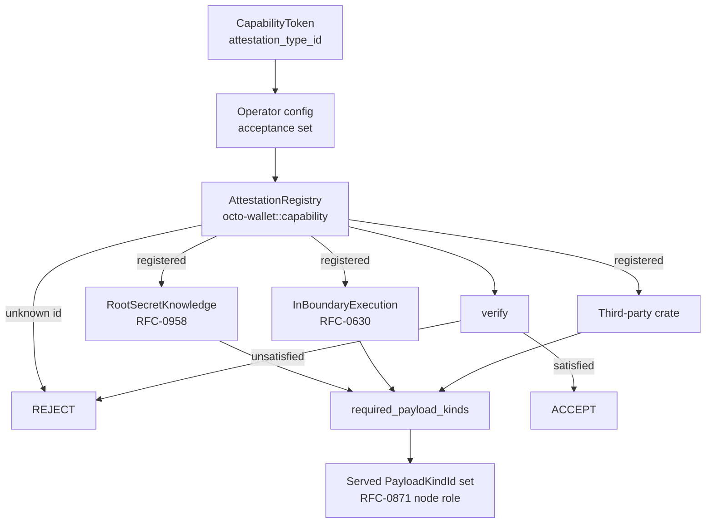

# RFC-0973 (Economics): Pluggable Proof Attestation for Capabilities

## Status

Draft

## Authors

- Author: @mmacedoeu

## Maintainers

- Maintainer: @mmacedoeu

## Summary

This RFC makes proof attestation a **pluggable, third-party extensible axis of
the capability substrate**. A capability declares _what it attests_ by a
128-bit attestation type id; the attestation is verified by a registered
`AttestationStrategy` implementation living in its own crate; and the node
operator chooses which strategies their node accepts and runs verifiers for.
The same mechanism carries both ZK-based capability types now being defined,
and any third-party attestation added later, without a central edit. It also
reconnects attestation to the node-role model RFC-0871 adopted on 2026-10-07: a
strategy declares which `PayloadKindId` UUIDs a node must serve in order to
produce a valid attestation, so "what is proven" and "who may prove it" stay
separate concerns.

## Dependencies

**Requires:**

- RFC-0957: Capability Token Format
- RFC-0871: Specialized Node Protocol Envelope

**Optional:**

- RFC-0958: ZK Capability Subclass — supplies the root-secret-knowledge reference strategy
- RFC-0630: Proof of Inference — supplies the in-boundary execution reference strategy
- RFC-0965: Capability Extension Format — this RFC applies its §Per-Extension Crate Layout to attestation strategies

## Design Goals

| Goal | Target                                                                  | Metric                                                   |
| ---- | ----------------------------------------------------------------------- | -------------------------------------------------------- |
| G1   | Adding an attestation strategy requires 0 edits to `octo-wallet` core   | strategy crate PR touches no core file                   |
| G2   | Unknown attestation id rejected, never downgraded                       | 100% of negative tests reject                            |
| G3   | Operator acceptance set is fail-closed against what the node can verify | config naming an unregistered strategy refuses boot      |
| G4   | Wallet can verify every capability minted before this RFC               | 100% of the historical token corpus                      |
| G5   | Both ZK capability types are instances, not special cases               | 2 reference strategies registered                        |
| G6   | Operator can select non-attested operation without a core change        | config-driven, unit-tested                               |
| G7   | A strategy can state its in-circuit cost and soundness                  | fields present and populated by every reference strategy |

## Motivation

**A proof is a general way to establish a fact without revealing the witness,
not one authorization mechanism.** RFC-0871's envelope carries
`Authorization::Proof(ProofBundle)` alongside `Signature`, `Capability`, and
`ThresholdSignature`. Reading the ZK subclass through that variant makes it look
like a fourth way to say "you may do this". It is not. What is coming is a
general proving substrate whose instances happen to include knowledge of a
macaroon root secret and attestation that an inference ran inside the protocol
boundary, and whose third instance will be written by someone outside this
repository. A mechanism that treats the first two as special cases will have to
be renegotiated for the third.

**The current shape caps extensibility at a closed vocabulary.**
`CapabilityClass { V1, ZKBearing }` is a two-variant enum, so a third kind of
proof is a central edit plus a cross-crate review — the exact cost CLAUDE.md's
"Extension over enumeration (no central enums)" exists to avoid. It was also
redeclared in three crates before being converged, which is what that cost
looks like in practice. It answers _whether a proof is present_, which stays
useful as a coarse wire discriminator, and should stop being the answer to
_what the proof establishes_.

**Node specialization already solved its half of this.** RFC-0871 §Node Role —
Payload-Kind Declared makes a node's role the set of `PayloadKindId` UUIDs it
serves, precisely so no role enum constrains future nodes. An attestation
strategy can declare the payload kinds required to produce a valid attestation,
which links the two axes without reintroducing a role taxonomy. RFC-0009's
`NodeType` enum was removed on 2026-10-07 for the same reason.

**Operators must be able to choose, and the choice must be checkable.** A node
that accepts an attestation it cannot verify is worse than one that rejects it:
the operator's configuration becomes an unauditable claim rather than a
decision.

## Roles and Authorities

| Actor                 | Identifier            | Authority scope                                                  | Lifecycle                 |
| --------------------- | --------------------- | ---------------------------------------------------------------- | ------------------------- |
| Core maintainer       | repo commit identity  | Allocates RFC-range attestation ids; owns the trait and registry | per PR                    |
| Strategy crate author | crate + registry key  | Implements and registers one strategy; may not modify core       | per crate release         |
| Node operator         | node config signature | Chooses the acceptance set for the node they operate             | per node, re-read at boot |
| Issuer                | holder DID            | Chooses the attestation when minting a capability                | per mint                  |
| Verifier              | node DID              | Executes a registered strategy against an attestation            | per verification          |

**Authority boundaries that MUST NOT be crossed:**

- An operator may restrict the acceptance set. An operator may **not** name a
  strategy the node cannot verify.
- A strategy crate author may claim an id in the RFC range only via a core
  allocation. User-range ids are self-allocated and fail closed on any node that
  has not registered them.
- No actor may weaken a verification outcome. Registry misses, unknown ids, and
  absent attestations are rejections, never downgrades.

## Specification

### System Architecture



### Data Structures

**Attestation type id.** A 128-bit value carried on any capability that
declares an attestation.

```text
attestation_type_id: 16 bytes
    RFC range   : 0x0000_0000_0000_0000 - 0x7FFF_FFFF_FFFF_FFFF  (core-allocated)
    user range  : 0x8000_0000_0000_0000 - 0xFFFF_FFFF_FFFF_FFFF  (self-allocated)
```

Unknown in either range means reject. The user range is a naming convenience,
not a bypass; its values are equally subject to registry lookup.

**Capability class, unchanged in role.** `CapabilityClass { V1, ZKBearing }` is
retained as the coarse wire discriminator for whether an attestation is present,
and is explicitly **not** the extensibility axis. It is declared once, in
`octo_cap_macaroon` (RFC-0206 §Layer B), and re-exported by consumers.

**Strategy trait.**

```rust
pub trait AttestationStrategy: Send + Sync {
    /// Stable 128-bit discriminator, RFC-allocated or user range.
    fn type_id(&self) -> AttestationTypeId;

    /// Payload kinds a node must serve to produce a valid attestation
    /// (RFC-0871 §Node Role — Payload-Kind Declared).
    fn required_payload_kinds(&self) -> &[PayloadKindId];

    /// Whether this strategy's attestation may be verified by a node that
    /// does not itself serve the required kinds (verifier-side checking
    /// needs less than prover-side production).
    fn verifier_needs_producing_kinds(&self) -> bool {
        false
    }

    /// Advertised in-circuit cost, for admission control and AC-4 budgeting.
    fn casm_cost_hint_words(&self) -> u32;

    /// Security bits the attestation actually carries, not the label.
    fn security_bits(&self) -> u32;

    /// Verify an attestation against a capability. Pure function of
    /// (capability, attestation, context): same inputs, same outcome on
    /// every node, or verification is non-deterministic across the fleet.
    fn verify(&self, ctx: &AttestationVerifyCtx<'_>) -> Result<AttestationOutcome, AttestationError>;
}
```

**Reference strategies shipped by this RFC.**

| Strategy                | Establishes                                                              | Source   | Circuit cost                                | Notes                                         |
| ----------------------- | ------------------------------------------------------------------------ | -------- | ------------------------------------------- | --------------------------------------------- |
| `root_secret_knowledge` | the holder knows the root secret behind the token, without disclosing it | RFC-0958 | **+78 CASM words** (field-native, measured) | the field at issue in RFC-0958 §Desired State |
| `in_boundary_execution` | the attested inference ran inside the protocol boundary                  | RFC-0630 | measured separately                         | trace fold plus PoI binding                   |

Both are instances of one mechanism. A third-party strategy is a third row, not
a code change.

### Algorithms

**Fail-closed dispatch.**

```text
verify_capability_attestation(token, node):
    1. strategy_id = token.attestation_type_id
       if absent:
           if token.class == V1:
               -> run the V1 macaroon path (RFC-0957)
           else:
               -> REJECT   (class says attested, but no strategy named)
    2. if strategy_id not in node.accept_set:
       -> REJECT   (operator does not accept this strategy here)
    3. strategy = registry.resolve(strategy_id)
       if unresolved -> REJECT   # includes user-range ids never registered
    4. if strategy.verifier_needs_producing_kinds():
       if node.served_payload_kinds does not contain every kind
          in strategy.required_payload_kinds() -> REJECT
    5. outcome = strategy.verify(capability, attestation)
       if unsatisfied -> REJECT
    -> ACCEPT
```

Step 3 is load-bearing: the operator's acceptance set is intersected with what
the node can actually verify, so a config naming an unregistered strategy fails
at boot rather than at redemption.

**Boot-time policy validation.**

```text
validate_policy(policy, registry):
    for strategy_id in policy.accept_set:
        if not registry.contains(strategy_id):
            -> FAIL TO START, naming the offending id
```

### Lifecycle Requirements

1. A strategy crate MUST implement `AttestationStrategy` and register in an
   `init` path. Core MUST NOT be edited to add one.
2. A node MUST validate its operator policy at boot and refuse to start on an
   unresolvable acceptance entry.
3. A verifier MUST reject, never downgrade, on unknown id, unresolved
   strategy, absent attestation where the class requires one, or policy
   mismatch.
4. Migration MUST preserve readability of every capability minted before this
   RFC. Tokens without an attestation id take the V1 path.
5. Strategy implementations MUST be deterministic functions of their inputs.
6. Deferral of any mission gated on a Draft dependency is user-initiated only.

### Determinism Requirements

Registry resolution is a pure lookup on a stable 128-bit key. Verification
outcomes are a pure function of (capability, attestation, context). RFC-0008
class: strategy **selection** by an operator is Class C (operator-local
discretion); strategy **verification** is Class A (consensus-adjacent, because
it decides acceptance of a monetary claim).

### RFC-0008 Execution Class Mapping

| Component                         | Class | Reason                                 |
| --------------------------------- | ----- | -------------------------------------- |
| Registry resolution               | A     | Pure lookup on a stable key            |
| Attestation verification          | A     | Decides acceptance of a monetary claim |
| Operator acceptance-set selection | C     | Operator-local, non-consensus          |

## Performance Targets

Registry resolution <1µs. Verification cost is the strategy's own.
`casm_cost_hint_words` and `security_bits` let a node refuse to admit a strategy
it has no budget or headroom for, rather than discovering it at mint time.

## Implicit Assumptions Audit

| Assumption                                               | Risk if false                                            | Mitigation                                                                                           |
| -------------------------------------------------------- | -------------------------------------------------------- | ---------------------------------------------------------------------------------------------------- |
| A strategy can name its own circuit cost                 | Admission control is advisory only                       | Field is required, not defaulted; strategies that cannot state it are out of scope                   |
| Verifier-side checking never needs more than prover-side | A node could verify something it could not have produced | `verifier_needs_producing_kinds` exists for the case where it does; strategies needing it declare it |
| Determinism holds across independent implementations     | Two nodes disagree on the same attestation               | Pure-function requirement is an acceptance criterion, not a comment                                  |
| An operator configures in good faith                     | Self-DoS at most                                         | Accepted: an operator weakening its own node harms its customers, not others                         |

## Security Considerations

Fail-closed is the whole argument. A node that rejects anything it cannot
verify cannot be induced to accept a forged attestation by configuration,
because configuration cannot widen what the node is capable of checking.
Widening requires shipping the strategy, which is a code change and therefore
auditable.

An operator may run a node that accepts no attestations at all. That is a real
permitted choice and a genuine weakening: such a node relies entirely on the
RFC-0957 macaroon path and inherits its custody properties. It must be visible
rather than silent — see A1.

## Adversarial Review

### Adversary Analysis

**A1 — Operator silently downgrades their node's assurance.** The operator sets
an acceptance set excluding every attested capability, and clients that assume
"this node verifies proofs" are not warned. _Impact:_ medium. _Mitigation:_ the
acceptance set is part of node identity and MUST be reported in advertised node
metadata, so a mismatch is peer-detectable. Specification requirement.

**A2 — Attestation id swapped between capabilities.** A holder pairs one
capability's id with another's attestation. _Impact:_ high if unspecified.
_Mitigation:_ the id participates in the canonical serialization that
`cap_root_hash` hashes, so swapping it changes the registry primary key.
Acceptance criterion, mutation-tested.

**A3 — Strategy registers an id already taken in the RFC range.** A user-range
id collides with a core allocation. _Impact:_ low; requires a crate already
trusted to run. _Mitigation:_ registration rejects an RFC-range id the crate
has no core allocation for.

**A4 — `verify` panics on adversarial attestation input.** _Impact:_ availability.
_Mitigation:_ `catch_unwind` at the dispatch boundary converts any panic into a
rejection, never an acceptance.

**A5 — Strategy verification is non-deterministic.** Two nodes disagree on the
same attestation. _Impact:_ high; fork in acceptance. _Mitigation:_
determinism is an acceptance criterion and a trait requirement.

**A6 — Attestation stripped from a `ZKBearing` capability.** _Impact:_ high.
_Mitigation:_ step 1 of the dispatch algorithm rejects an attested class with no
strategy named, rather than falling through to the V1 path.

## Economic Analysis

No token emission changes. Attestation choice is a security posture decision
with no direct fee effect. Operators with heterogeneous requirements should not
be forced to uniform posture, which is the economic argument for operator
selection over a centrally-chosen default. `casm_cost_hint_words` and
`security_bits` are operator-visible inputs to that decision.

## Compatibility

Capabilities carrying no `attestation_type_id` take the V1 path unchanged (G4).
`CapabilityClass` keeps its two variants and its meaning as a presence
discriminator. Consumers of the previously-divergent `CapabilityClass`
declarations import the converged type.

## Test Vectors

**TV1** — capability with no attestation id: accepted on an `authoritative`
node via the V1 path.

**TV2** — attested capability, registered strategy, in the acceptance set,
satisfying attestation: ACCEPT.

**TV3** — TV2 with an id not in the registry: REJECT.

**TV4** — TV2 with a registered strategy outside the acceptance set: REJECT.

**TV5** — TV2 with the attestation absent: REJECT.

**TV6** — TV2 with an unsatisfying attestation: REJECT.

**TV7** — policy names an unregistered strategy: node refuses to start.

**TV8** — `verify` panics on adversarial input: REJECT, node survives.

**TV9** — historical capability corpus replayed: all accepted (G4).

**TV10** — strategy declaring `verifier_needs_producing_kinds`, on a node not
serving them: REJECT.

## Alternatives Considered

**Central enum `{V1, ZKBearing, RootSecretKnowledge, InBoundaryExecution, …}`.**
Rejected. Each additional attestation becomes a central edit plus a cross-crate
review, which is what CLAUDE.md's "Extension over enumeration (no central
enums)" exists to prevent, and what RFC-0871 G1 already rejected for node roles.

**One centrally-mandated attestation.** Rejected. It caps the proof vocabulary
at whatever the first design decided, which is precisely the constraint the two
ZK capability types are being built to escape.

**Treat ZK as one more `Authorization` variant.** Rejected as too narrow. It
models a proof as a way to say "you may do this", which cannot express "this
inference ran in-boundary" or any third-party attestation a stranger writes
next year.

**Operator-selectable by registry only, no strategy trait.** Rejected. Without a
trait there is no way for a node to state what it can verify, so the operator's
acceptance set cannot be checked against reality.

## Implementation Phases

### Phase 1: Core

Land `AttestationTypeId`, the `AttestationStrategy` trait, and the fail-closed
`AttestationRegistry` in `octo-wallet::capability`. Add the attestation id to
the capability canonical serialization so it participates in `cap_root_hash`.

### Phase 2: Enhanced

Land both reference strategies as `octo-cap-*` crates. Land operator policy with
boot-time validation. Land the dispatch in the wallet verification path behind
V1 back-compat behaviour.

## Key Files to Modify

- `crates/octo-wallet/src/capability/` — trait, registry, dispatch
- `crates/octo-cap-macaroon/src/holder_record.rs` — attestation id in the canonical form
- `crates/octo-cap-zk/` — reference strategy 1 crate
- `crates/octo-cap-poi/` — reference strategy 2 crate (new)
- `crates/quota-router-core/src/zk_verify/` — operator policy consumption

## Future Work

- Third-party attestation strategies registering without core edits (G1).
- Advertising a node's acceptance set in node metadata so A1 is peer-detectable.
- RFC-0958 F7 recursive composition to close the proof-size gap, tracked there.

## Rationale

Why a trait and registry rather than an enum: CLAUDE.md §Architectural
Principles require it for extension-bearing types, RFC-0965 already declares
the crate layout, and RFC-0871 G1 established the precedent for exactly this
shape one day earlier. Why fail-closed: it is the only rule that keeps an
operator's policy from being an unverifiable claim. Why two reference
strategies: so the mechanism is exercised by two genuinely different facts
rather than one, which is what proves the abstraction is real rather than a
wrapper around a single case.

## Version History

| Version | Date       | Change                                                                                                                                                                                                               |
| ------- | ---------- | -------------------------------------------------------------------------------------------------------------------------------------------------------------------------------------------------------------------- |
| v0.1    | 2026-10-07 | Initial Draft. `AttestationStrategy` trait, fail-closed registry, operator acceptance set, two reference strategies. Rewritten from a narrower framing that treated proof attestation as an authorization mechanism. |

## Related RFCs

- RFC-0871: Specialized Node Protocol Envelope
- RFC-0957: Capability Token Format
- RFC-0958: ZK Capability Subclass
- RFC-0965: Capability Extension Format
- RFC-0630: Proof of Inference

## Related Use Cases

- [Pluggable Proof Attestation for Capabilities](../../../docs/use-cases/pluggable-proof-attestation-for-capabilities.md)
