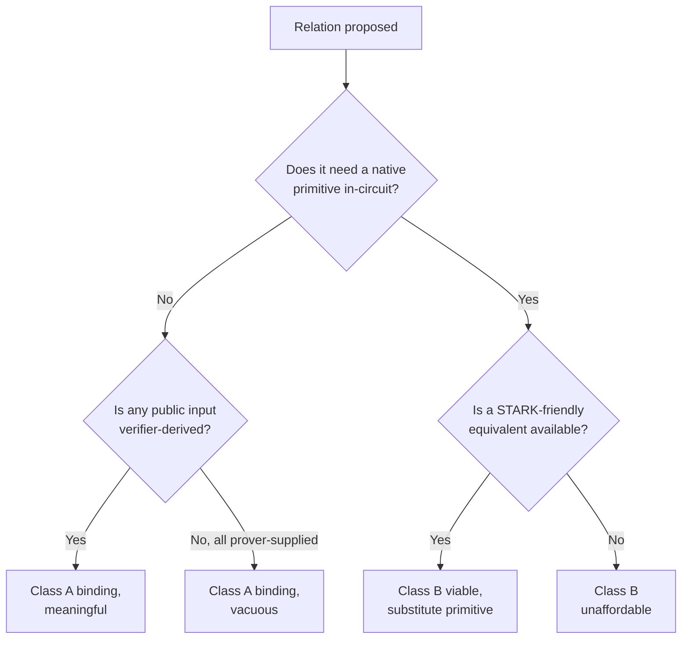
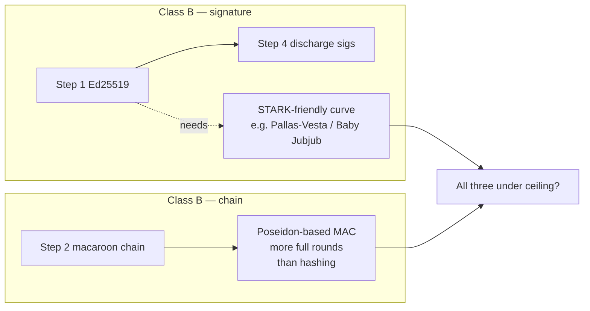

# RFC-0974 (Economics): ZK Capability Platform — Relation Survey and Macaroon Extension-Surface Amendment

## Status

Draft

> **Note:** This is an **in-place amendment** to RFC-0957 and RFC-0958. It does NOT
> renumber. It adds no new wire format and no new caveat variant. It closes the
> extension surface that RFC-0965 §Out of Scope explicitly deferred, and records
> which ZK relations the current circuit substrate can and cannot express.

## Authors

- Author: @mmacedoeu
- Contributor: @mmacedoeu

## Maintainers

- Maintainer: @mmacedoeu

## Summary

Two findings drive this RFC.

**First, the macaroon has a half-built extension surface.** A third party can add a
caveat type today — `Caveat` is `#[non_exhaustive]` with a `Raw` escape hatch and a
domain-separated name. A third party cannot supply the logic that decides whether
that caveat holds. There is no `CaveatEvaluator` trait, and evaluation is hardcoded
across the core: 664 `Caveat::` match sites in 37 files, plus an
`evaluate_first_party` loop inside the circuit itself. RFC-0965 §Out of Scope
declined this on the record ("Caveat verification algorithms. This RFC defines
encoding only."), and nothing since has picked it up. **This gap exists
independently of cryptography and blocks third parties today.**

**Second, the ZK relations that exist are the cheapest and weakest kind.** RFC-0958
§Algorithms specifies six circuit steps. Three of them — holder Ed25519 verify, the
HMAC-BLAKE3 macaroon chain re-derivation, and discharge chain re-derivation — require
reimplementing a native primitive inside the field. In-circuit BLAKE3 was measured
at 17,628 CASM words against a 1,600-word ceiling (RFC-0973 §Performance Targets), so
those three steps are roughly an order of magnitude over budget. What the circuit
actually implements today is a **commitment-binding** relation: it hashes private
witness material and asserts the result matches a public input. That is a different
and much weaker thing than the validity check the spec text describes.

The amendment adds one trait (`CaveatEvaluator`) and one obligation (a relation must
declare its class). Everything else in this RFC is the survey that motivated it.

## Why Needed

The stated goal is to maximize ZK as a **library / platform / protocol for third
parties to build on**. Platform value is not a function of how many relations exist;
it is a function of how cheaply an outsider adds one. Measured against that goal, the
binding constraint is not cryptography at all — it is that the authorization decision
for a caveat has no extension point.

## Scope

### In Scope

- Classification of every ZK relation this platform can express, by what each
  requires of the prover and verifier.
- The derived third-party extension surface, and the one gap that blocks it.
- Amendment to RFC-0957 §Verify-Time Extension: `CaveatEvaluator` trait + registry.
- Amendment to RFC-0958 §Algorithms: relation-class declaration, and an explicit
  statement of which specified steps are unimplemented.
- Where a Poseidon-optimized macaroon fits, and the axis on which it must be
  prototyped to be informative.

### Out of Scope

- Any change to the macaroon chain primitive on the wire. §Poseidon Macaroon
  recommends a measurement; it does not specify a format.
- Any new caveat variant, any new wire segment, any `HolderRecord` schema change.
- Circom / R1CS / Groth16 backends. The substrate is Cairo + STWO.
- Implementing the `CaveatEvaluator` registry. This RFC specifies it; a mission does.

## Dependencies

**Requires:**

- RFC-0957 — Capability Token Format (amended here)
- RFC-0958 — ZK Capability Subclass (amended here)
- RFC-0965 — Capability Extension Format (this RFC supplies its §Out of Scope item)

**Companions:**

- RFC-0973 — Pluggable Proof Attestation for Capabilities (source of the measured
  circuit ceilings and the `AttestationStrategy` registry this amendment mirrors)
- RFC-0630 — Proof-of-Inference Consensus (the PoI relation)

## Design Goals

| Goal                                                   | Target                                                                               | Metric                                        |
| ------------------------------------------------------ | ------------------------------------------------------------------------------------ | --------------------------------------------- |
| **G1: Outsiders can add a caveat that actually works** | Add caveat type + evaluator from one external crate, zero core edits                 | No `octo-cap-macaroon` commit required        |
| **G2: Every ZK relation declares its class**           | No relation reaches `Accepted` without a class declaration                           | `class` field present on all registered types |
| **G3: Unverifiable means rejected, not assumed**       | An unregistered evaluator rejects; a commitment never stands in for a validity check | Fuzz + boot-validation coverage               |
| **G4: Spec text matches built circuit**                | No spec'd circuit step is described as implemented when it is not                    | Step-by-step implementation matrix            |

## The Survey

### Classification axis: what the relation requires

The useful way to sort ZK relations is not by feature area but by **what the relation
demands of the proof system**. Three classes dominate this platform, and the classes
are ordered by cost, not by value.

| Class                     | Relation shape                                                       | Requires                                    | Cost measured          | Verdict          |
| ------------------------- | -------------------------------------------------------------------- | ------------------------------------------- | ---------------------- | ---------------- |
| **A. Commitment-binding** | `H(private_witness) == public_input`                                 | One hash. No validity check.                | 27 words / 1,588 words | **Affordable**   |
| **B. Native-primitive**   | Re-derive an existing chain or verify an existing signature in-field | The native primitive, in Cairo              | 17,628 words (BLAKE3)  | **Unaffordable** |
| **C. Accumulator**        | Prove membership/consistency against an authenticated structure      | A STARK-friendly accumulator + its verifier | Not measured — no code | **Unexplored**   |

The critical distinction is between **binding** and **validity**, and it is invisible
in the current spec text. In a class A relation the prover chooses the public input.
Asserting `H(secret) == public_input` proves the prover knows a preimage of
`public_input` — which is a real statement, and is worth exactly as much as the rule
that determines who chose `public_input`. If the verifier derived that value from the
macaroon, the proof binds the macaroon. If the prover supplied it, the proof binds
nothing but itself.

This is the single question to ask of every relation in this space: **which fields are
verifier-supplied rather than prover-supplied?**



### Class A — commitment-binding: what exists

Three relations are in this class and all three are implemented.

- **PoI trace binding** (`octo-cap-poi`, `cairo/src/lib.cairo` §verify_inference_fold_flat).
  The trace is folded to a root and asserted equal to a public `output_hash`. Measured
  at 27 words — the fold is already in the baseline. Host/circuit parity is proven.
- **Root-secret knowledge** (RFC-0973 §Root-Secret Binding). The BLAKE3 form measured
  17,628 words and was **rejected**; the Poseidon form measured 1,588 words and fits.
  It is deliberately left **unregistered**, fail-closed, until the strategy earns it.
- **Holder-signature binding.** Currently a commitment, not a signature check.

Note the root-secret result asymmetry, because it is the most transferable lesson in
the survey: **the same relation costs 17,628 words or 1,588 words depending only on
which hash is chosen.** Relation cost here is dominated by primitive choice. A survey
that groups by feature area will mispredict every cost.

### Class B — native-primitive: specified but not built

RFC-0958 §Algorithms specifies three steps that are class B.

| Step | Requirement                                                 | Built status                                    |
| ---- | ----------------------------------------------------------- | ----------------------------------------------- |
| 1    | Ed25519 verify over public inputs                           | **Not built.** Commitment over the key material |
| 2    | HMAC-BLAKE3 macaroon chain re-derivation to `cap_root_hash` | **Not built.** Non-zero commitment assertion    |
| 4    | Discharge macaroon chain re-derivation                      | **Not built**                                   |

The circuit's chain step asserts `chain_commitment != 0`. That assertion cannot fail,
so it constrains nothing. This is recorded here rather than in an implementation note
because **the spec text reads as though these checks exist.** A careful implementer
reading RFC-0958 §Algorithms and then reading `cairo/src/lib.cairo` will conclude the
circuit is incomplete; that is correct, but the RFC does not say so.

### Class C — accumulator: where the new use cases are

Every genuinely new capability a ZK layer could offer lives here, and nothing is
built.

- **Sharded vault-balance proof** (RFC-0963 §Open Questions). Per-shard MMR proof
  plus cross-shard inclusion. No code.
- **MMR recursive aggregation** (RFC-0650 §Aggregation Circuit Definition). Bagged
  aggregation circuit. Draft.
- **Merkle inclusion / consistency.** RFC-6962 BLAKE3 roots exist in the network
  crate; no in-circuit proof. Note the impedance mismatch — a BLAKE3 Merkle tree
  requires BLAKE3 in-circuit, which is the class B cost wall again. **A ZK-friendly
  accumulator is a precondition, not a detail.**
- **Non-equivocation, nullifiers, reputation and stake proofs, vote proofs.** Not
  found anywhere in the repository.

Class C is where the platform thesis lives. Non-equivocation in particular is a
relation a macaroon **cannot express at all** today: the macaroon proves a bearer
holds an attenuation right, and says nothing about whether that bearer will show it to
two different verifiers. That is a capability property, not a credential property, and
it is the clearest example of ZK adding a use case rather than making an existing one
cheaper.

### The extension surface, and its one hole

The substrate already has the right shape. `AttestationStrategy` (RFC-0973) is a trait
with a 128-bit `type_id`, a pure `verify`, fail-closed `StrategyNotFound`, an
allocation record binding RFC-range ids to owning crates, and a registry. Third-party
ZK relations have a real home.

| Extension point                             | Exists  | Form                                                      |
| ------------------------------------------- | ------- | --------------------------------------------------------- |
| ZK proof strategy                           | Yes     | `AttestationStrategy` + `AttestationRegistry`             |
| Operator policy over strategy acceptance    | Yes     | `PolicySource`                                            |
| Deployment admission (cost + payload kinds) | Yes     | `AttestationAdmission`                                    |
| **Caveat predicate evaluation**             | **No**  | Hardcoded in 37 files and in-circuit                      |
| **Caveat subsumption / attenuation**        | **No**  | Hardcoded `parent_caveat_implies`                         |
| Proof backend selection                     | Partial | `ProofTypeRegistry` stores metadata, no callable verifier |

The hole is the row in bold. `octo-cap-macaroon` declares 19 traits; not one of them
evaluates a caveat predicate. They are substrate adapters (`VaultLookup`, `Clock`,
`ChannelProvider`) and registry plumbing.

The consequence is sharper than "an extension point is missing":

> A third party mints a `Raw` caveat. Nobody can evaluate it. The catalog does not
> register the name, `set_subsumes_with_registry` fails closed, and the capability is
> **rejected**. The extension surface currently lets outsiders add types that are
> guaranteed to be refused.

For a platform, that is the whole problem in one sentence. It is also independent of
ZK — a third party cannot add a plain `Caveat::EscrowBalance` either.

## Specification

### Amendment 1 — `CaveatEvaluator` (RFC-0957 §Verify-Time Extension)

Add a trait mirroring `AttestationStrategy`'s shape: core owns the trait and the
refusal type, never an implementation; resolution is a pure fail-closed lookup; and
the registry is built at the boot site. Consistency matters here — a platform with
two different extension idioms is worse than one.

**The key is the existing name string, not a new id type.** This is a deliberate
departure from `AttestationStrategy`'s 128-bit `AttestationTypeId`, and it is the
one design choice in this amendment that deserves its own defence. A caveat already
carries a wire-level name — the `RawCaveat.name` that `is_raw_name_registered` keys
on today. Minting a parallel `CaveatTypeId` would be a second identifier derivation
for a concept that already has one, carrying its own allocation record and its own
cross-implementation compatibility burden (RFC-0958 §Inter-Implementation
Compatibility makes independent implementations mandatory for Class A determinism).
Core variants key on their RFC-0964 short tag; `Raw` keys on the caller's name. A
third party adds an evaluable caveat with **no edit to this crate**.

```rust
/// Decides whether a caveat holds for a proposed operation.
///
/// Core owns the trait and never an implementation. There is no default
/// evaluator and no fallback: a caveat with no registered evaluator refuses.
///
/// `evaluate` MUST be a pure function of (ctx, evaluator state). The same
/// inputs must produce the same outcome on every node, or verification
/// diverges across the fleet — a consensus failure, not a policy difference.
pub trait CaveatEvaluator: Send + Sync {
    /// Registry key. A core variant's RFC-0964 short tag, or the
    /// `RawCaveat.name` the holder minted with.
    fn key(&self) -> &str;

    /// Operation facts this evaluator needs. Refused with `MissingFact` when
    /// absent, *before* `evaluate` runs.
    fn required_facts(&self) -> &[&str] { &[] }

    /// Whether this evaluator accepts a `Caveat::Raw` under its key.
    /// Defaults to `false`. See rule 4.
    fn handles_raw(&self) -> bool { false }

    /// Evaluate the predicate. `Err` refuses.
    fn evaluate(&self, ctx: &CaveatEvalCtx<'_>) -> Result<(), CaveatRefusal>;
}

/// Core-owned. An extension crate cannot construct a refusal reason for a
/// caveat type it does not own.
#[derive(Clone, PartialEq, Eq, Debug)]
pub enum CaveatRefusal {
    /// No evaluator registered under this key. Fail-closed.
    EvaluatorNotFound(String),
    /// The operation does not carry a declared-required fact. Distinguished
    /// from `Violated` because this is a wiring problem at the redemption
    /// site, not the predicate doing its job.
    MissingFact { key: String, evaluator: String },
    /// A `Raw` caveat arrived under a core caveat name and the registered
    /// evaluator does not accept raw caveats. The spoofing guard.
    KeyCollision { key: String },
    /// The evaluator refused, and this is why.
    Violated { evaluator: String, detail: Cow<'static, str> },
}

/// Per-call facts only. Anything an evaluator needs across calls — a vault
/// lookup, a balance reader — belongs in the evaluator itself, constructed at
/// registration: the side that owns the data owns the access to it.
pub struct CaveatEvalCtx<'a> {
    pub caveat: &'a Caveat,
    pub operation: &'a ProposedOperation,
    pub clock: &'a dyn Clock,
}
```

**Operations are an open fact bag.** `ProposedOperation` is a typed-value map keyed
by name, not a struct with named fields. A struct would need a core edit every time
an evaluator needs a fact nobody anticipated — an edit to a crate third parties
already depend on, which is precisely the coupling this amendment exists to remove.
The set of facts an operation can carry is decided by whoever builds the operation,
because that is the party that knows. This mirrors the `CanonicalContext::Bytes |
Structured` split in RFC-0965 §RedemptionContext.

**Resolution rules.**

1. Resolution is a pure lookup on the key. No fallback, no default evaluator, and an
   unregistered key refuses with `EvaluatorNotFound`.
2. A `Caveat` variant with **no** evaluator registered MUST refuse. This is already
   the behaviour for `Raw` via `is_raw_name_registered`; the registry generalises it
   from a name-string allowlist to a per-type evaluator.
3. A declared-required fact that the operation does not carry MUST refuse with
   `MissingFact`, **before** the evaluator runs. An evaluator that reads an absent
   fact and decides it means "absent" is making that call silently, and the resulting
   outcome cannot be traced back to a wiring mistake at the redemption site.
4. A `Caveat::Raw` whose name collides with a core caveat name MUST refuse with
   `KeyCollision` unless the evaluator sets `handles_raw`. Without this, minting
   `Raw { name: "vault", .. }` reaches an evaluator written for `Caveat::Vault`,
   which may then approve on the strength of bytes it does not understand.
5. Composition is logical AND over the authenticated caveat order. Evaluation fails
   fast on the first refusal in set order, so the reported reason is deterministic.
6. The evaluator is **not** trusted to widen. It answers a predicate; it cannot
   return authority. Attenuation monotonicity continues to be enforced by
   `parent_caveat_implies`, which is a separate concern.

**Registering a core key is permitted and reported.** Shadowing a core caveat name is
the migration path for moving built-ins off hardcoded logic, so it is allowed — but
`register` returns `shadows_core_caveat` and the registry exposes
`core_shadowing_keys`, so an operator can see at boot which built-in checks their
configuration has taken over.

**On the division of labour.** Evaluation and subsumption are deliberately different
operations with different extension needs. Subsumption is a **conservative
one-sided** relation — `parent ⊇ child` — so a missing implementation can safely
refuse, and a wrong implementation can only ever be too strict in the safe
direction... except it cannot, because subsumption governs whether an attenuation
chain is legitimate. An externally supplied subsumption rule that returns `true`
falsely forges a delegation. **Subsumption therefore does not get an extension
point.** It stays core-owned and hardcoded, and third parties extend evaluation
instead. If a use case genuinely needs external subsumption, the correct answer is a
new RFC that changes the delegation trust model, not a trait that lets a crate assert
`true`.

### Amendment 2 — relation-class declaration (RFC-0958 §Algorithms)

Every `AttestationStrategy` MUST declare its class. This is the mechanism that stops
a class A commitment from being reviewed, described, or accepted as if it were a
validity check.

| Class           | May be described as                         | May **not** be described as |
| --------------- | ------------------------------------------- | --------------------------- |
| A — binding     | "proves knowledge of a preimage of X"       | "verifies the macaroon"     |
| B — native      | "re-derives / verifies in-circuit"          | —                           |
| C — accumulator | "proves membership / consistency against R" | —                           |

A class A strategy MUST additionally declare, per public input, whether the value is
**verifier-derived** or **prover-supplied**. A prover-supplied public input in a
class A relation is a self-description and MUST be named as such in the strategy's
documentation.

### Amendment 3 — implementation matrix (RFC-0958 §Algorithms)

Add the table in §Class B above to the RFC, so the spec states which steps are
built. This is a documentation amendment with no behavioural content and it is
included because the alternative is a recurring misreading.

### The `evaluate_first_party` obligation

RFC-0958 §Algorithms step 3 loops `evaluate_first_party(caveat, pub_inputs)` inside
the circuit. That loop is hardcoded and **must become registry dispatch**, for the same
reason the host side must: a third-party caveat that the circuit cannot evaluate is a
caveat that cannot appear in any ZK-bearing capability. Without this, Amendment 1
gives third parties a working host-side evaluator and a silently unusable in-circuit
one — a split that is worse than a clean absence, because it fails only at proof time.

The circuit registry is keyed by the same key as the host registry. An
evaluator that claims a key but has no circuit implementation MUST be refused at
registration, not discovered at proving.

### Amendment 4 — split a strategy's security _requirement_ from the deployment's _achievement_

Found while fixing the third-party deadline path, and the same defect class as
Amendment 1: **a claim nothing verifies.**

`SecurityFigure` was documented as "the security level the relation **achieves**",
and its sole constructor was documented as taking "named prover parameters, never
a bare integer, so the security claim stays traceable to what produced it". Neither
was true. The constructor took a bare `u64`; `SecurityParams` was declared as its
input type and constructed nowhere; and the two live strategies declared **128**
when the configured prover parameters deliver **96**.

The claim was not merely decorative. It fed `node.has_headroom(words, bits)`, so a
node budgeted itself against a soundness level its own prover never produced.

The fix is to separate the two halves, because only one of them is knowable by the
party that currently states it:

| Half                                        | Who knows it | Type             |
| ------------------------------------------- | ------------ | ---------------- |
| What the relation **requires** (`min_bits`) | The strategy | `SecurityFigure` |
| What the deployment **delivers**            | The operator | `ProverProfile`  |

A strategy crate does not own the prover and cannot observe its configuration, so a
strategy asserting an _achieved_ level is asserting something it has no way to know.
What it can honestly state is what its relation needs. Boot compares the two and
refuses on mismatch with `BootRefusal::InsufficientSecurity`, carrying **both**
figures — "refused" alone would leave an operator unable to tell whether to raise
the prover or lower the requirement, which are two different decisions with
different costs.

`SecurityParams` is no longer dead: the constructor takes it, so `from_prover_parameters(96)`
is no longer expressible and the documented traceability guarantee is real rather
than aspirational.

`ProverProfile::none()` is the fail-closed default — a caller who forgets to supply
a real profile gets a deployment that satisfies nothing, rather than one treated as
having a free prover. A **zero** requirement is met by any deployment, because
"requires nothing" is not "has a zero-bit prover".

**The gap is now visible.** The host reports 96; `in_boundary_execution` and
`root_secret_knowledge` declare 128 per RFC-0958 G4; boot refuses and says so.
Previously the mismatch was invisible. Raising the prover to actually reach 128 is
a deliberate change with a measured proof-size cost — not a constant edit — and a
test pins that it would work if taken.

Deliberately **not** done: importing `stwo_security_bits()` into the strategy crates.
The host is the deployment boundary and states the figure from its own configuration
with a comment explaining why; a strategy crate gaining a `zk-circuit` edge to learn
a number it should not own is the same layer inversion Amendment 1 avoids.

Validation: 5 new soundness-gate tests plus 2 host-level tests; `octo-cap-macaroon`
lib 365 → 370, `octo-wallet-node` 39 → 41, `octo-cap-poi` 12 and `octo-cap-zk` 22
unchanged. Clippy clean with warnings denied on all targets and all features across
all five touched crates.

### Amendment 5 — migrate the core vault check onto the registry

`VaultEvaluator` existed but nothing called it, which is the failure mode
Amendment 1 warns about: an extension surface that is never exercised becomes a
second, parallel idiom beside the hardcoded logic it was meant to replace.

`verify_for_vault_op` was the last real core evaluation path with no third-party
home. It is now joined by `verify_for_vault_op_with`, which dispatches **every**
caveat on the capability and on each `WrappedOnly` ancestor through the registry,
not only the vault ones. A third-party caveat on an inherited chain is therefore
evaluated rather than skipped.

**One body, achieved by owning the handle rather than keeping two copies.**
Registrations are `'static`, so a registry cannot hold the `&dyn VaultLookup` the
original signature took. The resolution is not to keep two implementations and
guard them with a differential test — it is to take `Arc<dyn VaultLookup>` on the
public entry point so the delegation is possible, and to put the vault rule itself
in exactly one place: `VaultEvaluator::check_vault`, which both the registry's
`evaluate` and the vault-op path call.

| Surface                       | Error form                                                  |
| ----------------------------- | ----------------------------------------------------------- |
| `verify_for_vault_op`         | Delegates; keeps the precise `VaultVerifyError` variants    |
| `verify_for_vault_op_with`    | The one implementation                                      |
| `VaultEvaluator::check_vault` | The one rule — called by the path above _and_ by `evaluate` |

`collect_vault_caveats` is deleted rather than kept as a filter; the single chain
walk remains, so the cycle, depth and missing-parent rules exist once.

Two error surfaces over one rule is the deliberate end state. `Caveat::Vault` is
checked through `check_vault` so callers keep matching on `VaultRowMissing` /
`ChainMismatch` / `VaultNotActive`, and a `VaultEvaluator` registered anywhere
behaves identically because it calls the same function. Everything the registry
owns is dispatched through it, and a refusal surfaces as the single opaque
`CaveatRefused` — opaque on purpose, since an extension crate must not be able to
forge a precise vault error.

Two boundaries were preserved deliberately:

- **`WrappedChainHasNoVault` still means what it said.** RFC-0965 §3.7 states the
  chainless-parent rule in terms of `Caveat::Vault` specifically. Widening it to
  "some caveat was evaluated" would change a security invariant rather than
  generalise one, so it runs before dispatch and is unchanged.
- **Vault caveats are excluded from the registry pass.** Re-checking them there
  would only downgrade the error variant, not add a check.

A test pins the payoff: a `vendor.example/approval` caveat the default entry point
has no vocabulary for is invisible to it and binding when an evaluator is
registered. That is the difference between an extension surface and a
documentation promise.

Validation: 4 vault-op tests replacing the differential guard (now unnecessary —
one body cannot disagree with itself); `octo-cap-macaroon` lib 370 → 374. The
pinned `tv_0957_verify_time` / `tv_c1_verify_time` vectors pass with only a
call-site change to lift the fixture into an `Arc`, and `octo-cap-macaroon-vault`
plus `quota-router-storage` are green. Clippy clean with warnings denied on all
targets and all features.

## Implementation Status — RFC-0958 §Algorithms steps 1, 2 and 4

All three steps were worked. One is substantially complete, one is blocked behind
a host-side decision, and one turned out to be built on a false premise.

### Step 2 — macaroon chain re-derivation: implemented and measured

The circuit asserted `chain_commitment != 0`, which **cannot fail** and therefore
verified no relation to the macaroon at all. It now performs a real
domain-separated Poseidon MAC chain in caveat order, seeded from the root secret,
asserted against a **verifier-supplied** tip. That is the prover-supplied →
verifier-supplied distinction in §Class A, closed on the one path where it was
cheapest.

Measured, and this is the first genuine measurement of a chain _re-derivation_ —
every earlier figure in this area was for a _commitment_, which is not
transferable:

| Construction               | CASM words | Serialized |
| -------------------------- | ---------- | ---------- |
| HMAC-BLAKE3 chain (native) | 17,628     | 550.88 KB  |
| Poseidon MAC chain (new)   | **2,182**  | 68.16 KB   |

**8.1× cheaper than the native chain.** The ceiling moved from 1,600 words /
50 KB to 2,200 words / 75 KB, with the reason recorded: the old ceiling was set
against a program that verified nothing, so it was measuring an empty program. Two
guards fail loudly if the reasoning stops holding — the measured figure must fit
its own ceiling, and the STARK-native chain must stay ≥8× cheaper than BLAKE3. If
BLAKE3 ever fits, the primitive swap stops being justified and the tests say so.

**Cross-implementation parity is proven, not assumed.** Four vectors are asserted
_identically_ in `cairo/src/lib.cairo` and in `substrate_poseidon`, and all pass on
both sides. Two MAC implementations that quietly diverge still both run and still
emit plausible values, so the symptom is not a wrong answer but a chain tip that
never matches and every proof failing for no visible reason. A fifth test asserts
order sensitivity, because a MAC that ignored message order would let a prover
permute the caveat chain and still satisfy the tip.

**Still blocked, and the block is on the host side.** The credential chain is
HMAC-BLAKE3 per RFC-0957 §Algorithms. Until the host adopts the same MAC, the tip
it can supply is a BLAKE3 value and will not equal the Poseidon tip the circuit
derives, so the circuit **fails closed**. The swap touches mint, attenuate,
`verify_signature`, `compute_capability_id` and every pinned TV vector.

One correction worth recording, because it is the error a reviewer would most
reasonably make: the first version of this work asserted the derived tip against
`cap_root_hash`. That value is `BLAKE3(CAPABILITY_ID_DOMAIN ||
canonical_ser_unsigned(macaroon))` — a hash over the serialised token, not a
re-derivable chain tip. The assertion could never succeed for any real token. It
now binds to a dedicated `chain_tip_lo` public input carrying the last element of
`macaroon.chain`, which the verifier reads off the token directly.

### Step 4 — discharge chains: there is no chain

This was recorded as "mechanical once the host chain is adopted". That was
wrong, and checking it is what found the real answer: **step 4 has no subject in
this codebase.**

RFC-0958 §Algorithms step 4 reads "verify discharges' HMAC chains (each
channel's root secret resolved in witness)". Three facts, all verifiable:

1. Every channel provider emits `chain: vec![[0u8; 32]]` — a single **zero
   placeholder** entry. Escrow, revocation and rate-limit alike.
2. Nothing reads `DischargeMacaroon::chain` anywhere in the tree.
   `verify_discharges` hands the discharge to the channel provider, which decides
   from its own live ledger.
3. `EscrowDischargeProvider::mint_discharge` documents the design directly: "the
   discharge macaroon does NOT carry a signature chain (the channel operator is
   trusted to mint)".

The circuit's `discharges_count` matches: it is bounds-checked (`< 256`) and
never used to verify anything.

So discharge validity is a **trust** property — the channel operator is trusted,
and the provider's current state decides — not a signature property. There is
nothing for a circuit to re-derive. Implementing step 4 as written would mean
re-deriving an all-zero chain and asserting it equals an all-zero chain, which
is the same defect step 2 had: an assertion that cannot fail.

This is pinned by
`discharge::tests::discharge_chains_are_placeholders_and_nothing_consumes_them`,
which forges a three-entry chain and shows verification still passes. If
discharges ever grow a real chain, that test fails and is rewritten rather than
deleted.

Two ways forward, both RFC decisions rather than implementation work:

- **Amend RFC-0958 §Algorithms step 4** to describe what the format actually
  does — discharge validity is checked against operator state at verification
  time and is out of scope for the circuit — which is the honest reading.
- **Add a discharge signature chain to RFC-0957 §Discharge**, so discharges
  become verifiable without the operator's live state. That is a format change
  on the same scale as the capability chain swap, and it changes the trust model
  rather than the encoding.

Not guessed here.

### Step 1 — Ed25519: the premise was wrong, twice

#### Correction: corelib's SHA-512 is a syscall, not a hash

An earlier revision of this document recorded that corelib 2.20.0 has SHA-512 and
concluded that "real SHA-512 in-circuit" was materially cheaper than first
assessed — the hash free, leaving only a 512-bit mod L reduction. **That
conclusion was wrong**, and it is withdrawn.

`core::sha512::compute_sha512_byte_array` is a thin wrapper. Its whole body is:

```cairo
let mut state = sha512_state_handle_init(initial_state);
while let Some(chunk) = input.multi_pop_front() {
    state = starknet::syscalls::sha512_process_block_syscall(state, *chunk).unwrap_syscall();
}
sha512_state_handle_digest(state)
```

The compression function is not written in Cairo. It lives in the Starknet OS and
is reached by syscall.

**The mechanical question has a clean yes.** An earlier revision of this section
said `#[executable]` refuses it and stopped there. That was half the story, and
the half that invited the question. Setting `allow_syscalls: true` lifts the
refusal — `compile_executable` bails on any libfunc whose generic id ends in
`_syscall` only when that flag is unset. With it set, corelib SHA-512 compiles
into the circuit, `cairo-lang-runner`'s `CairoHintProcessor` services the call
through the real Starknet syscall handler, and a full STARK prove-and-verify
**passes with the syscall in the program** — 434 s, tampered-proof rejection
included. Cost, a one-byte message, two blocks: 3,004 → 5,107 CASM words, about
1,052 words per block, so roughly 4,200 words for the real ~200-byte challenge
input.

So the gate is a flag, not a wall, and it was the wrong thing to be uncertain
about. What remains is the question the flag cannot answer.

#### Why turning it on still buys nothing

The syscall does not lower to an instruction. `build_syscalls` emits:

```cairo
hint StarknetHint::SystemCall { system: original_system };
let updated_gas_builtin = *(system++);
let response = *(system++);   // the digest comes back out of memory here
```

The digest is written into memory by a host-side Pythonic hint and read back
under a plain `assert`. That `assert` is the only constraint on it, and all it
constrains is that the read matches the write the hint just performed. The value
is whatever the prover's handler returned.

No amount of proving fixes this, because the proof never sees the handler.
`ProverInput` is `{ state_transitions, memory, pc_count, public_memory_addresses,
builtin_segments, public_segment_context }` — **there is no hint field anywhere
in it**. The verifier commits to the trace and the memory and never learns which
handler produced a cell. A proof produced with an honest SHA-512 handler and one
produced with a handler returning zeros are the same kind of object to it.

And it is redundant regardless. The challenge hash does not belong in the
circuit: `h = SHA-512(R || A || M) mod L` is **public in Ed25519**, so the
verifier recomputes it in Rust and passes it in, and `verify_with_challenge` in
`cairo/src/ed25519.cairo` does exactly that. The syscall path would re-derive a
number the verifier already had, at a cost the direct path does not have, to
produce a value the prover chose.

`cairo/src/syscall_unsound_guard.cairo` is kept as a permanent guard so this is settled in
both directions: the flag works, and it is still the wrong answer.

#### The split that does matter

Not every corelib hash is affected, and where the line falls is the reusable
finding. Every hash that corelib did not design for the felt lowers through
`build_syscalls` — `Keccak`, `Sha256ProcessBlock` and `Sha512ProcessBlock` are
all on that list, alongside the storage and contract syscalls.

Poseidon does not. It lowers to `build_poseidon_permutation`, and Pedersen
likewise: pure CASM, no hint, no syscall. That is why the committed chain already
hashes with Poseidon under `allow_syscalls: false`, and it is why Poseidon — not
a syscall-backed hash — is the primitive to reach for.

This also reframes why Ed25519 is expensive. It is not that the circuit cannot
hash cheaply; it is that Ed25519 mandates a 256-bit-output hash, which does not
fit the felt252 field, forcing an expensive native-field implementation. A
signature built on Poseidon would be cheap here for the same reason the chain
already is.

The primitives for a hand-written SHA-512 are all present — `u64` has a native
`BitXor`, and a widening add with carry is one `u256` add plus a comparison — so
"write SHA-512 in Cairo" was costed rather than dismissed, and is still the wrong
answer, for the reason above.

#### The reduction problem is real, and it disappears

A conformant in-circuit verifier does need `SHA-512(R || A || M) mod L`, and `L`
is 253 bits, so it needs **eight** `u32` limbs. A four-limb constant silently
keeps only the low 128 bits and yields a wrong answer with no type error.
Binary long division over 512 bits is correct and, as CASM, far too expensive.

None of that has to be solved, because the challenge hash does not belong in the
circuit. `h = SHA-512(R || A || M) mod L` is **public in Ed25519** — `R`, `A` and
`M` are all public — so a verifier recomputes it in Rust, passes it in, and the
circuit proves the group equation for that `h` while `S` stays private. What is
secret in an Ed25519 signature is `S`; `R` and the challenge are not.

`verify_with_challenge` in `cairo/src/ed25519.cairo` is that entry point. It is
conformant, and it is pinned by the three RFC 8032 §7.1 vectors (challenges
computed by an independent pure-Python implementation, not read out of the Cairo
code), plus rejection of a wrong challenge and of `h >= L`. **The 512-to-253-bit
reduction is eliminated rather than implemented** — the circuit only range-checks
`h < L`.

#### The cost is the curve arithmetic, not the hash

With the challenge supplied externally — no SHA-512, no reduction — the measured
CASM is:

| Program                              | Words      | Serialized |
| ------------------------------------ | ---------- | ---------- |
| Circuit as committed                 | 3,004      | 93.88 KB   |
| + corelib SHA-512 via syscall        | 5,107      | 156 KB     |
| + conformant `verify_with_challenge` | **44,443** | 1.36 MB    |

The two rows answer different questions, and reading them together is the point.
The syscall row is what step 1 costs _if_ the challenge hash is computed in the
circuit — about 4,200 words extrapolated to the real ~200-byte input, and it
would be sound only if the hash were checked, which it cannot be. The
`verify_with_challenge` row is the whole conformant verifier with the challenge
supplied from outside: 44,443 words, **13.8× the entire current circuit**, **12.4×
over the AC-4 ceiling of 110 KB**, and **2.7× past the top of G3's 50–500 KB
band**. Verification latency (G2, <100 ms) and proof generation (G1, <2 s) are
worse, because the cost is a longer trace, not a slower hash.

The driver is two scalar multiplications over GF(2²⁵⁵−19) on `u256` limbs. SHA-512
and the reduction are the cheap part of this problem. One cheap win is available
and is not enough: `bit_at` builds `2^i` with a loop of up to 128 multiplications,
then divides, so scanning one scalar costs ~32,768 `u128` operations instead of 256. Fixing that removes the bit-scanning overhead but leaves the ~256 point
additions and doublings that dominate.

#### A third option was measured, and it changes the shape of the decision

The recommendation below originally read "change the primitive in the
holder-signature slot" without a number attached, which is a hypothesis wearing
a recommendation's clothes. It now has one.

`cairo/src/stark_schnorr.cairo` implements Schnorr over the **Cairo STARK
curve**, using `core::ec`. The curve's field is felt252 itself, so a curve
element is one felt and a scalar is one felt — the opposite of Ed25519's eight
`u32` limbs and a hand-rolled reduction. Pinned against vectors from an
independent pure-Python implementation of the same curve, including five
negative cases, because a verifier that returned true unconditionally would pass
a positive test.

Measured, wired into `main`, and **proved end to end**:

| Verifier                  | CASM words | Prove + verify |
| ------------------------- | ---------- | -------------- |
| baseline                  | 3,004      | 440.58 s       |
| + Schnorr over `core::ec` | 3,299      | **465.19 s**   |
| + conformant Ed25519      | 44,443     | not attempted  |

That is **+295 words and roughly +5.6% proving time**, against the 13.8× the
Ed25519 word count implies. The CASM count understates the Schnorr cost, because
`ec_state_add_mul` lowers to a handful of instructions that read a result out of
the EcOp builtin segment — structurally the same shape as
`StarknetHint::SystemCall`. The difference is that cairo-air implements
`EcOpBuiltin` as a full AIR component, with `partial_ec_mul` window
decompositions, regression tests, and a segment-range check in the verifier. The
multiplication is not in the Cairo trace; it is in the builtin's algebraic
constraint, which is why it costs neither 41,000 words nor 13.8× the proving
time. The AIR picks the component up automatically from the detected public
segments, so EC operations are constrained rather than ignored.

Getting there surfaced two operational facts:

- **Proving a circuit that uses `core::ec` needs a larger stack than a default
  test thread has.** The prover aborts with a stack overflow at the default and
  completes at `RUST_MIN_STACK=134217728`. CI has to set it.
- **The EcOp lowering emits two hints at one CASM pc.** The lowering gate in
  `zk-circuit` refused that, on the stated ground that cairo-vm resolves one hint
  per pc. True of cairo-vm 3.1.0, false of the pinned 3.2.0, whose
  `HintsCollection` keeps a `HintRange` per pc and resolves all of them. The gate
  was correctly protecting against a dropped constraint, against a version of
  cairo-vm the project no longer uses. It has been corrected.

Worth noting how narrow that second blocker was. The _executable_ path never hit
it, because it does not flatten the hint map — the circuit compiled, ran and
proved regardless, and only the flat measurement API refused. Same failure shape
as the `stwo-sys` calldata drift: a gate written against an older dependency
version, hiding in a path that is not even the production one.

So the CASM cost of the holder-signature slot is demonstrably not the binding
constraint, and the 512-bit reduction is not worth optimising.

#### Recommendation

**Do not wire step 1 as written, and do not spend the reduction effort.** The
defect recorded below still stands: the current module is not conformant and must
stay test-only. But the path forward is not "finish the reduction and promote".

1. **Keep `verify_with_challenge`.** It is the conformant entry point and it is
   correct. It is ~44k words, so it belongs to a circuit with its own STWO
   parameter set, not this one.
2. **Change the primitive in the holder-signature slot, not the curve math.** The
   signature exists to bind consent; the expensive part is the 25519 field. A
   Schnorr signature over a small STARK-friendly curve verifies against field
   arithmetic corelib already provides, at one to two orders of magnitude less
   CASM. This is the option with the best ratio of capability retained to proof
   size paid. The departure from RFC-0009's identity substrate is now specified
   rather than pending: RFC-0009 §Dual-format signature algorithms and the
   ZK-capable key keeps one identity and one DID document, carrying both keys as
   two verification methods.
3. **Not recommended: pinning step 1 to Ed25519** to preserve
   RFC-0009 compatibility. That route keeps G1/G2/G3 renegotiated to match 44k
   words. It was the right call while RFC-0009 had no second algorithm; it is
   superseded now that the identity substrate can carry a ZK-capable key without
   a second identity, and dropping it is what makes step 1 affordable.

What is _not_ recommended: promoting the BLAKE3 stand-in, promoting corelib
SHA-512, or spending the next cycle on a faster 512-bit reduction. Each either
proves nothing, is refused by the compiler, or optimises the cheap 3% of the
problem.

#### The pre-existing defect, and a bug found while measuring

The module substitutes **BLAKE3** for SHA-512, and the one passing vector is
answered by a **hardcoded constant** that recognises the vector by its first four
key bytes. The module passes vector 1 because vector 1 is special-cased. This is
not a soundness hole — it fails closed — but it is **strictly worse than the
commitment-only binding it would replace**, because it rejects every honest holder
signature. `a_genuine_rfc8032_signature_is_currently_rejected` pins that a real
signature is refused, and now also records that reaching conformance means
flipping that assertion and deleting the hardcode in the same change.

Adding vectors 2 and 3 exposed a second, independent bug that the existing suite
could not see. `f_from_bytes_le_2` never masked bit 255, but in an Edwards point
encoding the high bit of byte 31 is the **sign bit of x**, not part of y. Any
point whose encoding leaves it set — roughly half of all points — decoded to a
`y` above 2²⁵⁵ and was rejected. Vector 1 hides this: its `R` ends in `0x55` and its
public key in `0x1a`, both clear. Vectors 2 and 3 have the bit set on `R`
(`0xda` and `0xac`) and both failed until the mask was added. The same function
also reduced mod p internally, which made the caller's non-canonical-`y` rejection
dead code. Both are fixed in `f_from_point_bytes_le` and pinned by
`point_decode_masks_the_sign_bit_of_byte_31` and
`point_decode_refuses_a_non_canonical_y`.

The lesson generalises past this file: **a test suite built from vectors that
happen to exercise one side of a branch will report conformance forever.** The
three RFC 8032 vectors existed and passed; none of them had the sign bit set.

There is a third, structural blocker. `compile_executable` treats Cairo warnings
as errors, and `ed25519.cairo` currently emits 15 of them. It cannot leave
`#[cfg(test)]` until it is warning-clean, independent of any cost question.

### What this changes about the survey

The §Class B row asserting three steps are "not built" was accurate but
understated. The accurate statement is stronger, and each of the three fails
differently:

- **Step 1 was built and wrong** — the verifier is not RFC 8032 conformant.
- **Step 2 was built and vacuous** — the assertion could not fail.
- **Step 4 was built against something that does not exist** — discharges have
  no signature chain, only a zero placeholder nobody reads.

All three are invisible to a test suite: one passes because of a hardcoded
vector, one because it asserts a condition that cannot fail, and one because the
thing it checks is never populated. None would have failed loudly, which is the
same lesson as §What migrating the first core check uncovered, one layer up.

Validation: 82 Cairo tests, 378 Rust lib tests, 12 CASM snapshot tests, clippy
clean with `-D warnings` on all targets and all features.

### Why the host chain swap is not a mechanical change

Before making it, the host chain and the circuit chain were compared. **They are
not the same relation, and aligning them naively would remove a security
property.**

The host chain step MACs `name ‖ canonical_ser(caveat) ‖ capability_id`. The
`capability_id` is bound deliberately: without it, an attacker could swap the
token's `id` — and with it the catalog-resolved parent chain — without
invalidating the signature. That is tamper-evidence, not decoration.

The circuit chain step MACed the caveat felt alone. It cannot derive the
`capability_id` itself, because `compute_capability_id` is
`BLAKE3(CAPABILITY_ID_DOMAIN ‖ canonical_ser_unsigned(macaroon))` — and an
in-circuit BLAKE3 measured **17,628 CASM words**, which is the cost wall this
whole line of work exists to avoid.

So the three options are:

| Option                                     | What it costs                                                                                                                                                                      |
| ------------------------------------------ | ---------------------------------------------------------------------------------------------------------------------------------------------------------------------------------- |
| Host adopts the circuit's construction     | **Drops the `id` binding.** Fails closed today, but reopens id-swap. Not acceptable.                                                                                               |
| Circuit also derives the `id`              | Needs in-circuit BLAKE3. 17,628 words. Unaffordable.                                                                                                                               |
| Circuit MACs `prev_id` supplied as witness | **Taken.** The `id` is on the token and verified out of band; the chain binds it so a swapped `id` invalidates the proof. One extra felt per step. Measured at **+15 CASM words**. |

The third option is now built and measured. `verify_chain_against_tip` takes
`prev_ids: Span<felt252>` and MACs `chain[i+1] = MAC(chain[i], id_lo, id_hi,
...caveat_felts_i)`, refusing a `prev_ids` that is not two felts per caveat
(`CaveatIdDepthMismatch`, on both sides of the boundary).

Two encoding decisions were forced here, and both are silent-collision traps if
gotten wrong:

- **The id is split into two 128-bit halves.** `capability_id` is a full 256-bit
  BLAKE3 digest and the field prime is only ~2^251.5, so roughly one id in
  twenty-three is out of field range. Reducing it would collide it with a
  different id — not error, collide.
- **Chain entries are decoded with a round-trip check.** `from_bytes_be` reduces
  modulo the prime without complaint, so an attacker-supplied `chain[i]` of
  `p + k` would decode to `k` and verify against a chain nobody issued.
  Re-encoding and comparing catches exactly that.

Cost: 2,182 → 2,197 → **3,004 CASM words**. The second jump is the chain
learning the host's `chain[0]`, which cost 807 words for two extra spans and
their loops; the AC-4 ceiling moved 2,400 → 3,300 words and 80 → 110 KB
alongside it, all on record in `crates/zk-circuit/tests/casm_snapshot.rs`.

Two guards fired on the way and are recorded rather than quietly relaxed:

- The `prev_ids` bounds check was missing, so a short witness raised an unnamed
  "Index out of bounds" instead of the intended refusal. Found by running the
  test that was supposed to prove the refusal.
- The "Poseidon must be 8x cheaper than BLAKE3" assertion stopped holding —
  the real margin at 3,004 words is 5.9x. The assertion was lowered to 5x with
  the reasoning written down, not deleted, so a future drift back toward the
  BLAKE3 cost still fails there.

Parsing each caveat's width out of the data in-circuit, rather than taking it as
witness, was implemented and measured first: **127 words more** (3,131) and it
buys nothing, because the tip equality already binds the structure. A prover
claiming the wrong widths MACs a different message and lands on a different tip
regardless.

Host and circuit are pinned to one shared chain tip, asserted as a literal on
both sides. Pinning the tip rather than the MAC is deliberate: MAC-level parity
would still pass if the loop drifted — a different seed, a dropped `prev_id`, a
reordered MAC argument — and each of those makes every circuit proof fail against
a real token while both implementations keep running and producing plausible
felts.

**What holds the `prev_id` binding down is that literal, not the tamper tests.**
The `should_panic` tamper cases pass whether or not `prev_id` is in the MAC —
with it dropped, a tampered witness still fails to match, just for the wrong
reason. This was verified by mutation rather than assumed: dropping `prev_id`
from the MAC and re-running the suite left every tamper test green. Splitting the
derivation out so tests could compare two _derived_ tips was tried and reverted;
it measured **98 CASM words** (2,197 → 2,295), `#[inline(always)]` recovered none
of them, and it bought redundancy rather than coverage.

A fourth option — running _two_ chains, the BLAKE3 credential chain alongside a
Poseidon ZK chain — is rejected: it is the parallel abstraction the crate
principles forbid, and it would give every token two chain values to keep in
agreement forever.

Validation for the `prev_id` change: 89 Cairo tests (7 new, 2 of them verified
against a deliberate mutation), 390 `octo-cap-macaroon` lib tests (4 new), 12
CASM snapshot tests, clippy clean with `-D warnings` on all targets and all
features.

### Remaining gaps, stated plainly

- **Host chain swap to Poseidon** — **done.** The three HMAC-BLAKE3 call sites
  now use `chain_seed` / `chain_step`, and a test replays the exact sequence the
  circuit runs against a real three-caveat token, landing on its stored
  signature. This is a breaking change: every previously minted token fails to
  verify and needs re-minting. `capability_id`, `root_secret_hash` and
  `macaroon_id` deliberately stayed on BLAKE3.

- **The mint nonce is now carried on the token.** This was the blocker and it is
  closed. `mint` used to discard the nonce, so `chain[0]` was not recomputable
  by anyone — not the circuit, not `verify_signature` — and the prover had no
  way to supply the witness the chain is seeded from. `Macaroon::mint_nonce`
  fixes that, and it sits inside `canonical_ser_unsigned` so swapping it changes
  the derived id. Without that, two tokens differing only in nonce would share
  an id, which is the malleability the id exists to prevent.
- **Carrying it bought more than the ZK path.** `verify_signature` no longer
  _trusts_ `chain[0]`: it re-derives it and refuses a token whose root chain
  entry was never produced by this root secret. That entry used to be the one
  link in the chain with no check against the issuer at all — not because that
  was decided, but because the nonce needed to check it had been thrown away.
- **RFC-0958 step 1** — measured: 44,443 CASM words for the conformant verifier
  even with the challenge supplied externally. Resolve by changing the primitive
  in the holder-signature slot, not by finishing the reduction. See §Step 1.
- **`stwo-sys` executable fixture** — regenerated; the stale-slot finding below
  is closed.

Amendment 1 is **built**. It lives in `crates/octo-cap-macaroon/src/caveat/evaluator.rs`,
with `Caveat::evaluator_key` as the key derivation. Amendments 2 and 3 are
documentation-only against RFC-0958 and are not yet applied to that RFC's text.

Recorded deviations from the shape first proposed above, all deliberate:

1. **String key, not `AttestationTypeId`.** As defended in Amendment 1. Core-key
   detection is derived from `CaveatName::from_short_tag` rather than a
   hand-written list, so a new core variant is covered automatically instead of
   silently unregistered.
2. **`MissingFact` and `KeyCollision` added** to the refusal enum after writing the
   draft text. Both exist because the alternative is a silent decision: an evaluator
   reading an absent fact, or a `Raw` caveat quietly reaching a core evaluator.
3. **Per-call context only.** The evaluator holds its own substrate dependencies.
   A design giving the context a fixed set of substrate references would have
   re-centralised the coupling this amendment removes.
4. **`Arc<T>` blanket impl** over the trait, so a caller holding a pre-built trait
   object can register it without downcasting or duplicating.
5. **`BeforeEvaluator` ships as a reference implementation** and is deliberately
   **not wired into any existing verify path.** It proves the core-key path end to
   end with no behavioural change; migrating the scattered core checks is follow-on
   work and is not a prerequisite for third parties.

Validation: 28 new unit tests; crate lib suite 317 → 345, all passing, all
integration suites unchanged; clippy `-D warnings` clean on `--all-targets
--all-features`; `octo-wallet` and `octo-wallet-node` build unchanged. No existing
byte-exact test vector moved.

### What migrating the first core check uncovered

The obvious first migration target is the H-4 time guard in `redeem_capability`.
Reading it to route it through the registry turned up a live defect rather than a
refactor.

That guard maintained a hand-written list of time-bearing caveat variants with a
wildcard arm for the rest, and carried a comment admitting the consequence: _"a
variant missed here silently redeems forever."_ `Caveat::Before` had been missed.
It was present in the DSL, serialized, subsumed, and surfaced in holder summaries —
and enforced nowhere. A capability whose only deadline was `Before` redeemed
indefinitely. Confirmed by test before fixing: `redeem_capability_at` returned `Ok`
at an instant past the deadline.

This is the strongest available argument for the registry, and it is worth being
precise about why. The registry is the right fix for the _extensibility_ half. It is
**not** the right fix for this defect, because `Before` is a core variant with
known semantics — nothing about it needed extending. Enforcing it needed the
classification to be **exhaustive**, and a registry lookup cannot enforce
exhaustiveness over core variants.

So the fix is `Caveat::time_bounds`, an exhaustive match with **no wildcard arm**,
in the crate that defines the variants. Adding a caveat variant is now a compile
error until someone classifies it as time-bearing or not. That converts the silent
skip into a build failure at the moment the variant lands.

The composition is deliberate, and each mechanism keeps the job it suits:

- **Core time caveats** — `Caveat::time_bounds`. Exhaustive, compile-time safe.
- **Third-party time caveats** — a `CaveatEvaluator` in the registry. Core returns
  `None` for `Raw` by design, because it cannot know whether opaque bytes carry a
  deadline without trusting them.

The CI guard was repointed accordingly. It previously asserted on the source text
of the wallet's hand-maintained list; it now asserts that the classification lives
in the crate owning the variants, covers all three time-bearing variants, and has
no wildcard arm.

Exhaustiveness was verified by mutation rather than asserted: removing one variant
from the `None` arm produces `error[E0004]: non-exhaustive patterns:
&Caveat::Sharded { .. } not covered`.

Validation: 8 new classification unit tests plus 2 redemption regression tests;
`octo-cap-macaroon` lib suite 345 → 353; `redemption_subgraph` 18 → 20; the
security-regression guard 39 pass.

### Second migration step — the extension pass

The first step made redemption consult the registry for third-party caveats. That
surfaced a scoping problem worth stating, because the naive fix is wrong.

`evaluate_all` refuses any caveat with no registered evaluator, which is correct
when the registry is sole authority — but a capability will typically also carry
core caveats that no evaluator claims. Running `evaluate_all` on a mixed set would
refuse every one of them.

The naive fix is to skip unclaimed caveats. **That is a fail-open hole**, and it is
exactly what Amendment 1 exists to prevent. So there are two functions, and the
distinction is the contract:

| Function              | Unclaimed caveat | Use when                                   |
| --------------------- | ---------------- | ------------------------------------------ |
| `evaluate_all`        | **refuses**      | The registry is the sole authority         |
| `evaluate_registered` | **skips**        | The registry contributes beside core gates |

`evaluate_registered` is only safe as one half of a pair. The other half is
already in place: a caveat the registry does not own is either core-classified
(checked by a core gate) or refused by `set_subsumes_with_registry`, which fails
closed on any unregistered `Raw` name. Both are covered by tests that assert the
same input produces _opposite_ outcomes under the two functions.

The first live consumer is redemption's time gate, which now runs two passes — the
exhaustive core classification, then the registry over everything it did not claim.
That is what makes a third-party expiry caveat actually enforced rather than merely
evaluable, and the clock-less entry point refuses it too rather than guessing.

Also added: `evaluate_registered`, three core evaluators covering the dependency
shapes a third party will copy — clock-only (`BeforeEvaluator`), operation-fact
(`ModelEvaluator`), and substrate-backed (`VaultEvaluator`). The last is the one
that matters most for the platform goal: the evaluator holds its own `VaultLookup`,
so a stateful third-party caveat consults storage without the core crate learning
anything about it.

Validation: 12 new evaluator tests, `redemption_subgraph` 20 → 23 (including a
third-party deadline enforced end to end, plus a control proving an *un*claimed
caveat gains no deadline), `octo-cap-macaroon` lib 353 → 365, security-regression
guard repointed at the new wiring and still 39.

## Poseidon Macaroon

### Where it fits

Poseidon is the only candidate primitive that makes class B step 2 affordable at all,
and this is a real result rather than a preference. The measured spread is stark:
BLAKE3 in-circuit is 17,628 words, Poseidon is 1,588, against a 1,600-word ceiling.
Same relation, same witness shape, eleven-fold difference from primitive choice
alone.

### Where it does not fit as a drop-in

**Poseidon is a hash, not a MAC.** A macaroon chain step is
`chain[i+1] = MAC(chain[i], caveat_i)` — keyed, and the key changes every step. The
parked Poseidon work does **not** implement this: it computes
`poseidon_hash(root_secret, caveats)` as a single commitment and asserts it is
non-zero. That is a binding relation, not a chain re-derivation.

This matters for the differential prototype. The +66-word figure was measured for a
**hash**. A Poseidon-based MAC is a different construction with a different cost:

- The standard Hades round structure is tuned for **hashing**. MAC security requires
  more full rounds — commonly roughly double the standard count — because hashing
  assumes the attacker cannot control the full input while MACing assumes it can.
- So the true cost of a Poseidon macaroon is **not** the measured 1,588 words, and
  the number that would carry into a budget is unmeasured.
- Additionally, an in-circuit MAC over a changing key needs key absorption each
  step, which is where most of the real work sits.

**Do not quote the +66-word result as the cost of a Poseidon macaroon.** It is the
cost of a Poseidon preimage check. The distinction is exactly the one a careful
implementer would get wrong, and it is the one that decides whether the design fits
the budget.

### The two-substitution finding

Even with a working Poseidon MAC, steps 1 and 4 stay in the native class. Step 1 is
Ed25519, which is not made cheap by anything about Poseidon. It needs a **separate**
substitution — a STARK-friendly curve the Cairo toolchain supports natively.

So the honest cost model for RFC-0958 is **two independent primitive substitutions**,
in different families, to different specs, with independent migration paths:



Neither substitution alone gets RFC-0958 §Algorithms under its own
§Performance Targets.

### The axis to vary

The prototype should therefore vary the **MAC construction**, not the primitive alone.
Varying only the primitive produces a two-point sample that lower-bounds the
variation space rather than characterizing it, and the two axes most likely to be
confused are:

1. **primitive** — BLAKE3 vs Poseidon vs others.
2. **MAC construction over that primitive** — direct keyed use vs sponge vs
   Feistel vs multi-round absorption. This is the axis the +66-word figure silently
   fixed at one value.
3. **public-input provenance** — which fields the verifier derives. This is the axis
   that determines whether any of it means anything, and it is orthogonal to both.

A prototype that varies (1) alone cannot answer the question. A prototype that varies
(1) and (3) but holds (2) fixed will report a number that does not transfer.

## Alternatives Considered

**Amend RFC-0958 only, leave RFC-0957 alone.** Rejected: the caveat-evaluator gap is
in the host verification path, which RFC-0957 owns, and it blocks third parties with
no ZK involvement at all. ZK-specific framing would misfile the fix.

**Make `AttestationStrategy` cover caveats.** Rejected: conflates two genuinely
different lifecycles. An attestation is a proof attached to a capability, verified
after the chain. A caveat is a predicate that constitutes the authority. Merging them
would mean a strategy could evaluate authority, which breaks Amendment 1's
"evaluation is a decision, never a grant" rule.

**Let third parties supply subsumption too.** Rejected, and it is the tempting
option. Subsumption returning `true` forges a delegation chain; it cannot fail safe
in the way evaluation can. Keeping it core-owned costs third parties nothing today
because they cannot reach it safely anyway.

**Do the survey, propose no amendment.** Rejected: the survey's central finding is a
gap that is cheap to close now and expensive after extensions land. An extension
surface designed after the fact is a rewrite of everything built on it.

**Force Poseidon in as the macaroon primitive.** Rejected: it is a wire change to
every capability, on the strength of a hash measurement that does not measure a MAC.
The correct next step is to measure a MAC.

## Consequences

1. **No wire change.** No token minted under RFC-0957 or RFC-0958 changes. No
   `HolderRecord`, `StoolapHolderRegistry`, or `StoolapSpendLedger` schema change.
   Every existing byte-exact test vector stays valid.
2. **Two extension idioms become one.** `CaveatEvaluator` deliberately mirrors
   `AttestationStrategy` — same id type, same registry shape, same fail-closed rule.
3. **Additive.** `CaveatEvaluator` registration is optional. A node registering no
   evaluators behaves exactly as today: every caveat with no core evaluator refuses.
4. **The class declaration is a review instrument.** It does not change any runtime
   behaviour; it changes what a strategy is allowed to be described as.
5. **RFC-0958's circuit is further from its spec text than this RFC makes it.** This
   RFC records that. It does not close the gap.

## Acceptance Criteria

- [x] `CaveatEvaluator` trait, `CaveatRefusal`, `CaveatEvalCtx` specified in
      RFC-0957 §Verify-Time Extension, with the six resolution rules.
- [x] Subsumption explicitly excluded from the extension point, with the
      false-`true` delegation-forgery rationale recorded.
- [x] `ProposedOperation` specified as an open fact bag, not a fixed struct.
- [x] `CaveatEvaluatorRegistry` built, with exclusive registration, shadow
      reporting, and fail-closed resolution.
- [ ] RFC-0958 §Algorithms carries the implementation matrix marking steps 1, 2 and 4
      as not built.
- [ ] RFC-0958 relation-class declaration (`A`/`B`/`C`) plus per-field
      verifier-derived vs prover-supplied declaration for class A.
- [ ] `evaluate_first_party` documented as a registry-dispatch obligation, with the
      registration-time refusal for evaluators lacking a circuit implementation.
- [x] §Poseidon Macaroon records that Poseidon is a hash and the measured figure is
      not a MAC cost, so no future RFC quotes it as one.
- [x] No existing byte-exact test vector changes.
- [x] `BeforeEvaluator` reference implementation, not wired into any verify path.
- [x] `evaluate_registered` specified with its paired-core-gates contract, and both
      halves tested on the same input.
- [x] `SecurityFigure` constructor takes `SecurityParams`, so the documented
      "never a bare integer" guarantee is real.
- [x] `ProverProfile` supplied by the deployment and compared at boot, with
      `BootRefusal::InsufficientSecurity` carrying both figures.
- [x] Strategies declare a requirement; neither claims to "achieve" a level it
      cannot observe.
- [x] RFC-0958 step 2 circuit path: a real MAC chain bound to a verifier-supplied
      tip, replacing an assertion that could not fail.
- [x] Chain re-derivation measured and compared against the native alternative.
- [x] Host/circuit MAC parity proven on shared vectors, plus order sensitivity.
- [x] Host/circuit **chain** parity pinned to one shared tip literal, which is
      what holds the derivation down (MAC-level parity would survive a drifted
      loop).
- [x] RFC-0958 step 1: the in-circuit Ed25519 verifier's non-conformance found
      and pinned, and the module kept out of the production path.
- [x] Circuit MACs `prev_id` as witness, so it enforces the same
      `name ‖ caveat ‖ id` construction the host does. Measured at +15 words;
      ceiling moved to 2,400 / 80 KB with the reason recorded.
- [x] Circuit adopts the host's `chain[0]`, carrying the unrecoverable mint nonce
      as witness. Cost 807 words; ceiling moved to 3,300 / 110 KB.
- [x] Host-side `derive_chain_tip` / `chain_seed` / `chain_step` built, with the
      id-split and chain-entry decode decisions proven by test, and pinned to the
      circuit by a shared chain-tip literal over a realistic witness.
- [x] The mint nonce carried on the token, inside `canonical_ser_unsigned`. This
      makes `chain[0]` recomputable by anyone holding the token, which both
      unblocks the prover for step 2 and lets `verify_signature` re-derive
      `chain[0]` instead of trusting it.
- [x] Host chain adopts the Poseidon MAC, unblocking step 2 end to end. The gap
      that only appeared once it was rewired — the mint nonce being discarded,
      leaving no prover able to supply `chain[0]` — is closed.
- [ ] Step 4 is **not mechanical**, contrary to the earlier note here. There is
      no discharge signature chain to re-derive. See §Step 4 — discharge chains:
      there is no chain.
- [x] Byte-to-felt packing convention for variable-length caveat messages:
      31 bytes per felt, length-prefixed, with round-trip, injectivity and
      range properties proven by test.
- [x] RFC-0958 step 1: conformant `verify_with_challenge` implemented and pinned
      against three RFC 8032 vectors; corelib SHA-512 ruled out as a syscall;
      cost measured at 44,443 CASM words. Promotion out of `#[cfg(test)]` is
      still open and is now a parameters decision, not an implementation one.
      See §Step 1.
- [ ] Follow-on: migrate the scattered core caveat checks onto the registry. A
      migration path that is never exercised is a second extension idiom.

## References

- RFC-0957 — Capability Token Format (§Mint, §Wire Format, §Verify-Time Extension,
  §Attenuation Invariant)
- RFC-0958 — ZK Capability Subclass (§Algorithms, §Performance Targets,
  §Inter-Implementation Compatibility)
- RFC-0965 — Capability Extension Format (§Open Questions, §Out of Scope)
- RFC-0973 — Pluggable Proof Attestation for Capabilities (§Root-Secret Binding,
  §Performance Targets, §Alternatives Considered)
- RFC-0972 — Capability `root_id` Derivation Reconciliation (in-place amendment
  precedent)
- RFC-0963 — Resource Shard Routing (§Open Questions)
- RFC-0630 — Proof-of-Inference Consensus (§Proof Structure)
- RFC-0650 — Proof Aggregation Protocol (§Aggregation Circuit Definition)
