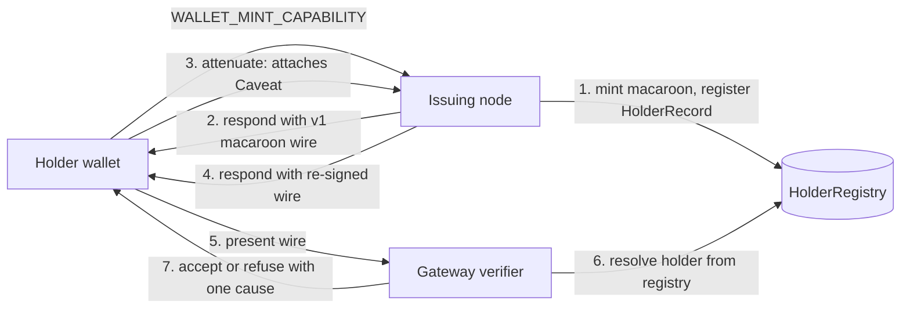

# RFC-0009-A1 (Process): The V2 Bundle Is Not A Credential (Amendment)

## Status

Draft

> **Note:** This is an **in-place amendment** to RFC-0009. It does NOT renumber. It
> proposes to withdraw the claim that `CapabilityBundleV2` is the mint response
> payload — a credential a holder can present — and to restore the v1 macaroon
> wire form as that payload. It proposes **no** new cryptographic material, **no**
> change to the macaroon, the chain, the Ed25519 holder signature, the discharge
> protocol, or `HolderRegistry`. The decision it asks for is about which wire form
> carries a capability, not about what a capability is.

## Authors

- Author: @mmacedoeu
- Contributor: @mmacedoeu

## Maintainers

- Maintainer: @mmacedoeu

## Summary

RFC-0009 §Forward compatibility defines `CapabilityBundleV2` as
`{ bundle_version, token: CapabilityTokenV2, holder_record, discharge_macaroon }`
and `CapabilityTokenV2` as
`{ chain_depth, chain_parent, audience_did, channel_id, expires_at_unix_secs, issuer_did }`.
Not one of those fields is a capability. The bundle is a **descriptor**: it says
what a capability would be for, to whom, until when, and which holder record
describes it. It cannot be presented to a verifier, because it contains nothing
that verifies.

Mission `0957-f-v2-bundle-cutover` made this descriptor the response payload for
`WALLET_MINT_CAPABILITY` and `CAPABILITY_ISSUE`, replacing the v1 macaroon wire.
The consequence is that the mesh now issues one form and verifies another. This
amendment restores the v1 macaroon wire as the mint response payload, and
demotes `CapabilityBundleV2` from _the credential_ to _a descriptor of the
credential_, with its production emission removed rather than deprecated.

## Dependencies

**Requires:**

- RFC-0009: Identity Evolution v1.2 (the base RFC being amended)
- RFC-0957: Capability Token Format (the v1 macaroon wire form that becomes the
  payload again, and the discharge protocol this amendment does not touch)
- RFC-0957-A1: Holder Registry (the `HolderRecord` the descriptor carries; its
  persistence semantics are unchanged by this amendment)

**Optional:**

- RFC-0871: Specialized Node Protocol Envelope (names the two payload kinds whose
  handlers change)
- RFC-0969: Dual-pipeline dispatch (defines the verifier interface this restores
  input to)

> No new dependency is introduced. This amendment removes a claim; it does not
> add a component.

## Design Goals

| Goal | Target                                 | Metric                                                        |
| ---- | -------------------------------------- | ------------------------------------------------------------- |
| G1   | Every issued capability is presentable | A mint response round-trips into `CapabilityVerifier::verify` |
| G2   | Zero production consumers stranded     | No production code path loses its only input format           |
| G3   | No secret in any response payload      | Payload is safe to log, relay and store at rest               |
| G4   | Descriptor metadata is not lost        | `chain_depth`, `audience_did`, expiry remain available        |

## Motivation

The mint handlers emit the V2 envelope; the verifier and the attenuate handler
consume the v1 wire. Measured in this workspace:

| Wire form            | Production consumers                                                     | Test-only consumers |
| -------------------- | ------------------------------------------------------------------------ | ------------------- |
| v1 macaroon wire     | **2** — `verify_with_resolve`, the `WALLET_ATTENUATE_CAPABILITY` handler | several             |
| `CapabilityBundleV2` | **0** — every `canonical_de` call site in the workspace is inside a test | every call site     |

So the credential the system verifies is not the credential the system issues.
Before this amendment, and for some time before the cutover mission, the issuing
and verifying ends were the same string format; the cutover moved the issuing end
alone.

The capability lifecycle is consequently broken in a way that is easy to miss,
because each half still passes its own tests. Mint returns a well-formed
envelope. Attenuate accepts a wire token. Verify accepts a wire token. Nothing
joins them, and no test spans the join — a mint's own output cannot be fed to
anything that consumes credentials.

Fixing mint-side persistence (both issuing nodes now write a `HolderRecord` and
agree byte for byte on the descriptor field) was necessary but not sufficient.
It made the registry correct and left the payload unable to reach the verifier.

## Roles and Authorities

> **The "Nothing should be implied" rule (specification layer):** Every actor that
> affects correctness, security, accountability, or consensus MUST be named with a
> stable identifier, a defined authority scope, and a typed lifecycle.

This amendment changes no authority. It changes which bytes one existing role
emits. The actors are listed for completeness and are unchanged from RFC-0957-A1
§Roles and Authorities.

### Role/Authority Coverage Table

| Role                       | Identifier                             | Authority Scope                           | Lifecycle                  | Source/Ref           |
| -------------------------- | -------------------------------------- | ----------------------------------------- | -------------------------- | -------------------- |
| Token Issuer               | RFC-0009 `IdentityKey` of issuing node | mint + revoke + register                  | node identity lifecycle    | RFC-0957-A1 §Roles   |
| Vault Holder               | RFC-0009 §Vault                        | provider key storage                      | node identity lifecycle    | RFC-0009 §Vault      |
| Holder (capability bearer) | RFC-0009 `IdentityKey` of holder vault | holds the macaroon; presents it to verify | node identity lifecycle    | RFC-0957 §Roles      |
| Verifier                   | node consuming `CapabilityVerifier`    | read-only over wire + registry            | stateless per verification | RFC-0969 §Algorithms |
| Sync Peer                  | peer_set member of node                | gossip `HolderRecord` deltas              | epoch-bounded heartbeat    | RFC-0862             |

**Out-of-scope roles.** The platform operator's management of physical group
membership, and any wallet-side custody policy, are not addressed here. Neither is
changed by this amendment; the statement is a named responsibility transfer, not
an implied one.

## Specification

### System Architecture



Steps 2 and 5 are the ones this amendment reconnects. Before it, step 2 emitted a
descriptor and step 5 expects a macaroon.

### Data Structures

**Unchanged.** `CapabilityToken`, `Macaroon`, `Caveat`, `HolderRecord`,
`HolderRegistry`, `CapabilityCatalog`, the 3-segment wire form, and the
`CIPHEROCTO_V2_BUNDLE_PREFIX` envelope are all as specified today.

**The payload contract this amendment sets:**

```
mint_response_payload := serialize_wire(CapabilityToken::mint(...))
                        // 3 base64url-no-pad segments, '.'-separated, ASCII
```

**What production must no longer emit:** `CapabilityBundleV2Envelope::canonical_ser()`
as the response payload of `WALLET_MINT_CAPABILITY` or `CAPABILITY_ISSUE`.

**What the descriptor remains good for.** `CapabilityBundleV2` still models
capability metadata that has no better home — `chain_depth`, `chain_parent`,
`audience_did`, `expires_at_unix_secs`, `issuer_did`. It keeps its type, its
tests and its consumers for catalog and announcement use. It stops being the
credential, and its doc comment stops being able to imply otherwise.

### Algorithms

No new algorithm. The verification path is unchanged; only its input is restored
to the form it was written for.

```
verify(token_wire)          := deserialize_wire(token_wire, registry.holder_did, registry.holder_pub)
                               → verify_macaroon_chain
                               → verify_holder_sig
                               → resolve ask_binding from caveats
```

`deserialize_wire` continues to take `holder_did` and `holder_pub` from the
caller, and that caller is `verify_with_resolve`, which takes both from the
registry. A token therefore still cannot assert its own holder. Restoring the v1
payload does not weaken that: it restores the input for which the registry-authoritative
lookup was designed.

### Lifecycle Requirements

No stateful actors are introduced by this amendment. `CapabilityBundleV2` is a
value, not an actor. The mint → hold → attenuate → present lifecycle is unchanged
and is restated here only to show the join it repairs:

| From       | To         | Trigger                                  | Deterministic? | Side Effects                             | Signing              |
| ---------- | ---------- | ---------------------------------------- | -------------- | ---------------------------------------- | -------------------- |
| Requested  | Minted     | node receives mint envelope              | Yes            | `HolderRecord` inserted into registry    | issuer `IdentityKey` |
| Minted     | Held       | holder receives the wire                 | Yes            | none                                     | n/a                  |
| Held       | Attenuated | holder requests a caveat                 | Yes            | none (v1 wire re-signed, not registered) | holder `IdentityKey` |
| Attenuated | Presented  | holder presents wire to verifier         | Yes            | none                                     | n/a                  |
| Presented  | Accepted   | registry resolves holder, chain + sig OK | Yes            | none                                     | n/a                  |

**Liveness check:** not applicable — no new actor, no new periodic process.

**Recovery semantics:** an unpresented mint is recoverable in the same way it
always was: the `HolderRecord` is in the registry and the macaroon can be
re-derived by the issuer that holds the root secret. This is unchanged.

**Time bounds:** not applicable — no term, cool-down or grace period is
introduced.

### Determinism Requirements

The restored payload is `serialize_wire`, a deterministic function of the
macaroon. `CapabilityBundleV2::canonical_ser` remains deterministic and remains
in use for descriptor emission. Nothing in this amendment introduces
non-determinism, wall-clock dependence, or hash-order dependence.

### RFC-0008 Execution Class Mapping

| Operation                  | Class | Rationale                                                                |
| -------------------------- | ----- | ------------------------------------------------------------------------ |
| Emit mint response payload | C     | I/O at a node boundary; not consensus-critical                           |
| Register `HolderRecord`    | C     | Local storage write; gossiped but not consensus state                    |
| Verify presented wire      | B     | Determines acceptance; a divergence is a correctness failure, not a fork |
| Attenuate and re-sign      | B     | Signature output must be byte-identical across implementations           |
| Descriptor emission (`V2`) | C     | Metadata only; carries no acceptance decision                            |

### Error Handling

| Condition                               | Error                                | Recovery                                                     |
| --------------------------------------- | ------------------------------------ | ------------------------------------------------------------ |
| Mint succeeds, registry write fails     | `ProtocolError::AuthorizationFailed` | Node refuses the mint; no record, no response                |
| Mint succeeds, no identity configured   | `ProtocolError::AuthorizationFailed` | Fail closed — a bundle nobody can verify is not a credential |
| Presented wire's holder not in registry | `CapError::HolderUnknown`            | Refusal; the holder must re-mint or sync                     |
| Presented wire fails holder signature   | `CapError::InvalidSignature`         | Refusal; not retryable by the presenter                      |
| Presented wire has no ask binding       | `CapError::AskUnbound`               | Refusal; see RFC-0959 §Phase 3 for when to bind              |
| Presented wire has two distinct asks    | `CapError::AskBindingAmbiguous`      | Refusal; never resolved to the first                         |

No error variant is removed or renamed by this amendment. Each cause keeps its
own variant — nine in all, from `MacaroonInvalid` through `AskBindingAmbiguous`
— which is the property the fail-closed split exists to preserve.

## Performance Targets

| Metric         | Target        | Notes                                                                                               |
| -------------- | ------------- | --------------------------------------------------------------------------------------------------- |
| Payload size   | ~1.1x smaller | The v1 wire is 3 segments; the V2 bundle is 16-byte prefix + borsh with a JSON holder record inside |
| Mint latency   | unchanged     | Serialization moves from borsh to base64url, both non-signing                                       |
| Verify latency | unchanged     | `verify_with_resolve` already parses the v1 wire                                                    |

The payload shrinks because the descriptor no longer rides along with the
credential. The holder record is already in the registry, which is where
verification reads it from.

## Implicit Assumptions Audit

| Assumption                                                                                 | Where Relied Upon       | Blast Radius if False                                                            | Mitigation / Status                                                                                                                                  |
| ------------------------------------------------------------------------------------------ | ----------------------- | -------------------------------------------------------------------------------- | ---------------------------------------------------------------------------------------------------------------------------------------------------- |
| The issuer node holds the root secret and can re-derive a macaroon for an unpresented mint | §Lifecycle Requirements | An unpresented mint is unrecoverable; the holder must mint again. Recoverable.   | RFC-0957 §Roles already names the issuer as root-secret holder                                                                                       |
| A holder that loses its wire can ask the registry, but the registry cannot re-mint         | §Data Structures        | Lost capability. Not recoverable by the registry alone.                          | Named here rather than left implied; the mitigation is a holder re-mint, which is an accepted cost of not persisting root secrets                    |
| Every verifier in the deployment accepts the v1 3-segment wire                             | §Algorithms             | Mixed-version deployments: a V2-only verifier would reject the payload           | ACCEPTED RISK: no V2-only verifier exists. Closure: this amendment's §Compatibility requires the v1 wire to remain valid for the deployment lifetime |
| The registry is populated before presentation                                              | §Algorithms             | `HolderUnknown` for every real capability — exactly the defect just fixed        | Closed by the two issuing nodes now registering; re-verified by tests on both handlers                                                               |
| `discharge_macaroon` stays empty for a root mint                                           | §Data Structures        | A non-empty discharge would have to be carried by the payload, changing its size | Already true today; recorded so the reversion is checked against it rather than assumed                                                              |

**Categories considered and not applicable here:** operator trust (no new human in
the loop), platform trust (no external platform in this path), time source (the
restored payload carries no new time dependence), network partition (unchanged),
configuration (the registry requirement is already fail-closed), identity
stability (unchanged), resource availability (payload shrinks).

## Security Considerations

**Replay attacks.** Restoring the v1 payload does not change replay posture. The
macaroon is replayable exactly as it was before the cutover, which is the
documented macaroon property; attenuation is the control, and it re-signs. The V2
descriptor had no replay property at all because it was not a credential.

**Secret exposure.** This amendment removes the pressure that produced the two
secret-bearing payloads. When the response payload was a descriptor, producers
looking for something to put in `holder_record_bytes` put the capability root
secret there (issuer node) and a derived identifier there (wallet node). With the
payload being the wire, that field's fate in the descriptor is no longer
load-bearing for the credential path. **This RFC does not by itself remove those
bytes from the descriptor** — that was fixed separately, where both producers now
write canonical `HolderRecord` bytes and neither writes a secret.

**Determinism violations.** None introduced; §Determinism Requirements covers it.

**Proof forgery.** Not applicable; no proof material is added or removed.

**Consensus attacks.** `verify` is Class B. Its input format changes; its
decisions do not. A token accepted before this amendment is accepted after, and
vice versa, because both forms reduce to the same macaroon — or, in the V2 case,
to nothing verifiable.

## Adversarial Review

| Threat                                                        | Impact                                                        | Mitigation                                                                                                                                           |
| ------------------------------------------------------------- | ------------------------------------------------------------- | ---------------------------------------------------------------------------------------------------------------------------------------------------- |
| A producer keeps emitting the V2 envelope after the amendment | Mint responses remain unpresentable; the regression is silent | The response payload becomes `serialize_wire`, whose output is ASCII and structurally distinct; a consumer that rejects it fails loudly, not quietly |
| A consumer is written against the V2 envelope shape           | Build breaks at the type level, which is the point            | The struct is retained, so only the payload contract moves; typecheck surfaces the drift                                                             |
| Mixed-version rollout: a V2-only node receives a v1 wire      | That node cannot read it                                      | §Compatibility requires both forms to remain decodable for the deployment lifetime; the failure is a refusal, never a wrong acceptance               |
| The descriptor is reintroduced as the credential later        | Regression returns unnoticed                                  | Acceptance criterion: a mint response must round-trip into `CapabilityVerifier::verify` — a span no current test covers                              |

## Adversary Analysis

> **The 5-Question Adversary Test.** This RFC touches a cryptographic credential
> wire form, so the full test applies to the decision to restore the v1 payload.

1. **Who benefits from breaking it?** An attacker holding the v1 wire benefits if
   they can make a verifier accept a _different_ capability under the same bytes.
   The macaroon chain and holder signature bind that, and this amendment restores
   the input for which those checks were written rather than weakening them.
2. **What does it cost them?** Forging a holder signature requires the holder's
   Ed25519 key; producing a valid chain requires the root secret. Both are held by
   parties this amendment does not touch.
3. **What do they gain if successful?** Presentation of an arbitrary capability —
   the pre-cutover threat model, unchanged by this amendment.
4. **What is our defense and its cost to legitimate operation?** Registry-authoritative
   holder resolution, macaroon chain verification, and holder signature
   verification. Cost is one registry lookup and one Ed25519 verification per
   presentation, unchanged.
5. **What is the residual risk, and is it acceptable?** A capability that is never
   presented remains only in the registry, which is the accepted cost of not
   persisting root secrets (§Implicit Assumptions Audit). Acceptable, and named.

## Economic Analysis

None. This amendment changes a wire format, not participation, staking, pricing,
or incentives.

## Compatibility

**Backward.** The v1 3-segment wire form is unchanged and remains the canonical
verifier input. Any consumer written against `verify_with_resolve` or
`deserialize_wire` continues to work, with no change, after this amendment.

**Forward.** `CapabilityBundleV2` and its envelope remain defined, typed,
tested and decodable. Removing them from the _credential_ path is not removing
them from the codebase, and this amendment proposes no deprecation window for the
type itself — only the end of its use as a response payload. If the maintainers
prefer to delete the type outright, that is a separate decision with its own
migration, and this amendment does not presume it.

**Mixed-version.** A V2-issuing node and a V1-issuing node can coexist: their
responses differ in shape, and a holder holding either can present the one that
carries a macaroon. A holder holding only a descriptor cannot present anything —
which is the defect being fixed, not a compatibility risk introduced here.

## Test Vectors

| TV  | Pre-state                      | Action                                | Post-state                                                                      |
| --- | ------------------------------ | ------------------------------------- | ------------------------------------------------------------------------------- |
| 1   | empty registry                 | mint via wallet node                  | `HolderRecord` present; response payload parses as `serialize_wire` output      |
| 2   | TV1 complete                   | feed the response payload to `verify` | Accepted, or refused with exactly one `CapError` cause — never a hang           |
| 3   | minted, not bound to an ask    | `verify` the payload                  | `CapError::AskUnbound` — refusal is the expected result until RFC-0959 §Phase 3 |
| 4   | TV1 complete, registry cleared | `verify` the same payload             | `CapError::HolderUnknown` — the registry is authoritative, not the wire         |
| 5   | minted, then attenuated        | attenuate, then `verify`              | `chain_depth = 1`, holder signature valid, ask binding readable                 |
| 6   | minted                         | inspect the payload                   | ASCII, `.`-separated, 3 segments; contains no root secret and no holder record  |

TV 2 and TV 6 are the ones with no current coverage. TV 6 is the regression test
for the secret that was in the payload before the descriptor took its place.

## Alternatives Considered

| Approach                                                     | Pros                                                                                     | Cons                                                                                                                                 | Verdict      |
| ------------------------------------------------------------ | ---------------------------------------------------------------------------------------- | ------------------------------------------------------------------------------------------------------------------------------------ | ------------ |
| **(a) Put the macaroon inside the V2 bundle**                | One self-contained envelope; metadata and capability travel together                     | Duplicates material that is already a wire form; every consumer unwraps a bundle to get what it had; changes a frozen Layer A format | Rejected     |
| **(b) Revert the mint response to the v1 wire** (this RFC)   | Restores the input every existing consumer already takes; smallest change; no new crypto | The descriptor's metadata leaves the response path                                                                                   | **Proposed** |
| **(c) Emit both — wire payload plus a descriptor alongside** | No information lost                                                                      | Two response shapes, two code paths per consumer, and one of them is still not a credential                                          | Rejected     |
| **(d) Keep V2 and migrate every verifier to accept it**      | Preserves the cutover                                                                    | Rewrites the verification path to unwrap a descriptor; larger blast radius for zero gain                                             | Rejected     |
| **(e) Leave as-is and file the gap**                         | No work now                                                                              | The system issues a credential it cannot verify; the lifecycle has no join                                                           | Rejected     |

Approach (a) is the one to argue against most carefully, because "the envelope
should contain the thing it describes" is intuitive. It fails on redundancy: the
macaroon _is already_ a wire form, and consumers already take it bare. Wrapping
it buys metadata alongside it — metadata that was never the reason to move off the
v1 wire, and that the registry already holds authoritatively.

## Implementation Phases

### Phase 1: Restore the payload

- [ ] Both mint handlers respond with `serialize_wire(&token)`.
- [ ] Both drop the V2 envelope construction from the response path.
- [ ] The descriptor is retained for catalog and announcement use, with its docs
      no longer implying it is a credential.
- [ ] The response payload contract is asserted: ASCII, 3 `.`-separated segments.

### Phase 2: Close the loop with a test that spans it

- [ ] An integration test: mint through a node handler with a real registry,
      attenuate the returned wire, and `verify` it through
      `ProductionCapabilityVerifier`.
- [ ] The same test asserts the specific refusal for each un-met precondition
      (`AskUnbound`, `HolderUnknown`), so the join is proven rather than assumed.

### Phase 3: Decide the descriptor's fate

- [ ] Maintainer decision: retain `CapabilityBundleV2` as a scoped descriptor, or
      delete it. This amendment assumes retention and does not presume deletion.

## Key Files to Modify

| File                                                       | Change                                               |
| ---------------------------------------------------------- | ---------------------------------------------------- |
| `crates/octo-wallet-node/src/handlers/mint.rs`             | Respond with the v1 wire instead of the V2 envelope  |
| `crates/octo-capability-issuer-node/src/handlers/issue.rs` | Respond with the v1 wire instead of the V2 envelope  |
| `crates/octo-cap-macaroon/src/bundle_v2.rs`                | Docs: stop describing the descriptor as a credential |

## Future Work

- F1: Bind `Caveat::AskBinding` at mint or attenuation on the restored path, so
  `CapError::AskUnbound` stops being the universal outcome (RFC-0959 §Phase 3).
- F2: Decide whether `expires_at_unix_secs` belongs on the descriptor, on a
  macaroon caveat, or both — today it is `u64::MAX` with expiry living in caveats.
- F3: Re-examine the `holder_record` field on the descriptor now that the payload
  is a credential. If nothing reads it on the response path, removing it is
  cleaner than keeping it decodable.

## Rationale

The system already had a credential format that worked end to end. The cutover
replaced it with a format that describes a credential without being one, and moved
only the issuing end. The measurement in §Motivation is unambiguous: two
production consumers of the v1 wire, zero of the V2 bundle, every V2 reader in a
test.

Restoring the payload is the smallest change that makes the lifecycle join. Adding
a capability to the V2 bundle would preserve a change whose only effect was to
disconnect the two ends, at the cost of a semver-major edit to a frozen Layer A
format.

## Version History

| Version | Date       | Changes       |
| ------- | ---------- | ------------- |
| 1.0     | 2026-10-11 | Initial draft |

## Related RFCs

- RFC-0009: Identity Evolution v1.2 (amended by this document)
- RFC-0957: Capability Token Format
- RFC-0957-A1: Holder Registry
- RFC-0871: Specialized Node Protocol Envelope
- RFC-0969: Dual-pipeline dispatch

## Related Use Cases

- Capability issuance and presentation — see `docs/architecture/` for the
  verification path this amendment reconnects.
